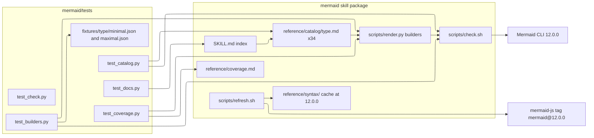
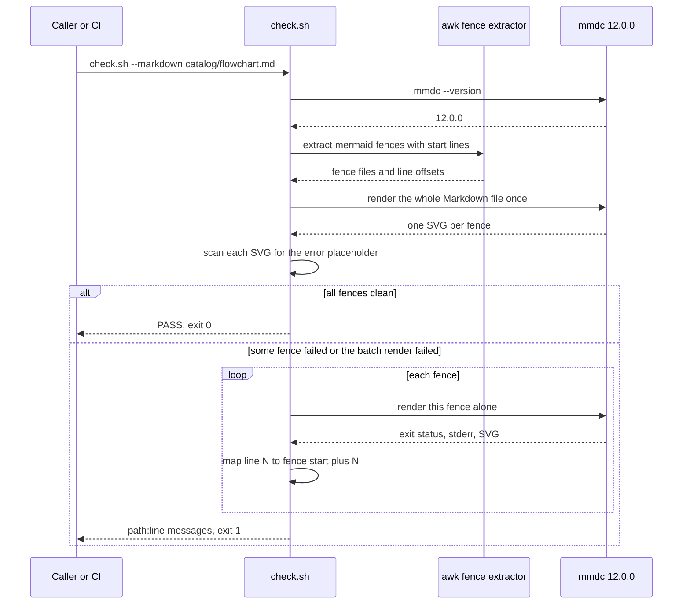
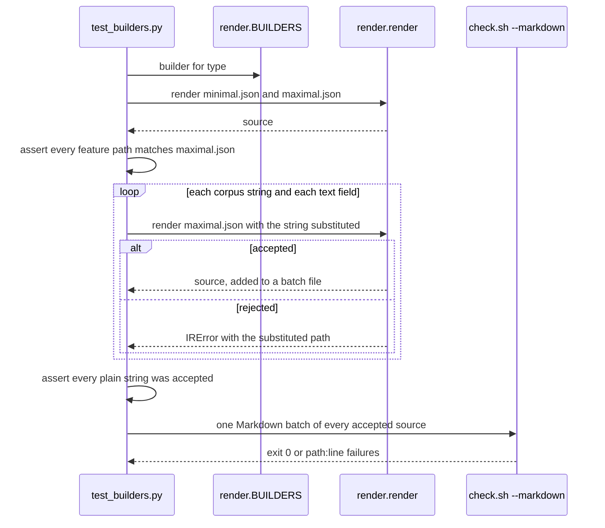
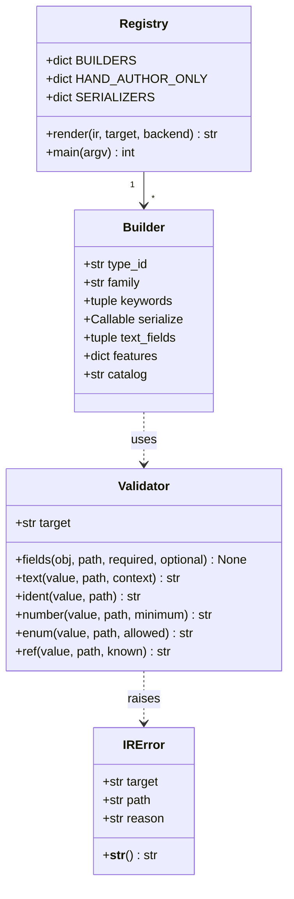
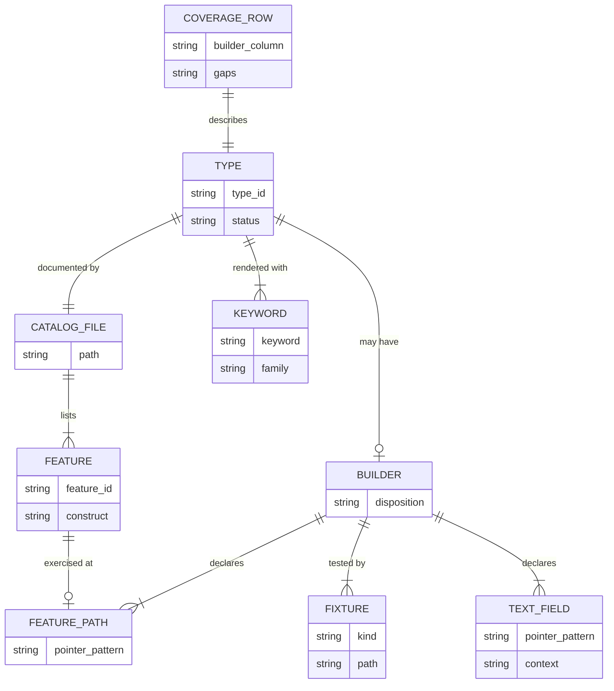
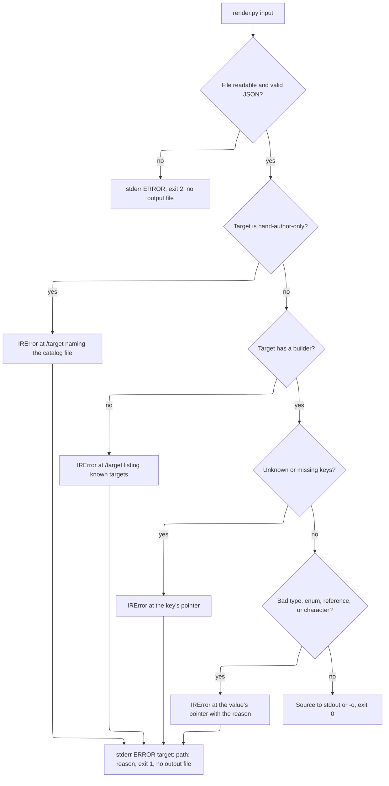

# Design Document

## Decision note — parse-only validation (2026-11-02)

Validation is **parse-only**. `scripts/check.sh` confirms that Mermaid source parses with the
pinned Mermaid 12.0.0 by calling `mermaid.parse()` through `scripts/mermaid-parse.mjs` (Node +
`mermaid@12.0.0` + `jsdom`, plus the zenuml plugin for that one type). It does **not** render:
no headless browser, Puppeteer, Playwright, Chromium, or `mmdc` render in the validation path or
the main test suite. Mermaid diagrams live in Markdown and are rendered by whatever viewer
displays them, so validation only needs to confirm the source parses. The builder reliability
bar reads accordingly: **every accepted IR parses with the pinned Mermaid 12.0.0; unrepresentable
input is rejected with a JSON Pointer.** `render.py` remains an optional IR-to-source tool and is
not used to render images by `check.sh` or the tests. Where this note conflicts with the
render-based wording below (Requirement 3's error-placeholder SVG, the mmdc CLI selection, the
"accepted IR always renders" phrasing), this note governs; the surrounding text is kept for
history. This supersedes the render-based approach discussed in issue #5.

## Overview

The `mermaid` skill becomes a per-type catalog with a deterministic check and a smaller, stricter set of optional IR builders. Four pieces change:

- **Catalog.** `mermaid/reference/catalog/<type>.md` holds one file per type in the Mermaid 12.0.0 type set (34 files). The file stem is the type id and equals the stem of the type's cached syntax page (`entityRelationshipDiagram`, `c4`, `xyChart`), so the type-set check is a set equality. `info`, which has no syntax page, is the one addition. Each file has the syntax, a Features table with feature ids, configuration and theming notes, traps, a complete example, and the builder status. `reference/type-cheatsheets.md` and `reference/ir-catalog.md` are deleted. `reference/syntax/` stays as the cached upstream pages, refreshed from the `mermaid@12.0.0` tag.
- **Index.** `mermaid/SKILL.md` keeps `name: mermaid`. It shrinks to routing rules, the check rule, and a 34-row index that links each catalog file.
- **Check.** `mermaid/scripts/check.sh` enforces CLI 12.0.0, reports a line number on failure, and gains a `--markdown` mode that validates every fence in Markdown files and reports `path:line`.
- **Builders.** `mermaid/scripts/render.py` gets a `Builder` registry. Every kept builder declares its fields, text fields, and feature paths. A shared validator rejects unknown keys and unrepresentable values with a JSON Pointer. Tests render each kept builder's minimal and maximal fixtures plus a text corpus through the pinned check, and check feature parity against the catalog file. Builders that cannot meet the bar are removed and their types become hand-author-only.

`mermaid/reference/coverage.md` is the single matrix that ties these together, and tests parse it.

### Requirement mapping

| Requirement | Where it is met |
| --- | --- |
| 1 Catalog files | Catalog file template, `tests/test_catalog.py` |
| 2 Lean index | `SKILL.md` layout, `tests/test_docs.py` |
| 3 Deterministic check | `check.sh` interface, `tests/test_check.py`, `tests/test_catalog.py` in CI |
| 4 Builder reliability | `Builder` registry, `_Validator`, `tests/test_builders.py`, fixtures |
| 5 CLI exit codes | `render.py` `main`, `tests/test_render_cli.py` |
| 6 Coverage matrix | `coverage.md` format, `tests/test_coverage.py` |
| 7 README | `README.md`, `tests/test_docs.py` |
| 8 Pinned syntax cache | `refresh.sh` with `MERMAID_REF`, `tests/test_check.py` (static checks) |

### What carries over from `spec/mermaid-json-ir-schema`

| Old requirement | Status here |
| --- | --- |
| R1.4 reject unknown fields with a pointer | Kept as 4.2 |
| R4.13 no raw Mermaid fragments | Kept as 4.9 |
| R4.14 no silent drop | Kept as 4.4 |
| R6.1 to R6.7 semantic checks, no output on failure | Kept as 4.3 and 5.2 |
| R7.1, R7.2, R7.4 byte-stable output, array order, context escaping | Kept as 4.5 and the text contexts below |
| R8.1 to R8.4 render verification, error placeholder, minimal and maximal fixtures | Kept as 3.6 and 4.1 |
| R9 coverage evidence | Simplified into feature ids, `coverage.md`, and parity tests (4.6, 6.x) |
| R10 offline, CLI exit status | Kept as 4.12 and Requirement 5 |
| R11.3, R11.4 minimal and maximal examples | Kept as fixtures and the catalog Builder section |
| R1.1 to R1.3 versioned envelope, R2 schema defaults, R3 legacy migration, R5 renderer config split, extensions, constrained JSON Schema runtime | Dropped |

The dropped parts made sense when the IR was the primary contract. Here the builders are an optional fast path inside one stdlib-only script, and the only callers are agents that read the catalog file. A versioned envelope and a migrator would add a second IR shape to maintain with no caller that needs it. The old branch's `maximal.json` examples and target schemas are still the parity source: they are ported to the flat IR shape (rules under Data Models) and their constructs become required feature paths. The old `railroad-beta` target is the current `railroad-ebnf-beta` keyword. The old `.specs/` folder, its state and execution files, and its `mermaid_ir` package are not copied.

## Architecture



### Check of a Markdown file



### Builder reliability test for one type



## Components and Interfaces



### `render.py`

`IRError(ValueError)` now carries `target`, `path`, and `reason`. `str(err)` is `<target>: <path>: <reason>`. `path` is an RFC 6901 JSON Pointer into the input IR, such as `/nodes/2/label`, or `/` for the document.

`Validator` is a small class bound to one target. Every serializer uses it instead of reading keys directly:

- `fields(obj, path, required, optional)` raises on a non-object, a missing required key, or any key outside `required | optional | {"diagram", "target"}` at the root. This is the single mechanism behind 4.2.
- `text(value, path, context)` returns the encoded text for one named context, or raises. Each context is a pair: characters it encodes and characters it rejects. Encoding uses Mermaid entity codes (`#quot;`, `#35;`, `#59;`) only where that type renders them as the original character, so the visible text is unchanged (4.4). A character with no safe encoding in that context is rejected (4.3). Contexts are defined once, for example `flowchart.label`, `sequence.message`, `gantt.task`, `c4.arg`, `csv.cell`, `bare.id`.
- `ident`, `number`, `enum`, `ref` cover identifiers, numbers (rejecting `bool`), enums, and references to declared ids.

`Builder` is a frozen dataclass:

```python
@dataclass(frozen=True)
class Builder:
    type_id: str                      # catalog file stem, e.g. "flowchart", "c4"
    family: str                       # IR "diagram" value, e.g. "graph"
    keywords: tuple[str, ...]         # IR "target" values, e.g. ("C4Context", ...)
    serialize: Callable[[dict, str], str]   # (ir, keyword) -> source
    text_fields: tuple[str, ...]      # pointer patterns, "*" matches one array index or key
    features: dict[str, str]          # feature id -> pointer pattern that must exist in maximal.json
    catalog: str                      # "reference/catalog/flowchart.md"
```

- `BUILDERS: dict[str, Builder]` is keyed by keyword. `SERIALIZERS` stays as a derived `{(family, keyword): serialize}` view so existing callers keep working.
- `HAND_AUTHOR_ONLY: dict[str, str]` maps each hand-author-only keyword to its catalog path. `render()` checks it first and raises `IRError(target, "/target", "hand-author-only; see reference/catalog/zenuml.md")` (4.11).
- `render(ir, target=None, backend="mermaid") -> str` keeps its signature.
- `main(argv) -> int` returns 0, 1 for `IRError`, and 2 for a missing file, unreadable file, or `json.JSONDecodeError` (Requirement 5). The output file is written only after `render` returns.

### `check.sh`

```text
check.sh FILE.mmd [-o OUT]
check.sh -c 'CODE' [-o OUT]
cat FILE.mmd | check.sh
check.sh --markdown FILE.md [FILE.md ...]
```

- CLI selection: run `mmdc --version`. Use it only when it prints `12.0.0`. Otherwise use `npx -y @mermaid-js/mermaid-cli@12.0.0`. With neither, exit 3 and print `need Mermaid CLI 12.0.0`. `MERMAID_CLI_PACKAGE` stays as an override for the npx package.
- Line reporting: on a non-zero CLI exit, match `on line ([0-9]+)` and `line ([0-9]+)` in the CLI output. On a match print `FAIL line N: <source line N>`. Without a match print `FAIL line unknown` and the first CLI error line. The full CLI output follows either way.
- Error placeholder: the existing SVG scan stays, and it now also prints `FAIL line unknown`.
- `--markdown`: an awk pass extracts each fence whose opening line is exactly ```` ```mermaid ```` at column 0 and records its first content line. The file is rendered once with `mmdc -i FILE.md -o TMP/out.md`, which writes one SVG per fence. When that run exits 0 and no SVG is an error placeholder, the file passes. Otherwise each fence is rendered alone and each failure prints `PATH:LINE: <message>`, where `LINE` is the fence's first content line plus the CLI line minus 1. Files with no fence print `PATH: no mermaid fences`. Exit 1 when any fence failed, else 0. Task 2.3 confirms the SVG naming of CLI 12.0.0 before relying on the batch path, and uses per-fence rendering only if the naming differs.
- `MERMAID_PUPPETEER_CONFIG` behaves as today. The script stays compatible with bash 3.2.

### `refresh.sh`

A `MERMAID_REF` variable defaults to `mermaid@12.0.0`. Every GitHub API and raw content URL passes `ref=${MERMAID_REF}`. Downloads go to a temp directory and replace `reference/syntax/` and `diagram-types.md` only after every fetch succeeded (8.2). The stamp reads `cached against Mermaid 12.0.0`.

### Catalog file template

```text
# <Type name>

## Keywords
`flowchart` (alias `graph`). Status: stable | beta.

## When to use
One or two sentences, plus the nearest alternative type.

## Syntax
Statement forms, one short block each.

## Features
| Feature id | Construct | Snippet |
| flowchart.subgraph-direction | direction inside a subgraph | `direction LR` |

## Configuration and theming
Frontmatter `config.<namespace>` keys with defaults, themeVariables, accTitle and accDescr support.

## Traps
Parser and lexer pitfalls seen with CLI 12.0.0. Invalid samples use text fences.

## Complete example
One mermaid fence with every coexisting feature, plus one fence per exclusive group.

## Builder
`builder`: family, keywords, IR keys, link to tests/fixtures/<type>/maximal.json.
or `hand-author-only`: one sentence on why.
```

### `SKILL.md` layout

Frontmatter (`name: mermaid`, a description that lists the type families), then: Route (four steps, the same flow as the requirements flowchart), Check (the rule from 2.6 and 2.7, the CLI pin, exit codes), Builders (one paragraph: optional, `coverage.md` says which types have one, `render.py` fails closed), Index (34 rows: Type, Keywords, Use for, Catalog link), Repair and cache (`refresh.sh`, `setup-mcp.sh`, one line each). The ISO 5807 rule moves into `catalog/flowchart.md`. Target: about 90 lines, hard limit 120.

## Data Models



### `coverage.md` table

```text
| Type | Keywords | Catalog | Builder | Tests | Gaps |
| `flowchart` | `flowchart`, `graph` | [flowchart.md](catalog/flowchart.md) | builder | `test_builders.py::flowchart` | — |
| `zenuml` | `zenuml` | [zenuml.md](catalog/zenuml.md) | hand-author-only | `test_catalog.py::zenuml` | n/a |
```

`test_coverage.py` parses this table. Builder is `builder` or `hand-author-only`. For `builder` rows Gaps must be `—`. Keywords must equal the union of `BUILDERS` and `HAND_AUTHOR_ONLY` keys, split by row.

### Fixtures

`mermaid/tests/fixtures/<type>/minimal.json` and `maximal.json` per kept builder. Types with several keywords (C4) get one maximal fixture per keyword: `maximal.C4Context.json`, and so on. Old-branch examples are ported by these rules: `content.*` and `source.*` move to the top level, `accessibility` stays as `{"title", "description"}` and emits `accTitle` and `accDescr` where the type supports them, `schemaVersion`, `renderer`, `extensions`, and `$schema` are dropped. A ported construct that the flat IR cannot express is a gap until the builder supports it.

### Text corpus

`mermaid/tests/corpus.py` defines two tuples:

- `PLAIN`: `Alpha`, `Two words`, `release 2 build 7`, `Ünïcode 日本`. Every kept builder accepts these in every text field (4.8).
- `HOSTILE`: `Order (paid)`, `a: b`, `say "hi"`, `it's`, `a;b`, `#tag`, `[x]`, `{y}`, `<b>bold</b>`, `end`, `a|b`, `back\slash`, `%%note`, `` `tick` ``, `---`, `a, b`, `-->`. Each is either accepted and rendered cleanly or rejected with `IRError` at the substituted path. A hostile string accepted but failing the check fails the test.

### Builder dispositions

Provisional. A type marked keep or evaluate may become hand-author-only during its task when it cannot meet Requirement 4. A hand-author-only type does not gain a builder without a spec change.

| Type | Keywords | Old-branch parity source | Disposition |
| --- | --- | --- | --- |
| flowchart | `flowchart`, `graph` | yes | keep |
| sequenceDiagram | `sequenceDiagram` | yes | keep |
| classDiagram | `classDiagram` | yes | keep |
| stateDiagram | `stateDiagram-v2`, `stateDiagram` | yes | keep |
| entityRelationshipDiagram | `erDiagram` | yes | keep |
| gantt | `gantt` | yes | keep |
| timeline | `timeline` | no | keep |
| userJourney | `journey` | no | keep |
| gitgraph | `gitGraph` | no | keep |
| kanban | `kanban` | no | keep |
| mindmap | `mindmap` | yes | keep |
| pie | `pie` | no | keep |
| quadrantChart | `quadrantChart` | no | keep |
| xyChart | `xychart`, `xychart-beta` | no | keep |
| sankey | `sankey`, `sankey-beta` | no | keep |
| radar | `radar-beta` | no | keep |
| treemap | `treemap-beta`, `treemap` | no | keep |
| venn | `venn-beta` | yes | keep |
| c4 | `C4Context`, `C4Container`, `C4Component`, `C4Dynamic`, `C4Deployment` | yes (Context, Container) | keep |
| architecture | `architecture-beta` | yes | keep |
| block | `block`, `block-beta` | yes | keep |
| packet | `packet`, `packet-beta` | no | keep |
| requirementDiagram | `requirementDiagram` | yes | keep |
| ishikawa | `ishikawa-beta` | yes | keep |
| treeView | `treeView-beta` | yes | keep |
| cynefin | `cynefin-beta` | yes | keep |
| info | `info` | no | keep |
| eventmodeling | `eventmodeling` | yes | evaluate |
| wardley | `wardley-beta` | yes | evaluate |
| swimlanes | `swimlane-beta` | yes | evaluate |
| agentflow | `agentflow-beta` | no | evaluate |
| usecase | `usecase-beta` | no | evaluate |
| railroad | `railroad-ebnf-beta` | yes, as an expression tree | evaluate: replace verbatim rule strings with the old branch's expression tree, or remove |
| zenuml | `zenuml` | no | remove: an external renderer with its own nested control-flow language, and today's builder emits messages only |

Alias keywords are accepted as IR `target` values only where the builder emits them unchanged. Otherwise the alias is listed in the catalog file and the builder emits the primary keyword.

## Error Handling



- The first error found stops the builder. Validation runs before any line is emitted for an object, so no partial source is returned.
- `check.sh` exit codes: 0 pass, 1 render failure or error placeholder, 2 bad input (missing file, empty diagram), 3 no usable CLI 12.0.0.
- When `npx` must download the CLI, the note goes to stderr so stdout stays clean for callers.
- `refresh.sh` failures leave the cache untouched and exit 1.

## Testing Strategy

All tests live under `mermaid/tests/` and run with `python3 -m pytest tests/ -q` from `mermaid/`, which `.github/workflows/tests.yml` already does with CLI 12.0.0 on Node 22.

- `test_check.py`: CLI version selection with a fake `mmdc` on `PATH` that prints another version, exit 3 with no CLI, line reporting for a known bad flowchart (line 3), `line unknown` for an unknown diagram keyword, error-placeholder detection, `--markdown` with a mixed file (two good fences, one bad at a known Markdown line), a file with no fences, and repeat runs giving identical output. Static checks that `refresh.sh` defaults `MERMAID_REF` to `mermaid@12.0.0` and that `check.sh`, `refresh.sh`, and `tests.yml` agree on `12.0.0`.
- `test_catalog.py`: the catalog file stems equal the stems of `reference/syntax/*.md` except `README` and `examples`, plus `info`; section order; Features table present with unique ids prefixed by the type; Builder section matches `coverage.md`; one `check.sh --markdown` run over all catalog files must pass.
- `test_builders.py`: parametrized over `BUILDERS`. For each kept builder: minimal and maximal fixtures render, feature parity (every catalog feature id has a feature path, and every path matches the maximal fixture), text corpus as described above, determinism (two renders, equal bytes, one trailing newline), unknown key at the root and at one nested object, `true` in a numeric field, an unknown enum, and an undeclared reference each raise `IRError` with the expected pointer. All renders for one type go through one `--markdown` batch.
- `test_coverage.py`: table parse, `builder` rows have Gaps `—`, keywords match `BUILDERS` and `HAND_AUTHOR_ONLY`, every hand-author-only keyword raises the hand-author-only `IRError`.
- `test_render_cli.py`: exit 0, 1, and 2 paths, the stderr format, and that `-o` is not created on failure.
- `test_docs.py`: `SKILL.md` has `name: mermaid`, at most 120 lines, one index row per type linking an existing catalog file, the check rule text; the removed files are absent and unlinked; README contains both `npx skills` commands and the links in 7.2.
- `test_render.py` today holds positive renders for every serializer. Its cases move into fixtures and `test_builders.py` as each group is done, and the file is deleted once empty.

Residual risks: CI time grows with corpus renders, which the per-type batch keeps to about one CLI start per type. Mermaid beta lexers may reject hostile strings that entity codes cannot cover, which pushes those characters into rejection rather than a dropped builder. A Mermaid release after 12.0.0 can break a kept builder; the pin keeps that out of scope until a deliberate bump.
