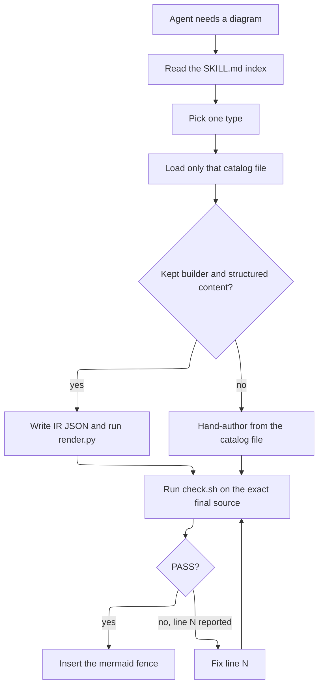
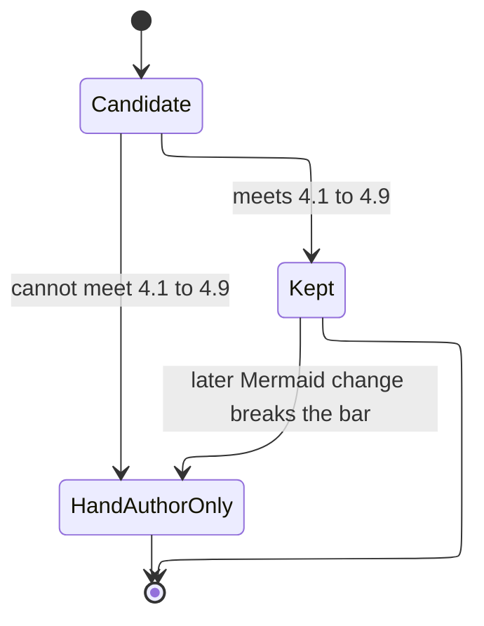
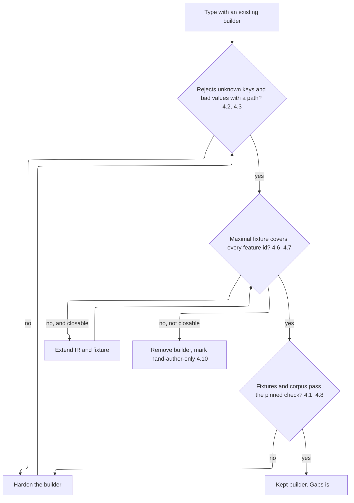

# Requirements Document

## Introduction

This spec covers GitHub issue #2. It turns the `mermaid` Agent Skill into a complete catalog of every open-source diagram type in Mermaid 12.0.0. Each type gets its own catalog file. A lean `SKILL.md` index replaces `reference/type-cheatsheets.md`. `scripts/check.sh` is the deterministic validator, and CI runs it on every catalog example. The IR builders in `scripts/render.py` stay an optional fast path. A type keeps its builder only when that builder is 100% reliable. Otherwise the builder is removed and the type is marked hand-author-only.

The earlier JSON IR schema spec on branch `spec/mermaid-json-ir-schema` (`.specs/mermaid-json-ir-schema/`) is retired as a format. Its still-relevant rules carry over here: strict rejection of unknown fields, no raw Mermaid fragments, no silent drops, path-addressed errors, no output after a failed validation, deterministic serialization, render verification that rejects error-placeholder SVGs, offline operation, and per-type maximal examples as the feature-parity target. Its versioned envelope, legacy migration, JSON Schema runtime, renderer-configuration split, and extension namespaces are out of scope. The design explains why.

Terms used in this spec and in `design.md`:

- **Type set**: the diagram types of the pinned Mermaid 12.0.0. These are the syntax pages cached in `mermaid/reference/syntax/` from Mermaid 12.0.0, except `README.md` and `examples.md`, plus `info`. The type id is the page's file stem. The five C4 keywords are one type, `c4`.
- **Catalog file**: `mermaid/reference/catalog/<type>.md`, the one file an agent loads for a type.
- **Feature id**: a stable id for one option or construct in a catalog file's Features table, such as `flowchart.subgraph-direction`.
- **Pinned check**: `mermaid/scripts/check.sh` running Mermaid CLI 12.0.0.
- **Builder**: the `render.py` serializer for one type's keywords.
- **Kept builder**: a builder that meets Requirement 4. Every other type is **hand-author-only**.
- **Maximal fixture**: `mermaid/tests/fixtures/<type>/maximal.json`, one IR document that exercises every feature id of a kept builder.
- **Text corpus**: the fixed list of plain and hostile strings that the builder tests substitute into every free-text field.

## Requirements

### Requirement 1

**User Story:** As an agent, I want one catalog file per diagram type, so that I load only the syntax, features, and example for the type I picked.

#### Acceptance Criteria

1. THE skill SHALL contain exactly one catalog file under `mermaid/reference/catalog/` for each type in the type set, and no other catalog files.
2. IF a type in the type set has no catalog file, or a catalog file names no type in the type set, THEN the catalog test SHALL fail and name the type or file.
3. THE catalog file SHALL contain these sections in order: Keywords, When to use, Syntax, Features, Configuration and theming, Traps, Complete example, Builder.
4. THE Features section SHALL list every option and construct that the Mermaid 12.0.0 syntax page documents for that type, one row per feature id, each with a minimal snippet.
5. THE Configuration and theming section SHALL list the type's frontmatter `config` keys, its `themeVariables` where Mermaid documents any, and whether `accTitle` and `accDescr` are supported.
6. THE Complete example section SHALL contain one `mermaid` fence that uses every feature id that can coexist in one diagram, plus one extra fence for each group of mutually exclusive features.
7. WHEN a catalog file shows syntax that does not render, THEN the catalog file SHALL put it in a `text` fence and never in a `mermaid` fence.
8. THE Builder section SHALL state either `builder` with the IR keys and a link to the maximal fixture, or `hand-author-only`, and SHALL match the Builder column of `coverage.md`.

### Requirement 2

**User Story:** As an agent, I want `SKILL.md` to be a lean index under the name `mermaid`, so that other skills can defer to it by name and I spend little context choosing a type.

#### Acceptance Criteria

1. THE `SKILL.md` frontmatter SHALL set `name: mermaid`, and the skill folder SHALL stay `mermaid/`.
2. THE `SKILL.md` index SHALL contain one row per type in the type set, with the type's keywords, when to use it, and a link to its catalog file.
3. THE `SKILL.md` SHALL tell the agent to load only the one catalog file for the chosen type.
4. THE `SKILL.md` SHALL be at most 120 lines and SHALL contain no per-type syntax beyond the index.
5. WHEN this change is complete, THEN `mermaid/reference/type-cheatsheets.md` and `mermaid/reference/ir-catalog.md` SHALL not exist, and no file in `mermaid/` or `README.md` SHALL link to them.
6. THE `SKILL.md` SHALL require the agent to run the pinned check on the exact final source before handing over any diagram.
7. IF the pinned check cannot run, THEN the `SKILL.md` SHALL tell the agent to deliver the source and say once that it is unverified.

### Requirement 3

**User Story:** As an agent or CI job, I want `check.sh` to give the same verdict on the same source with a line number on failure, so that I can fix the right line and trust a PASS.

#### Acceptance Criteria

1. WHEN `check.sh` runs, THEN it SHALL validate with Mermaid CLI 12.0.0.
2. IF the `mmdc` on `PATH` reports a version other than 12.0.0, THEN `check.sh` SHALL use `npx -y @mermaid-js/mermaid-cli@12.0.0` instead.
3. IF neither a 12.0.0 `mmdc` nor `npx` is available, THEN `check.sh` SHALL exit 3 and name the required version.
4. WHEN Mermaid CLI reports a parse error with a line number, THEN `check.sh` SHALL exit 1 and print that line number and the source line.
5. IF Mermaid CLI reports an error without a line number, THEN `check.sh` SHALL exit 1, print `line unknown`, and print the CLI message.
6. IF Mermaid CLI exits 0 but writes an error-placeholder SVG, THEN `check.sh` SHALL exit 1.
7. WHEN `check.sh --markdown` is given one or more Markdown files, THEN it SHALL validate every `mermaid` fence and report each failure as `<path>:<line>`, where the line is counted in the Markdown file.
8. WHEN every fence in `--markdown` mode passes, THEN `check.sh` SHALL exit 0, and IF any fence fails, THEN it SHALL exit 1 after reporting every failure.
9. IF a file given to `--markdown` contains no `mermaid` fence, THEN `check.sh` SHALL print that the file has no fences and SHALL not count it as a failure.
10. WHEN the same input is checked twice with the same CLI, THEN `check.sh` SHALL return the same exit status and the same failure lines.
11. WHEN CI runs, THEN it SHALL run the pinned check on every `mermaid` fence in every catalog file, and IF any fence fails, THEN CI SHALL fail.

### Requirement 4

**User Story:** As an agent using the optional fast path, I want every kept builder to be 100% reliable, so that accepted IR always renders and rejected IR tells me exactly what to fix.

#### Acceptance Criteria

1. WHERE a type has a kept builder, THE builder tests SHALL render the maximal fixture, the minimal fixture, and every text-corpus substitution that the builder accepts through the pinned check in CI, and each accepted IR SHALL pass.
2. IF an IR object at any depth contains a key the builder does not document, THEN the builder SHALL raise `IRError` naming the JSON path of the key and SHALL produce no source.
3. IF a value cannot be represented in the target syntax (wrong type, `true` or `false` where a number is expected, unknown enum, undeclared reference, or a character that the target context cannot carry), THEN the builder SHALL raise `IRError` naming the JSON path and the reason, and SHALL produce no source.
4. THE builder SHALL never drop, truncate, or rewrite a supplied value to make it render.
5. WHEN the same IR is rendered twice, THEN the builder SHALL return byte-identical source that ends in one newline and keeps the order of every input array.
6. WHERE a type has a kept builder, THE maximal fixture SHALL exercise every feature id in that type's catalog file, and IF one is not exercised, THEN the parity test SHALL fail and name it.
7. WHERE a type has a kept builder and the `spec/mermaid-json-ir-schema` branch has a `maximal.json` and target schema for it, THE maximal fixture SHALL cover every construct in them.
8. WHERE a type has a kept builder, THE builder SHALL accept every plain string of the text corpus in every free-text field.
9. THE IR SHALL contain no field that carries verbatim Mermaid source.
10. IF a type cannot meet criteria 4.1 to 4.9, THEN its builder SHALL be removed from `render.py`, and the type SHALL be marked hand-author-only.
11. WHEN `render.py` receives a hand-author-only target, THEN it SHALL raise `IRError` that says the type is hand-author-only and names its catalog file.
12. THE `render.py` SHALL run offline and use only the Python standard library.

### Requirement 5

**User Story:** As an agent or script calling `render.py`, I want stable exit codes and messages, so that I can tell bad IR from a bad invocation.

#### Acceptance Criteria

1. WHEN the IR is valid, THEN `render.py` SHALL exit 0 and write the source to stdout or to the `-o` path.
2. IF the builder raises `IRError`, THEN `render.py` SHALL exit 1, print `ERROR: <target>: <json-path>: <reason>` to stderr, and write no output file.
3. IF the input file is missing or is not valid JSON, THEN `render.py` SHALL exit 2 and write no output file.

### Requirement 6

**User Story:** As a maintainer, I want `coverage.md` to be the checked matrix of types, catalog files, and builders, so that a claim of no gaps is verified by tests.

#### Acceptance Criteria

1. THE `coverage.md` SHALL have one row per type in the type set, with columns Type, Keywords, Catalog, Builder, Tests, Gaps.
2. WHERE a row's Builder column is `builder`, THE Gaps column SHALL be `—`, and IF it is not, THEN the coverage test SHALL fail.
3. WHERE a row's Builder column is `hand-author-only`, THE `render.py` serializer table SHALL contain none of that row's keywords.
4. IF the keywords in `coverage.md` and the keys of the `render.py` serializer table disagree, THEN the coverage test SHALL fail and name each difference.

### Requirement 7

**User Story:** As a user, I want the README to show how to install and update the skill, so that I get it with one command.

#### Acceptance Criteria

1. THE `README.md` SHALL document `npx skills add sohampatwardhan/mermaid-skill -g` for install and `npx skills update -g` for update.
2. THE `README.md` SHALL name the skill `mermaid` and link to `mermaid/SKILL.md` and `mermaid/reference/coverage.md`.
3. IF either command in 7.1 is missing from `README.md`, THEN the docs test SHALL fail.

### Requirement 8

**User Story:** As a maintainer, I want the cached syntax pages pinned to Mermaid 12.0.0, so that catalog files are written against the same version the check runs.

#### Acceptance Criteria

1. WHEN `refresh.sh` runs, THEN it SHALL fetch the type list and syntax pages from the `mermaid@12.0.0` tag of mermaid-js/mermaid and stamp `diagram-types.md` with `Mermaid 12.0.0`.
2. IF any fetch fails, THEN `refresh.sh` SHALL exit non-zero and leave the existing cache unchanged.

## Builder disposition

Each type ends in exactly one of two states. The decision follows the criteria above.

