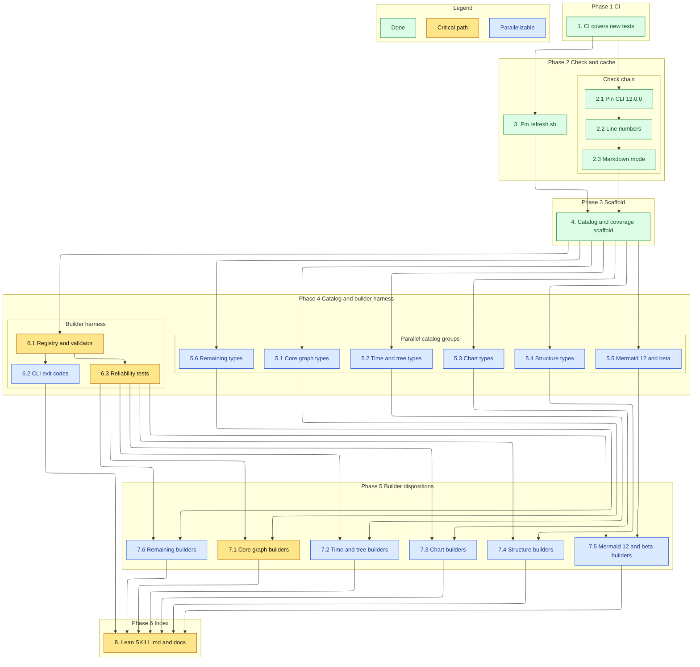

# Implementation Plan

The plan pins and hardens `check.sh`, writes one catalog file per Mermaid 12.0.0 type, puts every builder through the reliability bar (keep at parity or remove), and ends with the lean `SKILL.md` index. Type groups are the same in tasks 5 and 7, so each builder group starts once its catalog files exist.

## Task graph

An arrow means depends-on. Primary critical path: 1, 2.1, 2.2, 2.3, 4, 6.1, 6.3, 7.1, 8.



Type groups used by tasks 5 and 7:

| Group | Types |
| --- | --- |
| 1 Core graph | `flowchart`, `sequenceDiagram`, `classDiagram`, `stateDiagram`, `entityRelationshipDiagram` |
| 2 Time and tree | `gantt`, `timeline`, `userJourney`, `gitgraph`, `kanban`, `mindmap` |
| 3 Chart | `pie`, `quadrantChart`, `xyChart`, `sankey`, `radar`, `treemap`, `venn` |
| 4 Structure | `c4`, `architecture`, `block`, `packet`, `requirementDiagram` |
| 5 Mermaid 12 and beta | `agentflow`, `usecase`, `swimlanes`, `wardley`, `cynefin`, `eventmodeling` |
| 6 Remaining | `ishikawa`, `treeView`, `railroad`, `zenuml`, `info` |

If the 12.0.0 refresh in task 3 adds or removes a syntax page, task 3 adds or removes that type in this table and in the design's disposition table, using group 5 for a new type.

## Tasks

- [x] 1. Set up CI for build, lint, and test
  - `.github/workflows/tests.yml` already runs on push and pull request, installs `@mermaid-js/mermaid-cli@12.0.0` with `mermaid@12.0.0` on Node 22, asserts the core version, and runs `python3 -m pytest tests/ -q` from `mermaid/`. Every check in this plan is a pytest module under `mermaid/tests/`, so the job picks it up with no workflow change
  - Gates every later task: it must pass before task 2 starts

- [x] 2. Make `check.sh` the deterministic pinned validator
- [x] 2.1 Select only Mermaid CLI 12.0.0
  - In `mermaid/scripts/check.sh`, run `mmdc --version` and use it only when it prints `12.0.0`, else `npx -y ${MERMAID_CLI_PACKAGE}` (default `@mermaid-js/mermaid-cli@12.0.0`), else exit 3 with `need Mermaid CLI 12.0.0`
  - Send the npx download note to stderr
  - Add `mermaid/tests/test_check.py` with a fake `mmdc` on `PATH` that prints `11.16.0`, a run with no CLI on `PATH`, two identical runs giving identical output, and a static check that `check.sh` and `tests.yml` name the same `12.0.0`
  - _Requirements: 3.1, 3.2, 3.3, 3.10_
- [x] 2.2 Report the failing line
  - Parse `on line N` and `line N` from the CLI output and print `FAIL line N: <source line>`, otherwise `FAIL line unknown` and the first CLI error line, then the full output
  - Print `FAIL line unknown` for the error-placeholder SVG case as well
  - Extend `test_check.py`: a flowchart broken on line 3 reports line 3, an unknown diagram keyword reports `line unknown`, and a source that yields the placeholder exits 1
  - _Requirements: 3.4, 3.5, 3.6_
- [x] 2.3 Add `--markdown` mode
  - Extract column-0 ```` ```mermaid ```` fences with awk and record each fence's first content line, keeping bash 3.2 compatibility
  - Confirm the per-fence SVG naming of `mmdc -i FILE.md` under 12.0.0, render each file once, and fall back to per-fence renders to locate failures as `PATH:LINE: <message>`
  - Print `PATH: no mermaid fences` for files without fences, exit 1 after reporting every failure, else 0
  - Extend `test_check.py` with a Markdown file holding two good fences and one bad fence at a known line, and a file with no fences
  - _Requirements: 3.7, 3.8, 3.9_

- [x] 3. Pin the syntax cache to Mermaid 12.0.0
  - Add `MERMAID_REF="${MERMAID_REF:-mermaid@12.0.0}"` to `mermaid/scripts/refresh.sh` and pass `ref=` on every API and raw URL
  - Download into a temp directory and replace `reference/syntax/` and `reference/diagram-types.md` only after every fetch succeeded; stamp `cached against Mermaid 12.0.0`
  - Run it once and commit the refreshed cache; replace the hand-written `agentflow.md` and `usecase.md` notes with the upstream pages when the tag has them
  - Add static checks to `test_check.py` for the default ref and the stamp
  - _Requirements: 8.1, 8.2_

- [x] 4. Scaffold the catalog and the coverage matrix
  - Create `mermaid/reference/catalog/` and the section template from the design
  - Rewrite `mermaid/reference/coverage.md` to the columns Type, Keywords, Catalog, Builder, Tests, Gaps with one row per type; set every existing builder's Builder column to the transitional value `candidate` and keep today's gaps text
  - Add `mermaid/tests/test_catalog.py`: catalog stems equal syntax stems plus `info` minus a `PENDING_TYPES` set that lists every type without a file yet; section order; Features table with unique ids prefixed by the type id; one `check.sh --markdown` run over every catalog file must pass
  - Add `mermaid/tests/test_coverage.py`: table parse, keywords equal the `render.py` serializer keys, `builder` rows have Gaps `—`, and `candidate` is accepted only until task 8
  - _Requirements: 1.2, 3.11, 6.1, 6.2, 6.4_

- [ ] 5. Write the catalog files
- [ ] 5.1 Catalog group 1: core graph types
  - Write `catalog/flowchart.md` (including the ISO 5807 rule from `reference/iso-5807-flowcharts.md`), `sequenceDiagram.md`, `classDiagram.md`, `stateDiagram.md`, `entityRelationshipDiagram.md` from the 12.0.0 syntax pages
  - Each Features table lists every documented option and construct with a snippet; each Complete example uses every coexisting feature and adds one fence per exclusive group; invalid samples use `text` fences
  - Write the Builder section as `candidate` and remove the five types from `PENDING_TYPES`
  - _Requirements: 1.1, 1.3, 1.4, 1.5, 1.6, 1.7_
- [ ] 5.2 Catalog group 2: time and tree types
  - Write `gantt.md`, `timeline.md`, `userJourney.md`, `gitgraph.md`, `kanban.md`, `mindmap.md` as in 5.1, including the gantt title-colon trap
  - Remove the six types from `PENDING_TYPES`
  - _Requirements: 1.1, 1.3, 1.4, 1.5, 1.6, 1.7_
- [ ] 5.3 Catalog group 3: chart types
  - Write `pie.md`, `quadrantChart.md`, `xyChart.md`, `sankey.md`, `radar.md`, `treemap.md`, `venn.md` as in 5.1, with each chart's frontmatter config keys and theme variables
  - Remove the seven types from `PENDING_TYPES`
  - _Requirements: 1.1, 1.3, 1.4, 1.5, 1.6, 1.7_
- [ ] 5.4 Catalog group 4: structure types
  - Write `c4.md` (all five keywords), `architecture.md` (built-in icons and `pack:name`), `block.md`, `packet.md`, `requirementDiagram.md` as in 5.1
  - Remove the five types from `PENDING_TYPES`
  - _Requirements: 1.1, 1.3, 1.4, 1.5, 1.6, 1.7_
- [ ] 5.5 Catalog group 5: Mermaid 12 and beta types
  - Write `agentflow.md`, `usecase.md`, `swimlanes.md`, `wardley.md`, `cynefin.md`, `eventmodeling.md` as in 5.1, recording the 12.0.0 lexer limits found while making the examples pass
  - Remove the six types from `PENDING_TYPES`
  - _Requirements: 1.1, 1.3, 1.4, 1.5, 1.6, 1.7_
- [ ] 5.6 Catalog group 6: remaining types
  - Write `ishikawa.md`, `treeView.md`, `railroad.md`, `zenuml.md`, `info.md` as in 5.1
  - Remove the five types from `PENDING_TYPES`, which leaves it empty
  - _Requirements: 1.1, 1.3, 1.4, 1.5, 1.6, 1.7_

- [ ] 6. Build the builder reliability harness
- [ ] 6.1 Add the builder registry and validator
  - In `mermaid/scripts/render.py`, make `IRError` carry `target`, `path`, `reason` with `str()` as `<target>: <path>: <reason>`
  - Add `Validator` (`fields`, `text` with named contexts, `ident`, `number` rejecting `bool`, `enum`, `ref`) and the `Builder` dataclass, `BUILDERS`, `HAND_AUTHOR_ONLY`, and `SERIALIZERS` as a derived view
  - Register every current serializer as a `Builder` with empty `text_fields` and `features`; make `render()` raise the hand-author-only `IRError` from `HAND_AUTHOR_ONLY`
  - Unit tests for each `Validator` method and for the hand-author-only path; existing `test_render.py` keeps passing
  - _Requirements: 4.2, 4.3, 4.11, 4.12_
- [ ] 6.2 Fix `render.py` exit codes
  - `main()` returns 0 on success, 1 on `IRError` with `ERROR: <target>: <path>: <reason>` on stderr, 2 on a missing file, read error, or invalid JSON, and writes `-o` only after `render()` returns
  - Add `mermaid/tests/test_render_cli.py` for all three paths and the absent output file
  - _Requirements: 5.1, 5.2, 5.3_
- [ ] 6.3 Add the reliability tests
  - Add `mermaid/tests/corpus.py` with `PLAIN` and `HOSTILE` from the design
  - Add `mermaid/tests/test_builders.py`, parametrized over builders whose `coverage.md` row is `builder`: minimal and maximal fixture renders, feature parity against the catalog Features table, corpus substitution over `text_fields`, determinism, nested and root unknown keys, `true` in a numeric field, an unknown enum, an undeclared reference, and one `check.sh --markdown` batch per type
  - Add a self-test with a toy builder that drops a key, proving the harness fails on it
  - _Requirements: 4.1, 4.4, 4.5, 4.6, 4.8_

- [ ] 7. Decide and finish each builder
- [ ] 7.1 Builder group 1: core graph builders
  - For `flowchart`, `sequenceDiagram`, `classDiagram`, `stateDiagram`, `entityRelationshipDiagram`: port the old branch's `maximal.json` (`git show origin/spec/mermaid-json-ir-schema:.specs/mermaid-json-ir-schema/work/skill/examples/<target>/maximal.json`) to the flat shape as `tests/fixtures/<type>/maximal.json`, add `minimal.json`, and use the old target schema as a construct checklist
  - Move each serializer onto `Validator`, declare `text_fields` and `features`, and close every gap until the parity and corpus tests pass; if a type cannot reach the bar, remove its builder and add its keywords to `HAND_AUTHOR_ONLY`
  - Set the `coverage.md` row to `builder` with Gaps `—` or to `hand-author-only`, write the catalog Builder section to match, and move the group's cases out of `test_render.py`
  - _Requirements: 1.8, 4.1, 4.2, 4.3, 4.4, 4.5, 4.6, 4.7, 4.8, 4.9, 4.10, 6.2, 6.3_
- [ ] 7.2 Builder group 2: time and tree builders
  - Do 7.1 for `gantt`, `timeline`, `userJourney`, `gitgraph`, `kanban`, `mindmap`; only `gantt` and `mindmap` have old-branch examples, the others get fixtures written from their catalog Features tables
  - _Requirements: 1.8, 4.1, 4.2, 4.3, 4.4, 4.5, 4.6, 4.7, 4.8, 4.9, 4.10, 6.2, 6.3_
- [ ] 7.3 Builder group 3: chart builders
  - Do 7.1 for `pie`, `quadrantChart`, `xyChart`, `sankey`, `radar`, `treemap`, `venn`; only `venn` has an old-branch example
  - Chart options that Mermaid reads from frontmatter `config` become typed IR fields emitted as frontmatter, never a raw config string
  - _Requirements: 1.8, 4.1, 4.2, 4.3, 4.4, 4.5, 4.6, 4.7, 4.8, 4.9, 4.10, 6.2, 6.3_
- [ ] 7.4 Builder group 4: structure builders
  - Do 7.1 for `c4` (one maximal fixture per keyword; old examples exist for `C4Context` and `C4Container`), `architecture`, `block`, `packet`, `requirementDiagram`
  - _Requirements: 1.8, 4.1, 4.2, 4.3, 4.4, 4.5, 4.6, 4.7, 4.8, 4.9, 4.10, 6.2, 6.3_
- [ ] 7.5 Builder group 5: Mermaid 12 and beta builders
  - Do 7.1 for `agentflow`, `usecase`, `swimlanes`, `wardley`, `cynefin`, `eventmodeling`; these are marked evaluate or keep in the design, and a type that cannot reach the bar becomes hand-author-only
  - _Requirements: 1.8, 4.1, 4.2, 4.3, 4.4, 4.5, 4.6, 4.7, 4.8, 4.9, 4.10, 6.2, 6.3_
- [ ] 7.6 Builder group 6: remaining builders
  - Do 7.1 for `ishikawa`, `treeView`, and `info`
  - For `railroad`, replace the verbatim rule strings with the old branch's expression tree (`sequence`, `choice`, `zeroOrMore`, `terminal`, `nonterminal`, and the rest of its schema) or remove the builder
  - Remove the `zenuml` builder, add `zenuml` to `HAND_AUTHOR_ONLY`, and mark it hand-author-only
  - _Requirements: 1.8, 4.1, 4.2, 4.3, 4.4, 4.5, 4.6, 4.7, 4.8, 4.9, 4.10, 4.11, 6.2, 6.3_

- [ ] 8. Ship the lean index and remove the old references
  - Rewrite `mermaid/SKILL.md` to the design layout with `name: mermaid`, the check rule, and a 34-row index linking each catalog file, at most 120 lines
  - Delete `mermaid/reference/type-cheatsheets.md`, `mermaid/reference/ir-catalog.md`, and `mermaid/reference/iso-5807-flowcharts.md` (now inside `catalog/flowchart.md`); rewrite `mermaid/reference/ir.md` to the shared IR rules only (family and target keys, strict keys, error format, exit codes); fix every link to the removed files
  - Update `README.md` to keep both `npx skills` commands, name the skill `mermaid`, and link `mermaid/SKILL.md` and `mermaid/reference/coverage.md`
  - Add `mermaid/tests/test_docs.py` for 2.1 to 2.7 and 7.1 to 7.3; remove `PENDING_TYPES` from `test_catalog.py` and the `candidate` allowance from `test_coverage.py`; delete the emptied `test_render.py`
  - _Requirements: 1.1, 2.1, 2.2, 2.3, 2.4, 2.5, 2.6, 2.7, 6.1, 7.1, 7.2, 7.3_
