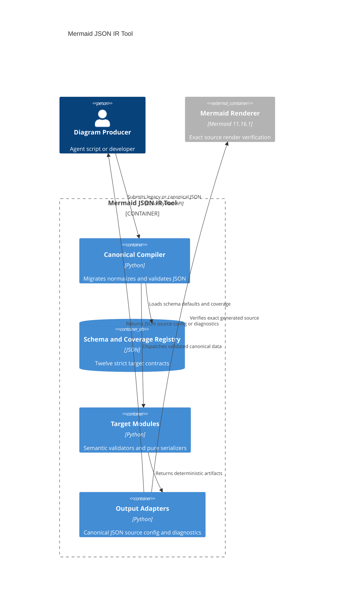

# Design: Mermaid JSON IR Schema

<!-- spec-nav:start -->
**Spec navigation:** [State](00_state.md) · [Discovery](01_discovery.md) · [Requirements](02_requirements.md) · [Design](03_design.md) · [Tasks](04_tasks.md) · [Execution](05_execution.md)
<!-- spec-nav:end -->

## Overview

This design replaces the renderer's prose-defined flat dictionaries with a versioned canonical
JSON envelope, 12 strict target schemas, a deterministic normalizer, layered validation, and pure
Mermaid serializers. The existing `render(ir, target, backend) -> str` interface remains as a
compatibility facade. New compilation interfaces expose canonical JSON, Mermaid source,
initialization configuration, and structured diagnostics without requiring callers to edit
generated text.

The design realizes the approved modular-schema direction. It does not reopen the rejected
monolithic-schema or grammar-AST approaches. It is pinned to Mermaid 11.16.1 and skill-tree digest
`b82d695a14f4ab0e6867808cd40d798cea55c4a39470a62d00cf16c532f8af22`.

> [!IMPORTANT]
> Approval gate: approve this design before work begins on [Tasks](04_tasks.md).

## Architecture

The architecture separates canonicalization, target contracts, serialization, and external render
verification. The authoritative structured source is
[the architecture IR](diagrams/architecture.json); the generated Mermaid source is
[the architecture diagram](diagrams/architecture.mmd).



## Components and Interfaces

### Compatibility facade

`render(ir: Mapping[str, Any], target: str | None = None, backend: str = "mermaid") -> str`
retains its current signature. It calls the canonical compiler and returns only `source`. It raises
`IRError` containing stable diagnostics when compilation fails.

`compile_ir(ir: Mapping[str, Any], target: str | None = None, backend: str = "mermaid", *,
deterministic: bool = True) -> CompileResult` is the complete public Python interface. It does not
mutate `ir` and performs no network access.

`CompileResult` contains:

- `normalized: dict[str, Any]` — fully migrated canonical JSON;
- `source: str` — byte-stable Mermaid source;
- `initialize_config: dict[str, Any]` — host/site renderer settings not emitted into source;
- `mermaid_version: str` — the effective pinned core version;
- `diagnostics: tuple[Diagnostic, ...]` — empty on success.

### Diagnostics

`Diagnostic` contains `code`, `pointer`, `message`, and `related_pointers`. Codes distinguish JSON
decode, migration, schema, semantic, determinism, serializer, and renderer failures. Diagnostics
sort by `(pointer, code, message)` before exposure. `IRError.diagnostics` retains the structured
tuple while its string form gives a concise multiline CLI message.

### Schema loader and constrained schema runtime

The runtime remains Python-standard-library-only. Bundled JSON Schema documents are authoritative;
a constrained Draft 2020-12 evaluator implements only the validation keywords used by this project:
`$ref`, `$defs`, `type`, `const`, `enum`, `required`, `properties`, `patternProperties`,
`additionalProperties`, `items`, `minItems`, `maxItems`, `uniqueItems`, `minimum`, `maximum`,
`minLength`, `pattern`, `allOf`, `oneOf`, and `if`/`then`/`else`.

The evaluator also permits the non-validating schema metadata and annotations `$schema`, `$id`,
`title`, `description`, and `default`. Normalization consumes `default`; the other permitted keys
improve identity and documentation without changing instance validity. The schema-keyword linter
distinguishes these annotations from unsupported validation keywords.

The schema checker fails if a bundled schema introduces an unsupported validation keyword. Local
references resolve only beneath the bundled schema directory; remote references are rejected.
This keeps validation offline and avoids adding a runtime package installation step.

### Legacy migrator

`migrate_legacy(ir: Mapping[str, Any], target_override: str | None) -> dict[str, Any]` recognizes
only the documented fields in the previously accepted flat shape. It moves semantic target fields
under `content`, source statements under `source`, accessibility values under `accessibility`, and
renderer values under `renderer`. Incidental unknown fields that the old permissive implementation
ignored were never part of the documented contract and produce migration diagnostics under R3.5
instead of being silently retained or dropped.

Migration preserves the old target serializer's semantic output. `TargetSpec` owns a target-local
legacy adapter for grammar-shaped legacy values that require semantic parsing; ER attributes and
class members therefore migrate into typed canonical values rather than retaining raw Mermaid
fragments. A `--normalize-out` CLI option lets users persist the canonical result. Legacy input
never causes canonical serializers to emit deprecated directive syntax.

### Default normalizer

`normalize(ir: Mapping[str, Any], target_override: str | None = None) -> dict[str, Any]` deep-copies
the input, migrates legacy documents, selects the target schema, and recursively applies declared
defaults. Defaults are read from the same schema documents used for validation. Objects are copied
with lexically ordered keys; arrays retain input order. Calling `normalize` twice produces an
equivalent value.

### Target registry

`TargetSpec` binds one exact target to its family, schema resource, target-local legacy adapter,
semantic validator, serializer, coverage entries, and Mermaid configuration namespace.
`TARGETS: Mapping[str, TargetSpec]` is the only dispatch table. Registering another target adds one
entry without modifying the canonical envelope.

The 12 target modules are `flowchart`, `mindmap`, `block`, `C4Context`, `C4Container`,
`architecture-beta`, `erDiagram`, `classDiagram`, `gantt`, `stateDiagram-v2`, `sequenceDiagram`,
and `requirementDiagram`. Shared graph structures remain reusable, but each target has an exact
schema so unsupported combinations cannot leak across targets.

### Semantic validators

Semantic validators run after schema validation. They enforce uniqueness, declared references,
mind-map tree constraints, nested state integrity, sequence actor references, Gantt dependency and
date constraints, requirement link integrity, C4 boundary compatibility, architecture side/icon
rules, ER cardinality, class relationship constraints, and other cross-field invariants. Each
error points to the originating JSON location and any conflicting location.

### Pure serializers

Serializers consume canonical validated documents only. Shared helpers own identifiers,
context-specific escaping, indentation, stable frontmatter, styles, interactions, and statement
ordering. Each target serializer emits in this order where supported:

1. canonical YAML frontmatter;
2. diagram declaration;
3. accessibility statements;
4. title and target-level settings;
5. primary declarations;
6. relationships, steps, or tasks;
7. styles and class assignments;
8. interactions.

Frontmatter uses JSON flow values inside YAML, allowing arbitrary JSON configuration to be emitted
without a YAML runtime dependency while retaining stable lexical key order.

### Coverage manifest

An independently sourced, versioned Mermaid 11.16.1 inventory is captured before target
implementation. Its provenance manifest records source identities, exact version, canonical path
ordering, exclusions, and content hashes. The coverage manifest is versioned JSON keyed by target
and inventory construct identifier.
Each entry contains `jsonPointer`, `presence`, `defaultPolicy`, `schemaRef`, `serializerSymbol`, and
`testIds`. A coverage checker requires exact identifier-set equality between the independent
inventory and coverage, and rejects missing or orphan entries, broken schema references, absent
serializer symbols, absent tests, and duplicate construct identifiers.

The manifest is a completeness claim about the selected Mermaid version, not a generic inventory
of every future Mermaid feature. A deliberate rebase updates the version, upstream inventory, and
coverage evidence together.

### CLI

The existing invocation continues to emit source. Additive options are:

- `--validate-only` — validate without emitting source;
- `--normalize-out PATH` — write canonical JSON with sorted keys and a trailing newline;
- `--initialize-config-out PATH` — write host initialization JSON separately;
- `--allow-nondeterministic` — permit an explicitly nondeterministic renderer contract;
- `--target TARGET` — retain the legacy override, rejecting a conflict with canonical `target`.

Validation failure returns exit 1 and writes no requested output. Input, usage, or filesystem
failure returns exit 2. Missing render capability remains exit 3 in the separate render checker.

## Data Models

### Canonical envelope

```json
{
  "$schema": "schema/diagram-ir.schema.json",
  "schemaVersion": "1.0.0",
  "diagram": "graph",
  "target": "flowchart",
  "content": {},
  "accessibility": {},
  "source": {},
  "renderer": {},
  "extensions": {}
}
```

`schemaVersion`, `diagram`, `target`, and `content` are compulsory. The other sections are
optional. Ordinary schema objects use `additionalProperties: false`.

### Accessibility

`accessibility.title` and `accessibility.description` map to `accTitle` and `accDescr`. Both are
optional nonempty strings. An absent section emits no accessibility statements.

### Source controls

Each target schema defines its native `source` controls: titles, directions, class definitions,
class assignments, element styles, link styles, notes, layout statements, links, and callback
declarations. Values are typed data, never raw Mermaid source. Interaction values are serialized
as inert text and are never executed by validation or compilation.

### Renderer controls

`renderer` has these fields:

- `mermaidVersion`, default `11.16.1`;
- `deterministic`, default `true`;
- `frontmatter.config`, containing allowed per-diagram Mermaid configuration;
- `initialize`, containing separately returned site initialization configuration.

Both configuration objects allow global Mermaid options and only the active target's diagram
namespace. The frontmatter schema excludes keys classified as secure by Mermaid 11.16.1.
`deterministic: true` materializes `deterministicIds: true` and a seed derived from the SHA-256 of
canonical content unless the caller supplies a stable seed. An explicit false identifier setting
conflicts with deterministic mode.

### Extensions

`extensions` keys match `^(?:[A-Za-z0-9-]+\.)+[A-Za-z0-9-]+/.+$` or an absolute URI. Extension
values may be any JSON value. Unknown namespaces survive normalization but never affect core
serialization. A serializer-specific extension handler must register its namespace before it may
emit output.

### Target schemas

The schema tree contains a root envelope, shared definitions, Mermaid configuration definitions,
and one target document per supported target. The root uses a discriminated `oneOf`; the runtime
also dispatches by `target` before evaluation to provide direct diagnostics.

Every target schema separately specifies compulsory content collections, optional fields,
defaults, enums, conditional combinations, and target source controls. Shared definitions cover
identifiers, text, styles, interactions, relationships, groups, notes, and renderer settings.

## Sequence and Flows

Compilation proceeds as follows:

1. Decode JSON when invoked through the CLI.
2. Detect legacy or canonical shape.
3. Migrate legacy fields without mutation.
4. Resolve the schema version and target.
5. Apply declared defaults.
6. Validate structure and collect stable diagnostics.
7. Validate semantic invariants.
8. Build effective frontmatter and initialization configuration.
9. Serialize the exact target in deterministic statement order.
10. Return `CompileResult` or write the selected CLI outputs.
11. When requested separately, render-verify the exact source with Mermaid 11.16.1.

No source or partial output is produced after a validation failure. Render verification remains a
separate side-effecting adapter so compilation stays pure and offline.

## Renderer Version Contract

The source and schema contract is Mermaid core 11.16.1. Deterministic verification uses
`@mermaid-js/mermaid-cli@11.16.0` together with `mermaid@11.16.1`; the CLI dependency accepts that
core version. The checker uses exact package selectors and asserts the resolved core version before
rendering. It does not silently use an arbitrary system `mmdc` or unversioned `npx` package.

An explicit renderer override is allowed only when the caller supplies the corresponding core
version. Version mismatch is a verification failure, not a warning. Initial package acquisition
may use the network; schema validation, normalization, and source serialization never do.

## Correctness Properties

### Property 1: Strict discriminated envelope

Every accepted canonical document has the compulsory envelope, selects exactly one registered
target, rejects unknown ordinary fields, and preserves only valid namespaced extensions.

**Validates: Requirements 1.1, 1.2, 1.3, 1.4, 1.5, 1.6, 9.8**

### Property 2: Schema-defined normalization

Normalization applies exactly the defaults declared by the selected schema, retains absence where
no default exists, rejects invalid explicit values, is idempotent, and does not mutate input.

**Validates: Requirements 2.1, 2.2, 2.3, 2.4, 2.5**

### Property 3: Meaning-preserving legacy migration

Every previously valid legacy fixture migrates to canonical JSON with equivalent generated
meaning; invalid or unmapped legacy input fails explicitly.

**Validates: Requirements 3.1, 3.2, 3.3, 3.4, 3.5**

### Property 4: Complete selected-version target coverage

For each of the 12 targets, every construct in the Mermaid 11.16.1 inventory has a typed JSON
address, strict schema entry, serializer mapping, and verification evidence; no supported supplied
field is silently dropped and no raw source fragment bypasses the contract.

**Validates: Requirements 4.1, 4.2, 4.3, 4.4, 4.5, 4.6, 4.7, 4.8, 4.9, 4.10, 4.11, 4.12, 4.13, 4.14, 9.1, 9.2, 9.3, 9.4, 9.5, 9.6**

### Property 5: Separated and deterministic renderer configuration

Accessibility statements and frontmatter appear only in generated source, initialization settings
remain a separate output, unsupported versioned settings fail, and deterministic mode always has
stable identifiers and seed behavior.

**Validates: Requirements 5.1, 5.2, 5.3, 5.4, 5.5, 5.6, 5.7, 5.8, 11.6**

### Property 6: Fail-closed semantic integrity

Duplicates, dangling references, target invariant violations, and forbidden combinations produce
stable pointer diagnostics. Structural or semantic failure produces no Mermaid source.

**Validates: Requirements 6.1, 6.2, 6.3, 6.4, 6.5, 6.6, 6.7**

### Property 7: Byte-stable serialization

Equal normalized JSON and backend contract produce byte-identical source; semantic array order is
preserved, unordered keys are stable, context escaping is correct, collisions resolve
reproducibly, and absent optional sections emit nothing.

**Validates: Requirements 7.1, 7.2, 7.3, 7.4, 7.5, 7.6**

### Property 8: Exact-source render verification

Verification renders the exact compiled source and fails on Mermaid parser errors or generated
error artifacts. Minimal and maximal fixtures for all targets render under the pinned core.

**Validates: Requirements 8.1, 8.2, 8.3, 8.4**

### Property 9: Envelope-stable extensibility

A new target can register a schema, semantic validator, serializer, and coverage entries without
changing the canonical envelope or existing target behavior.

**Validates: Requirements 9.7**

### Property 10: Offline and inert processing

Schema resolution, normalization, and source serialization require no network; interactions are
never executed; CLI success and failure return their specified exit classes.

**Validates: Requirements 10.1, 10.2, 10.3, 10.4, 10.5**

### Property 11: Self-sufficient author documentation

Documentation classifies every envelope and optional field, records every default, provides
minimal and feature-complete examples for all targets, explains migration, and distinguishes
source from initialization configuration.

**Validates: Requirements 11.1, 11.2, 11.3, 11.4, 11.5, 11.6**

## Error Handling and Edge Cases

- JSON Pointer escaping follows RFC 6901 for `~` and `/` in field names.
- Boolean values are rejected where integer fields are expected despite Python's `bool` subtype.
- Duplicate identifiers report both the duplicate and first declaration.
- Schema `$ref` cycles and path traversal are rejected during schema loading.
- Empty compulsory collections remain valid only where an intentionally empty diagram is valid.
- Target overrides that conflict with canonical JSON are rejected.
- Unknown schema versions fail before migration or serialization.
- Legacy compatibility covers the documented former IR fields; unknown root or nested legacy
  fields fail as unmapped under R3.5 even if the permissive former implementation ignored them.
- Defaults never repair an explicitly invalid value.
- Extension preservation does not grant serialization authority.
- Link and callback text is escaped without invocation.
- Mermaid version mismatch stops external verification before render.
- A live Agent skill digest change stops installation and triggers a merge checkpoint rather than
  overwriting concurrent user edits.

## Testing Strategy

### Schema and normalization tests

For every target, fixtures cover minimal valid input, every optional field, maximal valid input,
every omitted compulsory field, every unknown field boundary, enums, conditional combinations,
extension namespaces, defaults, idempotence, and input immutability. The schema-keyword linter and
local-reference resolver are tested independently.

### Migration tests

Every existing test fixture is captured as legacy input. Golden tests compare old source meaning
with canonicalized output. Invalid and unmapped legacy fields have pointer-specific negative tests.

### Semantic and serializer tests

Table-driven tests cover duplicates, references, cycles, target invariants, escaping contexts,
stable identifier collisions, statement order, object ordering, and repeated-run equality.
Existing renderer tests remain compatibility tests for `render()`.

### Coverage tests

The coverage checker verifies every manifest entry against schemas, symbols, and named tests.
Each target has minimal and feature-complete source snapshots. Adding an upstream inventory entry
without coverage makes the suite fail.

### Render tests

Minimal and feature-complete fixtures for all 12 targets render under Mermaid core 11.16.1.
Negative tests exercise parser errors and generated error-placeholder detection. Version mismatch
and missing capability paths fail with distinct evidence.

### CLI tests

Temporary-file tests cover validation-only mode, canonical output, initialization-config output,
legacy compatibility, no partial writes, deterministic exit statuses, and offline compilation.

## Cross-Cutting Risk Gates

| Gate | Failure mode | Verification | Owner / decision |
|---|---|---|---|
| Security | Interaction data executes or unsafe configuration crosses scopes | Inert callback/link tests; frontmatter secure-key negatives | Serializer and schema owners; fail closed |
| Authorization | Not applicable: the local compiler has no identity or permission model | Confirm no network publishing or account APIs enter scope | Feature owner |
| Privacy | Diagram content leaks through validation | Offline compilation tests; no telemetry or network calls | Compiler owner |
| Accessibility | Accessible labels are omitted or malformed | Per-target `accTitle` and `accDescr` render fixtures | Target serializer owners |
| Performance | Schema traversal or reference checks become unexpectedly superlinear | Baseline and regression fixtures at Mermaid's configured edge/text limits | Schema-runtime owner |
| Observability | Errors point only to generated Mermaid lines | Stable JSON Pointer diagnostic assertions | Validation owner |
| Migration | Legacy meaning changes or an input is silently dropped | Golden migration corpus and unmapped-field negatives | Migrator owner |
| Rollout | Canonical mode breaks existing callers | Compatibility facade tests and incremental canonical opt-in | CLI/API owner |
| Rollback | Installed skill cannot return to its prior snapshot | Preserve the pinned baseline and install only after full verification | Integration owner |
| Concurrent edits | Active skill changes are overwritten | Recheck live digest; stop for merge when it differs | Integration owner |

## Current Technology Evidence

Context7 was consulted using the official `/mermaid-js/mermaid` and
`/mermaid-js/mermaid-cli` identities. The decision is to bind the source contract to the exact
Mermaid versions below rather than treating current development-branch behavior as an implicit
moving target.

| Technology | Context7 identity/source | Exact selected version | Current-doc question | Decision |
|---|---|---|---|---|
| Mermaid core | `/mermaid-js/mermaid` official source and bundled official syntax cache | 11.16.1 | Configuration precedence, frontmatter, secure settings, deterministic IDs, and 12 target syntax categories | Pin schemas, source generation, and rendering to core 11.16.1 |
| Mermaid CLI | `/mermaid-js/mermaid-cli` official package metadata | 11.16.0 with core 11.16.1 | Exact-source rendering and configuration handoff | Use exact package selectors and assert resolved core version |
| JSON Schema | Draft 2020-12 vocabulary | Project-defined supported subset | Offline strict validation without a runtime package install | Bundle modular schemas and a constrained evaluator; reject unsupported keywords |

## Dependency Security Evidence

No in-project third-party dependency resolution is selected or changed. Schema processing uses the
Python standard library. Mermaid CLI remains the existing external render-verification adapter and
is invoked with exact ephemeral package selectors; it is not imported into the compiler or shipped
as a runtime library. Consequently no project manifest or lockfile changes, and dependency audit
mode is not applicable to this increment. If implementation introduces a manifest or imports a new
library, Design must be revised and the dependency-change audit contract applied before that task.

## Rollout and Integration

Execution first preserves an immutable project-local baseline tree and a separate working copy.
The manifest defines sorted-path hashing and excludes operating-system metadata, Python bytecode,
and test/runtime cache artifacts. Because the skill is not Git-tracked and the post-planning SVG-preview
documentation update changed the live tree, the planning digest remains semantic evidence while
the preserved current tree and its canonical manifest become the executable merge base. Before
installing, execution recomputes the live Agent skill digest:

- If the digest still matches the baseline, the verified staged tree may replace the canonical
  Agent skill and then refresh the Codex mirror.
- If the digest differs, installation stops. The staged delta is rebased onto the live skill,
  conflicts are reviewed, and the complete verification suite runs again before either installed
  tree changes.

Installation builds validated temporary sibling trees for both Agent and Codex destinations, then
performs atomic swaps while retaining distinct pre-install copies. The pre-install copies remain
available until both destinations pass post-install verification. Any second-destination or smoke
failure restores both baselines rather than leaving a mixed installation. Filesystem escalation is
requested for the exact destination paths at installation time; the user's execution authorization
does not bypass the host permission gate.

## Approval

Status: **Approved on 2026-08-09**
