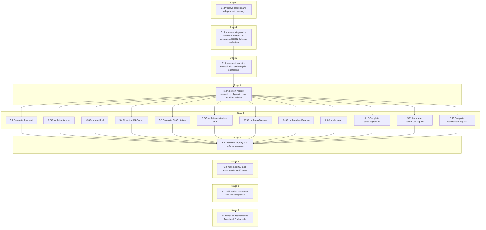

# Tasks: Mermaid JSON IR Schema

<!-- spec-nav:start -->
**Spec navigation:** [State](00_state.md) · [Discovery](01_discovery.md) · [Requirements](02_requirements.md) · [Design](03_design.md) · [Tasks](04_tasks.md) · [Execution](05_execution.md)
<!-- spec-nav:end -->

> [!WARNING]
> Execute dependency stages in order. Run Stage 5 target tasks concurrently only when their
> declared files remain disjoint. Installation must stop if the live Agent skill differs from the
> approved merge baseline.

## Stage and Dependency Overview

The checklist and its generated sidecar remain authoritative. The diagram is derived from
[the task IR](diagrams/tasks.json), with [the generated Mermaid source](diagrams/tasks.mmd).

- [x] 1. Establish the isolated compatibility and inventory baseline
  - [x] 1.1 Preserve the executable skill baseline and independent Mermaid inventory
    - Preserve the current live skill as an immutable baseline and make a separate working copy,
      using a sorted-path manifest that excludes operating-system metadata, Python bytecode, and
      test/runtime cache artifacts.
    - Capture every existing valid IR fixture and its exact source as the legacy golden corpus.
    - Capture a separately provenance-bound Mermaid 11.16.1 construct/configuration inventory for
      all 12 targets; classify every entry as supported or explicitly excluded.
    - Record the planning digest, executable baseline hash, Mermaid core `11.16.1`, CLI `11.16.0`,
      source identities, and hashing algorithm separately.
    - Add C4 matching/conflicting target-override permutations and unknown root/nested legacy fields
      to the compatibility corpus; the latter must fail as undocumented unmapped fields under R3.5.
    - **Files:** [work/mermaid-json-ir-schema/baseline/skill](../../work/mermaid-json-ir-schema/baseline/skill), [work/mermaid-json-ir-schema/skill](../../work/mermaid-json-ir-schema/skill), [work/mermaid-json-ir-schema/baseline-manifest.json](../../work/mermaid-json-ir-schema/baseline-manifest.json), [work/mermaid-json-ir-schema/inventory/mermaid-11.16.1](../../work/mermaid-json-ir-schema/inventory/mermaid-11.16.1), [work/mermaid-json-ir-schema/inventory-manifest.json](../../work/mermaid-json-ir-schema/inventory-manifest.json), [work/mermaid-json-ir-schema/skill/tests/fixtures/legacy](../../work/mermaid-json-ir-schema/skill/tests/fixtures/legacy)
    - **Dependency resolution:** none
    - **Dependency delivery:** none
    - **Depends on:** none
    - **Stage:** 1
    - **Interfaces:** Consumes: planning digest `b82d695a14f4ab0e6867808cd40d798cea55c4a39470a62d00cf16c532f8af22`, current live skill, official Mermaid 11.16.1 evidence, `render(ir, target, backend) -> str`, and existing tests; Produces: immutable `baseline/skill`, separate working `skill`, canonical baseline/inventory manifests, independent per-target inventory, and legacy input/source/error corpus
    - **Documentation:** no new public API; document provenance, sorted-path hashing/exclusions, planning-vs-executable baselines, inventory classifications, and C4 override behavior
    - **Verification:** `python -m unittest discover -s work/mermaid-json-ir-schema/skill/tests -v`; verify baseline/working manifests, inventory provenance and uniqueness, all legacy goldens, C4 override permutations, and unmapped-field failures
    - **Estimated effort:** 3–5 hours
    - **Risk:** medium; an incomplete baseline could hide migration regressions, so rollback is discarding the staging tree
    - **Task category:** code_analysis
    - **Delegation:** controller
    - _Requirements: 3.1, 3.2, 3.4, 3.5, 7.1_

- [x] 2. Build the canonical contract runtime
  - [x] 2.1 Implement diagnostics, canonical models, and constrained JSON Schema evaluation
    - Add immutable diagnostic/result models and RFC 6901 pointer helpers.
    - Implement the approved offline Draft 2020-12 keyword subset, local-only reference resolution, keyword linting, and stable error sorting.
    - Add the strict root envelope, shared definitions, renderer configuration, and extension schemas.
    - Test missing compulsory fields, unknown fields, invalid types, unsupported keywords, remote references, cycles, path traversal, and Python boolean/integer separation.
    - Permit and test `$schema`, `$id`, `title`, `description`, and `default` as non-validating
      metadata/annotations while rejecting unknown validation keywords.
    - **Files:** [work/mermaid-json-ir-schema/skill/scripts/mermaid_ir/__init__.py](../../work/mermaid-json-ir-schema/skill/scripts/mermaid_ir/__init__.py), [work/mermaid-json-ir-schema/skill/scripts/mermaid_ir/model.py](../../work/mermaid-json-ir-schema/skill/scripts/mermaid_ir/model.py), [work/mermaid-json-ir-schema/skill/scripts/mermaid_ir/diagnostics.py](../../work/mermaid-json-ir-schema/skill/scripts/mermaid_ir/diagnostics.py), [work/mermaid-json-ir-schema/skill/scripts/mermaid_ir/schema_runtime.py](../../work/mermaid-json-ir-schema/skill/scripts/mermaid_ir/schema_runtime.py), [work/mermaid-json-ir-schema/skill/schema/envelope.schema.json](../../work/mermaid-json-ir-schema/skill/schema/envelope.schema.json), [work/mermaid-json-ir-schema/skill/schema/common.schema.json](../../work/mermaid-json-ir-schema/skill/schema/common.schema.json), [work/mermaid-json-ir-schema/skill/schema/config.schema.json](../../work/mermaid-json-ir-schema/skill/schema/config.schema.json), [work/mermaid-json-ir-schema/skill/tests/test_schema_runtime.py](../../work/mermaid-json-ir-schema/skill/tests/test_schema_runtime.py), [work/mermaid-json-ir-schema/skill/tests/test_diagnostics.py](../../work/mermaid-json-ir-schema/skill/tests/test_diagnostics.py)
    - **Dependency resolution:** none
    - **Dependency delivery:** none
    - **Depends on:** 1.1
    - **Stage:** 2
    - **Interfaces:** Consumes: staged skill and approved canonical envelope; Produces: `Diagnostic`, `CompileResult`, `IRError`, RFC 6901 helpers, `SchemaRegistry`, `validate_schema(instance, schema_ref) -> tuple[Diagnostic, ...]`, strict shared schemas, and explicit validation-keyword versus annotation policy
    - **Documentation:** public module, class, and function docstrings must state validation contracts, supported keyword boundary, offline-only reference policy, and stable diagnostic ordering rationale
    - **Verification:** `python -m unittest work/mermaid-json-ir-schema/skill/tests/test_schema_runtime.py work/mermaid-json-ir-schema/skill/tests/test_diagnostics.py -v`; review public documentation
    - **Estimated effort:** 6–10 hours
    - **Risk:** high; a validator bug can accept malformed documents, so rollback retains the legacy facade and removes the new package
    - **Task category:** heavy_reasoning
    - **Delegation:** sequential subagent
    - _Requirements: 1.1, 1.2, 1.3, 1.4, 1.5, 1.6, 2.5, 6.5, 9.8, 10.1_

- [x] 3. Canonicalize inputs before serialization
  - [x] 3.1 Implement legacy migration, default normalization, and compiler scaffolding
    - Implement registry-dispatched `migrate_legacy` scaffolding and reject invalid or unmapped
      documented legacy fields; target grammar parsing is owned by target-local adapters.
    - Implement deep-copy normalization, schema-declared defaults, lexical object-key order, idempotence, and target/schema-version dispatch.
    - Implement `compile_ir` scaffolding through structural and semantic gates with no partial
      source on failure, tested with a private fixture target; keep the production `render.py`
      facade unchanged until all real targets are registered in Task 6.1.
    - **Files:** [work/mermaid-json-ir-schema/skill/scripts/mermaid_ir/migrate.py](../../work/mermaid-json-ir-schema/skill/scripts/mermaid_ir/migrate.py), [work/mermaid-json-ir-schema/skill/scripts/mermaid_ir/normalize.py](../../work/mermaid-json-ir-schema/skill/scripts/mermaid_ir/normalize.py), [work/mermaid-json-ir-schema/skill/scripts/mermaid_ir/compiler.py](../../work/mermaid-json-ir-schema/skill/scripts/mermaid_ir/compiler.py), [work/mermaid-json-ir-schema/skill/tests/test_migration.py](../../work/mermaid-json-ir-schema/skill/tests/test_migration.py), [work/mermaid-json-ir-schema/skill/tests/test_normalize.py](../../work/mermaid-json-ir-schema/skill/tests/test_normalize.py), [work/mermaid-json-ir-schema/skill/tests/test_compiler.py](../../work/mermaid-json-ir-schema/skill/tests/test_compiler.py)
    - **Dependency resolution:** none
    - **Dependency delivery:** none
    - **Depends on:** 2.1
    - **Stage:** 3
    - **Interfaces:** Consumes: `SchemaRegistry`, diagnostic/result models, shared schemas, legacy corpus, and private fixture `TargetSpec`; Produces: registry-dispatched `migrate_legacy(ir, target_override) -> dict[str, Any]`, `normalize(ir, target_override=None) -> dict[str, Any]`, and target-agnostic `compile_ir(ir, target=None, backend="mermaid", *, deterministic=True) -> CompileResult` scaffolding
    - **Documentation:** public migration, normalization, and compilation docstrings must explain mutation, failure, versioning, target-adapter dispatch, and the deferred production-facade integration
    - **Verification:** `python -m unittest work/mermaid-json-ir-schema/skill/tests/test_migration.py work/mermaid-json-ir-schema/skill/tests/test_normalize.py work/mermaid-json-ir-schema/skill/tests/test_compiler.py -v`; verify fixture-target compilation, unmapped-field failures, defaults, and no production-facade change; review public documentation
    - **Estimated effort:** 6–9 hours
    - **Risk:** high; migration drift can change existing diagrams, so rollback restores the staged baseline [work/mermaid-json-ir-schema/skill/scripts/render.py](../../work/mermaid-json-ir-schema/skill/scripts/render.py)
    - **Task category:** heavy_reasoning
    - **Delegation:** sequential subagent
    - _Requirements: 2.1, 2.2, 2.3, 2.4, 2.5, 3.1, 3.2, 3.3, 3.4, 3.5, 6.6, 6.7, 10.2_

- [x] 4. Establish shared target and serialization contracts
  - [x] 4.1 Implement the target registry, semantic helpers, configuration scopes, and pure serializer utilities
    - Add `TargetSpec`/`TARGETS` registration, including a target-local legacy adapter contract,
      without target-specific entries yet.
    - Add duplicate/reference/invariant helpers, deterministic ID collision handling, context-specific escaping, stable frontmatter, and statement ordering.
    - Separate accessibility/source/frontmatter output from returned initialization configuration.
    - Enforce Mermaid `11.16.1`, deterministic identifier settings, stable seed derivation, secure-key exclusions, and inert interaction values.
    - **Files:** [work/mermaid-json-ir-schema/skill/scripts/mermaid_ir/registry.py](../../work/mermaid-json-ir-schema/skill/scripts/mermaid_ir/registry.py), [work/mermaid-json-ir-schema/skill/scripts/mermaid_ir/semantic.py](../../work/mermaid-json-ir-schema/skill/scripts/mermaid_ir/semantic.py), [work/mermaid-json-ir-schema/skill/scripts/mermaid_ir/serialization.py](../../work/mermaid-json-ir-schema/skill/scripts/mermaid_ir/serialization.py), [work/mermaid-json-ir-schema/skill/scripts/mermaid_ir/config.py](../../work/mermaid-json-ir-schema/skill/scripts/mermaid_ir/config.py), [work/mermaid-json-ir-schema/skill/scripts/mermaid_ir/legacy_serializers.py](../../work/mermaid-json-ir-schema/skill/scripts/mermaid_ir/legacy_serializers.py), [work/mermaid-json-ir-schema/skill/scripts/mermaid_ir/targets/__init__.py](../../work/mermaid-json-ir-schema/skill/scripts/mermaid_ir/targets/__init__.py), [work/mermaid-json-ir-schema/skill/scripts/mermaid_ir/targets/_base.py](../../work/mermaid-json-ir-schema/skill/scripts/mermaid_ir/targets/_base.py), [work/mermaid-json-ir-schema/skill/tests/test_registry.py](../../work/mermaid-json-ir-schema/skill/tests/test_registry.py), [work/mermaid-json-ir-schema/skill/tests/test_serialization.py](../../work/mermaid-json-ir-schema/skill/tests/test_serialization.py), [work/mermaid-json-ir-schema/skill/tests/test_config.py](../../work/mermaid-json-ir-schema/skill/tests/test_config.py)
    - **Dependency resolution:** none
    - **Dependency delivery:** none
    - **Depends on:** 3.1
    - **Stage:** 4
    - **Interfaces:** Consumes: canonical compiler pipeline and approved serializer/configuration contracts; Produces: `TargetSpec`, `TARGETS`, semantic validation helpers, canonical frontmatter/escaping/ID utilities, and effective source/initialization configuration builders
    - **Documentation:** public registry and serializer utilities must explain extension boundaries, stable ordering, Mermaid-core version policy, inert interactions, and why initialization configuration is excluded from source
    - **Verification:** `python -m unittest work/mermaid-json-ir-schema/skill/tests/test_registry.py work/mermaid-json-ir-schema/skill/tests/test_serialization.py work/mermaid-json-ir-schema/skill/tests/test_config.py -v`; review public documentation
    - **Estimated effort:** 6–9 hours
    - **Risk:** high; shared escaping or configuration mistakes affect every target, so rollback removes the shared layer before target integration
    - **Task category:** heavy_reasoning
    - **Delegation:** sequential subagent
    - _Requirements: 4.13, 4.14, 5.1, 5.2, 5.3, 5.4, 5.5, 5.6, 5.7, 5.8, 6.1, 6.2, 6.3, 6.4, 7.1, 7.2, 7.3, 7.4, 7.5, 7.6, 10.3, 11.6_

- [x] 5. Implement all 12 strict target modules
  - [x] 5.1 Implement complete `flowchart` addressability
    - Inventory Mermaid 11.16.1 flowchart constructs/configuration, implement its exact schema, semantic validator, serializer, coverage entries, and minimal/maximal/negative/determinism/render fixtures.
    - **Files:** `work/mermaid-json-ir-schema/skill/scripts/mermaid_ir/targets/flowchart.py`, `work/mermaid-json-ir-schema/skill/schema/targets/flowchart.schema.json`, `work/mermaid-json-ir-schema/skill/coverage/targets/flowchart.json`, `work/mermaid-json-ir-schema/skill/examples/flowchart/`, `work/mermaid-json-ir-schema/skill/tests/targets/test_flowchart.py`
    - **Dependency resolution:** none
    - **Dependency delivery:** none
    - **Depends on:** 4.1
    - **Stage:** 5
    - **Interfaces:** Consumes: `TargetSpec`, shared graph/configuration schemas, semantic helpers, and serializer utilities; Produces: registered `flowchart` schema/validator/serializer, field-level coverage records, and canonical examples
    - **Documentation:** target module docstring and schema descriptions must state compulsory/optional/default semantics and source/configuration mappings
    - **Verification:** `python -m unittest work/mermaid-json-ir-schema/skill/tests/targets/test_flowchart.py -v`; render minimal and maximal examples with the exact pinned checker; review documentation
    - **Estimated effort:** 6–9 hours
    - **Risk:** high; flowchart grammar breadth may expose inventory gaps, with rollback isolated to this target module
    - **Task category:** heavy_reasoning
    - **Delegation:** parallel-safe
    - _Requirements: 4.1, 4.13, 4.14, 5.5, 6.1, 6.2, 6.3, 6.4, 7.4, 7.6, 8.4, 11.3, 11.4_

  - [x] 5.2 Implement complete `mindmap` addressability
    - Inventory Mermaid 11.16.1 mindmap constructs/configuration and implement the disjoint target schema, tree validator, serializer, coverage, examples, and tests.
    - **Files:** `work/mermaid-json-ir-schema/skill/scripts/mermaid_ir/targets/mindmap.py`, `work/mermaid-json-ir-schema/skill/schema/targets/mindmap.schema.json`, `work/mermaid-json-ir-schema/skill/coverage/targets/mindmap.json`, `work/mermaid-json-ir-schema/skill/examples/mindmap/`, `work/mermaid-json-ir-schema/skill/tests/targets/test_mindmap.py`
    - **Dependency resolution:** none
    - **Dependency delivery:** none
    - **Depends on:** 4.1
    - **Stage:** 5
    - **Interfaces:** Consumes: shared target contracts and mindmap 11.16.1 inventory; Produces: registered `mindmap` schema/validator/serializer, coverage records, and canonical examples
    - **Documentation:** document compulsory root/tree constraints, optional shapes/configuration, defaults, and emitted syntax
    - **Verification:** `python -m unittest work/mermaid-json-ir-schema/skill/tests/targets/test_mindmap.py -v`; render minimal and maximal examples; review documentation
    - **Estimated effort:** 3–5 hours
    - **Risk:** medium; tree invariants and indentation are target-local, with rollback isolated to this module
    - **Task category:** code_analysis
    - **Delegation:** parallel-safe
    - _Requirements: 4.2, 4.13, 4.14, 5.5, 6.1, 6.2, 6.3, 6.4, 7.4, 7.6, 8.4, 11.3, 11.4_

  - [x] 5.3 Implement complete `block` addressability
    - Inventory Mermaid 11.16.1 block constructs/configuration and implement nested composition, widths/columns, shapes, links, styling, coverage, examples, and tests.
    - **Files:** `work/mermaid-json-ir-schema/skill/scripts/mermaid_ir/targets/block.py`, `work/mermaid-json-ir-schema/skill/schema/targets/block.schema.json`, `work/mermaid-json-ir-schema/skill/coverage/targets/block.json`, `work/mermaid-json-ir-schema/skill/examples/block/`, `work/mermaid-json-ir-schema/skill/tests/targets/test_block.py`
    - **Dependency resolution:** none
    - **Dependency delivery:** none
    - **Depends on:** 4.1
    - **Stage:** 5
    - **Interfaces:** Consumes: shared target contracts and block 11.16.1 inventory; Produces: registered `block` schema/validator/serializer, coverage records, and canonical examples
    - **Documentation:** document compulsory collections, nesting/reference rules, optional layout/style fields, defaults, and mappings
    - **Verification:** `python -m unittest work/mermaid-json-ir-schema/skill/tests/targets/test_block.py -v`; render minimal and maximal examples; review documentation
    - **Estimated effort:** 4–7 hours
    - **Risk:** high; beta grammar and nesting combinations may be version-sensitive, with rollback isolated to this module
    - **Task category:** heavy_reasoning
    - **Delegation:** parallel-safe
    - _Requirements: 4.7, 4.13, 4.14, 5.5, 6.1, 6.2, 6.3, 6.4, 7.4, 7.6, 8.4, 11.3, 11.4_

  - [x] 5.4 Implement complete `C4Context` addressability
    - Inventory Mermaid 11.16.1 C4 context macros/layout/configuration and implement boundaries, elements, relationships, styling/update directives, coverage, examples, and tests.
    - **Files:** `work/mermaid-json-ir-schema/skill/scripts/mermaid_ir/targets/c4_context.py`, `work/mermaid-json-ir-schema/skill/schema/targets/C4Context.schema.json`, `work/mermaid-json-ir-schema/skill/coverage/targets/C4Context.json`, `work/mermaid-json-ir-schema/skill/examples/C4Context/`, `work/mermaid-json-ir-schema/skill/tests/targets/test_c4_context.py`
    - **Dependency resolution:** none
    - **Dependency delivery:** none
    - **Depends on:** 4.1
    - **Stage:** 5
    - **Interfaces:** Consumes: shared target contracts and C4Context 11.16.1 inventory; Produces: registered `C4Context` schema/validator/serializer, coverage records, and canonical examples
    - **Documentation:** document compulsory macro arguments, optional boundary/layout/style controls, defaults, and mappings
    - **Verification:** `python -m unittest work/mermaid-json-ir-schema/skill/tests/targets/test_c4_context.py -v`; render minimal and maximal examples; review documentation
    - **Estimated effort:** 5–8 hours
    - **Risk:** high; positional macro compatibility is strict, with rollback isolated to this module
    - **Task category:** heavy_reasoning
    - **Delegation:** parallel-safe
    - _Requirements: 4.8, 4.13, 4.14, 5.5, 6.1, 6.2, 6.3, 6.4, 7.4, 7.6, 8.4, 11.3, 11.4_

  - [x] 5.5 Implement complete `C4Container` addressability
    - Inventory Mermaid 11.16.1 C4 container macros/layout/configuration and implement elements, nested boundaries, relationships, styling/update directives, coverage, examples, and tests.
    - **Files:** `work/mermaid-json-ir-schema/skill/scripts/mermaid_ir/targets/c4_container.py`, `work/mermaid-json-ir-schema/skill/schema/targets/C4Container.schema.json`, `work/mermaid-json-ir-schema/skill/coverage/targets/C4Container.json`, `work/mermaid-json-ir-schema/skill/examples/C4Container/`, `work/mermaid-json-ir-schema/skill/tests/targets/test_c4_container.py`
    - **Dependency resolution:** none
    - **Dependency delivery:** none
    - **Depends on:** 4.1
    - **Stage:** 5
    - **Interfaces:** Consumes: shared target contracts and C4Container 11.16.1 inventory; Produces: registered `C4Container` schema/validator/serializer, coverage records, and canonical examples
    - **Documentation:** document compulsory container macro arguments, optional technologies/boundaries/layout/style controls, defaults, and mappings
    - **Verification:** `python -m unittest work/mermaid-json-ir-schema/skill/tests/targets/test_c4_container.py -v`; render minimal and maximal examples; review documentation
    - **Estimated effort:** 5–8 hours
    - **Risk:** high; nested boundaries and positional arguments are strict, with rollback isolated to this module
    - **Task category:** heavy_reasoning
    - **Delegation:** parallel-safe
    - _Requirements: 4.9, 4.13, 4.14, 5.5, 6.1, 6.2, 6.3, 6.4, 7.4, 7.6, 8.4, 11.3, 11.4_

  - [x] 5.6 Implement complete `architecture-beta` addressability
    - Inventory Mermaid 11.16.1 architecture constructs/configuration and implement groups, services, junctions, icons, ports, edges, nesting, coverage, examples, and tests.
    - **Files:** `work/mermaid-json-ir-schema/skill/scripts/mermaid_ir/targets/architecture.py`, `work/mermaid-json-ir-schema/skill/schema/targets/architecture-beta.schema.json`, `work/mermaid-json-ir-schema/skill/coverage/targets/architecture-beta.json`, `work/mermaid-json-ir-schema/skill/examples/architecture-beta/`, `work/mermaid-json-ir-schema/skill/tests/targets/test_architecture.py`
    - **Dependency resolution:** none
    - **Dependency delivery:** none
    - **Depends on:** 4.1
    - **Stage:** 5
    - **Interfaces:** Consumes: shared target contracts and architecture 11.16.1 inventory; Produces: registered `architecture-beta` schema/validator/serializer, coverage records, and canonical examples
    - **Documentation:** document compulsory port/reference fields, optional icons/groups/configuration, defaults, and grammar restrictions
    - **Verification:** `python -m unittest work/mermaid-json-ir-schema/skill/tests/targets/test_architecture.py -v`; render minimal and maximal examples; review documentation
    - **Estimated effort:** 5–8 hours
    - **Risk:** high; beta grammar, icon names, and title punctuation are version-sensitive, with rollback isolated to this module
    - **Task category:** heavy_reasoning
    - **Delegation:** parallel-safe
    - _Requirements: 4.10, 4.13, 4.14, 5.5, 6.1, 6.2, 6.3, 6.4, 7.4, 7.6, 8.4, 11.3, 11.4_

  - [x] 5.7 Implement complete `erDiagram` addressability
    - Use the independent Mermaid 11.16.1 ER inventory and implement entities, typed attributes, keys/comments, aliases, cardinalities, relationship styles, coverage, examples, and tests.
    - Implement the target-owned legacy member parser for type/name/key/comment/quoted forms so
      canonical JSON contains typed attributes rather than raw Mermaid fragments.
    - **Files:** `work/mermaid-json-ir-schema/skill/scripts/mermaid_ir/targets/er_diagram.py`, `work/mermaid-json-ir-schema/skill/scripts/mermaid_ir/legacy/er_diagram.py`, `work/mermaid-json-ir-schema/skill/schema/targets/erDiagram.schema.json`, `work/mermaid-json-ir-schema/skill/coverage/targets/erDiagram.json`, `work/mermaid-json-ir-schema/skill/examples/erDiagram/`, `work/mermaid-json-ir-schema/skill/tests/targets/test_er_diagram.py`, `work/mermaid-json-ir-schema/skill/tests/legacy/test_er_diagram.py`
    - **Dependency resolution:** none
    - **Dependency delivery:** none
    - **Depends on:** 4.1
    - **Stage:** 5
    - **Interfaces:** Consumes: shared target contracts, independent ER 11.16.1 inventory, and legacy member corpus; Produces: registered `erDiagram` schema/validator/serializer, `migrate_er_legacy_content()`, coverage records, and canonical examples without raw member syntax
    - **Documentation:** document compulsory entity/relationship fields, optional attributes/keys/configuration, defaults, and mappings
    - **Verification:** `python -m unittest work/mermaid-json-ir-schema/skill/tests/targets/test_er_diagram.py work/mermaid-json-ir-schema/skill/tests/legacy/test_er_diagram.py -v`; golden-migrate key/comment/quoted member forms, assert no raw syntax field, render minimal and maximal examples, and review documentation
    - **Estimated effort:** 4–7 hours
    - **Risk:** medium; identifier quoting and cardinality orientation can drift, with rollback isolated to this module
    - **Task category:** heavy_reasoning
    - **Delegation:** parallel-safe
    - _Requirements: 4.11, 4.13, 4.14, 5.5, 6.1, 6.2, 6.3, 6.4, 7.4, 7.6, 8.4, 11.3, 11.4_

  - [x] 5.8 Implement complete `classDiagram` addressability
    - Use the independent Mermaid 11.16.1 class inventory and implement namespaces, classes, annotations, typed members, relationships, cardinalities, notes, interactions, coverage, examples, and tests.
    - Implement the target-owned legacy member parser for visibility, generic, attribute, method,
      parameter, and return-type forms so canonical JSON contains typed members.
    - **Files:** `work/mermaid-json-ir-schema/skill/scripts/mermaid_ir/targets/class_diagram.py`, `work/mermaid-json-ir-schema/skill/scripts/mermaid_ir/legacy/class_diagram.py`, `work/mermaid-json-ir-schema/skill/schema/targets/classDiagram.schema.json`, `work/mermaid-json-ir-schema/skill/coverage/targets/classDiagram.json`, `work/mermaid-json-ir-schema/skill/examples/classDiagram/`, `work/mermaid-json-ir-schema/skill/tests/targets/test_class_diagram.py`, `work/mermaid-json-ir-schema/skill/tests/legacy/test_class_diagram.py`
    - **Dependency resolution:** none
    - **Dependency delivery:** none
    - **Depends on:** 4.1
    - **Stage:** 5
    - **Interfaces:** Consumes: shared target contracts, independent classDiagram 11.16.1 inventory, and legacy member corpus; Produces: registered `classDiagram` schema/validator/serializer, `migrate_class_legacy_content()`, coverage records, and canonical examples without raw member syntax
    - **Documentation:** document compulsory declarations, optional namespaces/members/interactions/configuration, defaults, and mappings
    - **Verification:** `python -m unittest work/mermaid-json-ir-schema/skill/tests/targets/test_class_diagram.py work/mermaid-json-ir-schema/skill/tests/legacy/test_class_diagram.py -v`; golden-migrate visibility/generic/return-type forms, assert no raw syntax field, render minimal and maximal examples, and review documentation
    - **Estimated effort:** 5–8 hours
    - **Risk:** high; member grammar and relationship direction are extensive, with rollback isolated to this module
    - **Task category:** heavy_reasoning
    - **Delegation:** parallel-safe
    - _Requirements: 4.12, 4.13, 4.14, 5.5, 6.1, 6.2, 6.3, 6.4, 7.4, 7.6, 8.4, 10.3, 11.3, 11.4_

  - [x] 5.9 Implement complete `gantt` addressability
    - Inventory Mermaid 11.16.1 Gantt constructs/configuration and implement date/axis formats, sections, tasks, tags, milestones, dependencies, exclusions, ticks, weekends, coverage, examples, and tests.
    - **Files:** `work/mermaid-json-ir-schema/skill/scripts/mermaid_ir/targets/gantt.py`, `work/mermaid-json-ir-schema/skill/schema/targets/gantt.schema.json`, `work/mermaid-json-ir-schema/skill/coverage/targets/gantt.json`, `work/mermaid-json-ir-schema/skill/examples/gantt/`, `work/mermaid-json-ir-schema/skill/tests/targets/test_gantt.py`
    - **Dependency resolution:** none
    - **Dependency delivery:** none
    - **Depends on:** 4.1
    - **Stage:** 5
    - **Interfaces:** Consumes: shared target contracts and Gantt 11.16.1 inventory; Produces: registered `gantt` schema/validator/serializer, coverage records, and canonical examples
    - **Documentation:** document compulsory schedule fields, optional timing/configuration controls, defaults, dependency semantics, and mappings
    - **Verification:** `python -m unittest work/mermaid-json-ir-schema/skill/tests/targets/test_gantt.py -v`; render minimal and maximal examples; review documentation
    - **Estimated effort:** 5–8 hours
    - **Risk:** high; date grammar and dependency combinations are complex, with rollback isolated to this module
    - **Task category:** heavy_reasoning
    - **Delegation:** parallel-safe
    - _Requirements: 4.3, 4.13, 4.14, 5.5, 6.1, 6.2, 6.3, 6.4, 7.4, 7.6, 8.4, 11.3, 11.4_

  - [x] 5.10 Implement complete `stateDiagram-v2` addressability
    - Inventory Mermaid 11.16.1 state constructs/configuration and implement composite states, pseudostates, transitions, notes, directions, concurrency, styling, coverage, examples, and tests.
    - **Files:** `work/mermaid-json-ir-schema/skill/scripts/mermaid_ir/targets/state_diagram.py`, `work/mermaid-json-ir-schema/skill/schema/targets/stateDiagram-v2.schema.json`, `work/mermaid-json-ir-schema/skill/coverage/targets/stateDiagram-v2.json`, `work/mermaid-json-ir-schema/skill/examples/stateDiagram-v2/`, `work/mermaid-json-ir-schema/skill/tests/targets/test_state_diagram.py`
    - **Dependency resolution:** none
    - **Dependency delivery:** none
    - **Depends on:** 4.1
    - **Stage:** 5
    - **Interfaces:** Consumes: shared target contracts and stateDiagram-v2 11.16.1 inventory; Produces: registered `stateDiagram-v2` schema/validator/serializer, coverage records, and canonical examples
    - **Documentation:** document compulsory state/transition fields, optional composite/pseudostate/style/configuration controls, defaults, and mappings
    - **Verification:** `python -m unittest work/mermaid-json-ir-schema/skill/tests/targets/test_state_diagram.py -v`; render minimal and maximal examples; review documentation
    - **Estimated effort:** 5–8 hours
    - **Risk:** high; recursive state integrity and concurrency syntax are complex, with rollback isolated to this module
    - **Task category:** heavy_reasoning
    - **Delegation:** parallel-safe
    - _Requirements: 4.4, 4.13, 4.14, 5.5, 6.1, 6.2, 6.3, 6.4, 7.4, 7.6, 8.4, 11.3, 11.4_

  - [x] 5.11 Implement complete `sequenceDiagram` addressability
    - Inventory Mermaid 11.16.1 sequence constructs/configuration and implement actors, messages, autonumber, activation, notes, links/properties, boxes, loops, alternatives, parallel/critical regions, breaks, backgrounds, coverage, examples, and tests.
    - **Files:** `work/mermaid-json-ir-schema/skill/scripts/mermaid_ir/targets/sequence_diagram.py`, `work/mermaid-json-ir-schema/skill/schema/targets/sequenceDiagram.schema.json`, `work/mermaid-json-ir-schema/skill/coverage/targets/sequenceDiagram.json`, `work/mermaid-json-ir-schema/skill/examples/sequenceDiagram/`, `work/mermaid-json-ir-schema/skill/tests/targets/test_sequence_diagram.py`
    - **Dependency resolution:** none
    - **Dependency delivery:** none
    - **Depends on:** 4.1
    - **Stage:** 5
    - **Interfaces:** Consumes: shared target contracts and sequenceDiagram 11.16.1 inventory; Produces: registered `sequenceDiagram` schema/validator/serializer, coverage records, and canonical examples
    - **Documentation:** document compulsory actor/step fields, optional control/interaction/configuration controls, defaults, and mappings
    - **Verification:** `python -m unittest work/mermaid-json-ir-schema/skill/tests/targets/test_sequence_diagram.py -v`; render minimal and maximal examples; review documentation
    - **Estimated effort:** 6–10 hours
    - **Risk:** high; deeply nested control blocks and interaction syntax are extensive, with rollback isolated to this module
    - **Task category:** heavy_reasoning
    - **Delegation:** parallel-safe
    - _Requirements: 4.5, 4.13, 4.14, 5.5, 6.1, 6.2, 6.3, 6.4, 7.4, 7.6, 8.4, 10.3, 11.3, 11.4_

  - [x] 5.12 Implement complete `requirementDiagram` addressability
    - Inventory Mermaid 11.16.1 requirement constructs/configuration and implement requirement types, risk/verification enums, elements, relationships, directions, coverage, examples, and tests.
    - **Files:** `work/mermaid-json-ir-schema/skill/scripts/mermaid_ir/targets/requirement_diagram.py`, `work/mermaid-json-ir-schema/skill/schema/targets/requirementDiagram.schema.json`, `work/mermaid-json-ir-schema/skill/coverage/targets/requirementDiagram.json`, `work/mermaid-json-ir-schema/skill/examples/requirementDiagram/`, `work/mermaid-json-ir-schema/skill/tests/targets/test_requirement_diagram.py`
    - **Dependency resolution:** none
    - **Dependency delivery:** none
    - **Depends on:** 4.1
    - **Stage:** 5
    - **Interfaces:** Consumes: shared target contracts and requirementDiagram 11.16.1 inventory; Produces: registered `requirementDiagram` schema/validator/serializer, coverage records, and canonical examples
    - **Documentation:** document compulsory requirement/element/link fields, optional risk/verification/configuration controls, defaults, and mappings
    - **Verification:** `python -m unittest work/mermaid-json-ir-schema/skill/tests/targets/test_requirement_diagram.py -v`; render minimal and maximal examples; review documentation
    - **Estimated effort:** 4–6 hours
    - **Risk:** medium; relationship direction and enum mappings must remain exact, with rollback isolated to this module
    - **Task category:** code_analysis
    - **Delegation:** parallel-safe
    - _Requirements: 4.6, 4.13, 4.14, 5.5, 6.1, 6.2, 6.3, 6.4, 7.4, 7.6, 8.4, 11.3, 11.4_

- [x] 6. Integrate coverage, CLI, and exact rendering
  - [x] 6.1 Assemble the target registry and enforce field-level coverage completeness
    - Register all 12 target modules and generate the versioned aggregate coverage manifest from target-owned records.
    - Require exact identifier-set equality between the independent Mermaid 11.16.1 inventory and
      coverage; reject both missing coverage and orphan coverage entries.
    - Validate every construct's JSON Pointer, presence, default policy, schema reference, serializer symbol, and named tests.
    - Assemble the strict discriminated root schema, integrate target-local legacy adapters, replace
      `render.py` with the compatibility facade, and compare the complete legacy corpus including
      C4 target-override permutations.
    - Prove that an additional synthetic target registers without changing envelope fields and unsupported targets list the supported set.
    - **Files:** [work/mermaid-json-ir-schema/skill/scripts/mermaid_ir/registry.py](../../work/mermaid-json-ir-schema/skill/scripts/mermaid_ir/registry.py), `work/mermaid-json-ir-schema/skill/scripts/mermaid_ir/coverage.py`, `work/mermaid-json-ir-schema/skill/schema/diagram-ir.schema.json`, `work/mermaid-json-ir-schema/skill/coverage/mermaid-11.16.1.json`, [work/mermaid-json-ir-schema/skill/scripts/render.py](../../work/mermaid-json-ir-schema/skill/scripts/render.py), `work/mermaid-json-ir-schema/skill/tests/test_coverage.py`, `work/mermaid-json-ir-schema/skill/tests/test_extensibility.py`, `work/mermaid-json-ir-schema/skill/tests/test_legacy_compatibility.py`
    - **Dependency resolution:** none
    - **Dependency delivery:** none
    - **Depends on:** 5.1, 5.2, 5.3, 5.4, 5.5, 5.6, 5.7, 5.8, 5.9, 5.10, 5.11, 5.12
    - **Stage:** 6
    - **Interfaces:** Consumes: independent upstream inventory, 12 target-owned `TargetSpec` modules/legacy adapters/schemas/coverage/examples/tests, compiler scaffolding, and legacy corpus; Produces: populated `TARGETS`, strict root schema, aggregate `coverage/mermaid-11.16.1.json`, `check_coverage()`, production compatibility `render()`, and envelope/legacy-stability evidence
    - **Documentation:** coverage and compatibility-facade modules must explain inventory equality, completeness semantics, target extension, override behavior, and migration boundaries
    - **Verification:** `python -m unittest work/mermaid-json-ir-schema/skill/tests/test_coverage.py work/mermaid-json-ir-schema/skill/tests/test_extensibility.py work/mermaid-json-ir-schema/skill/tests/test_legacy_compatibility.py -v`; mutate inventory/coverage independently to prove bidirectional failure, compare every legacy golden including C4 overrides, and review public documentation
    - **Estimated effort:** 3–5 hours
    - **Risk:** high; false completeness claims would defeat the feature, so rollback blocks integration rather than weakening the checker
    - **Task category:** review
    - **Delegation:** sequential subagent
    - _Requirements: 1.2, 4.1, 4.2, 4.3, 4.4, 4.5, 4.6, 4.7, 4.8, 4.9, 4.10, 4.11, 4.12, 4.14, 9.1, 9.2, 9.3, 9.4, 9.5, 9.6, 9.7, 9.8_

  - [x] 6.2 Implement deterministic CLI outputs and exact-version render verification
    - Add `--validate-only`, `--normalize-out`, `--initialize-config-out`, `--allow-nondeterministic`, and conflict-safe `--target` handling with exit classes 0/1/2.
    - Reconfirm the design's official Context7 evidence, then update `check.sh` to select exact CLI
      `11.16.0` plus core `11.16.1`, assert the core loaded from the CLI execution context, document
      the external ephemeral acquisition/cache boundary, render exact compiled source, reject parser
      errors/error SVG, and return render capability exit 3.
    - Test atomic/no-partial writes, offline compile paths, version mismatch, and exact-source handoff.
    - **Files:** `work/mermaid-json-ir-schema/skill/scripts/mermaid_ir/cli.py`, [work/mermaid-json-ir-schema/skill/scripts/render.py](../../work/mermaid-json-ir-schema/skill/scripts/render.py), [work/mermaid-json-ir-schema/skill/scripts/check.sh](../../work/mermaid-json-ir-schema/skill/scripts/check.sh), `work/mermaid-json-ir-schema/skill/tests/test_cli.py`, `work/mermaid-json-ir-schema/skill/tests/test_render_verification.py`
    - **Dependency resolution:** none
    - **Dependency delivery:** none
    - **Depends on:** 6.1
    - **Stage:** 7
    - **Interfaces:** Consumes: populated compiler/target registry, production compatibility facade, pinned renderer contract, and current official Context7 evidence; Produces: deterministic CLI, canonical JSON/config output adapters, exact-source version-asserting render checker, documented ephemeral acquisition/cache boundary, and stable exit statuses 0/1/2/3
    - **Documentation:** CLI module and shell comments must document output atomicity, exit classes, version assertions, and separation between compilation and rendering
    - **Verification:** `python -m unittest work/mermaid-json-ir-schema/skill/tests/test_cli.py work/mermaid-json-ir-schema/skill/tests/test_render_verification.py -v`; run pinned minimal/maximal render matrix and review documentation
    - **Estimated effort:** 4–7 hours
    - **Risk:** high; incorrect version or partial-write behavior could corrupt outputs, so rollback restores the baseline CLI/checker
    - **Task category:** heavy_reasoning
    - **Delegation:** sequential subagent
    - _Requirements: 3.3, 5.4, 5.6, 5.7, 5.8, 6.6, 6.7, 8.1, 8.2, 8.3, 8.4, 10.1, 10.2, 10.4, 10.5_

- [x] 7. Complete documentation and staged acceptance
  - [x] 7.1 Publish the canonical IR reference and run the complete acceptance matrix
    - Replace the prose-only flat IR reference with canonical envelope, compulsory/optional/default tables, source-vs-initialization guidance, migration instructions, and links to all 24 examples.
    - Update the Mermaid skill workflow and renderer documentation for canonical JSON, legacy compatibility, exact render verification, and future target modules.
    - Run schema, migration, semantic, determinism, coverage, CLI, offline, and all 24 real-render cases; record a staged acceptance report with hashes.
    - **Files:** [work/mermaid-json-ir-schema/skill/reference/ir.md](../../work/mermaid-json-ir-schema/skill/reference/ir.md), [work/mermaid-json-ir-schema/skill/SKILL.md](../../work/mermaid-json-ir-schema/skill/SKILL.md), `work/mermaid-json-ir-schema/skill/tests/test_documentation.py`, `work/mermaid-json-ir-schema/acceptance-report.json`
    - **Dependency resolution:** none
    - **Dependency delivery:** none
    - **Depends on:** 6.2
    - **Stage:** 8
    - **Interfaces:** Consumes: complete staged compiler, schemas, coverage manifest, CLI, checker, and 24 target examples; Produces: self-sufficient canonical IR documentation, updated skill instructions, documentation checks, and hash-bound `acceptance-report.json`
    - **Documentation:** this task owns the public author guide and must review all public module/schema comments for contract and rationale quality
    - **Verification:** `python -m unittest discover -s work/mermaid-json-ir-schema/skill/tests -v`; run every minimal/maximal example through `scripts/render.py` and the exact pinned `scripts/check.sh`; verify no network access during schema/normalize/compile tests
    - **Estimated effort:** 4–7 hours
    - **Risk:** medium; misleading documentation would make a correct schema unusable, so installation is blocked until documentation checks pass
    - **Task category:** review
    - **Delegation:** sequential subagent
    - _Requirements: 1.3, 1.4, 2.1, 2.2, 3.3, 4.1, 4.2, 4.3, 4.4, 4.5, 4.6, 4.7, 4.8, 4.9, 4.10, 4.11, 4.12, 5.4, 8.1, 8.2, 8.3, 8.4, 9.1, 9.2, 9.3, 9.4, 9.5, 11.1, 11.2, 11.3, 11.4, 11.5, 11.6_

- [ ] 8. Install the verified skill without overwriting concurrent edits
  - [ ] 8.1 Merge and synchronize the staged tree into Agent and Codex skill locations
    - Recompute the live Agent skill hash and compare it with the recorded merge baseline.
    - If it differs, stop, merge the staged delta onto the live tree, and rerun the complete acceptance matrix; never overwrite the live edit.
    - Build validated temporary sibling trees for both destinations and retain separate recoverable
      pre-install copies; request filesystem escalation for the exact two destination paths.
    - Atomically swap both destinations, rerun smoke/byte/hash checks, and restore both pre-install
      trees on any second-destination or post-install failure; remove only cache artifacts from the
      installed copies after both pass.
    - **Files:** `work/mermaid-json-ir-schema/install.py`, `work/mermaid-json-ir-schema/install-report.json`, `/Users/soham/.agents/skills/mermaid/`, `/Users/soham/.codex/skills/mermaid/`
    - **Dependency resolution:** none
    - **Dependency delivery:** none
    - **Depends on:** 7.1
    - **Stage:** 9
    - **Interfaces:** Consumes: hash-bound staged skill, canonical baseline manifest, both live destination trees, and `acceptance-report.json`; Produces: atomically installed Agent skill, byte-identical Codex mirror, separate recoverable pre-install copies, two-destination rollback behavior, and `install-report.json`
    - **Documentation:** installer comments must explain exact-path permission, hash-guard, temporary sibling validation, atomic swap, two-destination rollback, recovery, and mirror synchronization contracts; skills have no Git-history requirement
    - **Verification:** exercise a simulated second-destination failure and prove both baselines restore; then rerun compiler/CLI smoke tests from both installed locations, compare non-cache manifests/hashes, confirm both recovery copies and install report, and review installer documentation
    - **Estimated effort:** 2–8 hours
    - **Risk:** high; concurrent skill edits could be overwritten, so any hash mismatch stops installation and recovery restores the prior tree
    - **Task category:** review
    - **Delegation:** controller
    - _Requirements: 3.1, 3.2, 7.1, 8.1, 8.4, 10.1, 10.2, 11.5_

## Delivery Schedule

| Stage | Task | Estimate | Depends on | Critical path |
|---:|---|---|---|---|
| 1 | 1.1 | 3–5h | none | yes |
| 2 | 2.1 | 6–10h | 1.1 | yes |
| 3 | 3.1 | 6–9h | 2.1 | yes |
| 4 | 4.1 | 6–9h | 3.1 | yes |
| 5 | 5.1 | 6–9h | 4.1 | no |
| 5 | 5.2 | 3–5h | 4.1 | no |
| 5 | 5.3 | 4–7h | 4.1 | no |
| 5 | 5.4 | 5–8h | 4.1 | no |
| 5 | 5.5 | 5–8h | 4.1 | no |
| 5 | 5.6 | 5–8h | 4.1 | no |
| 5 | 5.7 | 4–7h | 4.1 | no |
| 5 | 5.8 | 5–8h | 4.1 | no |
| 5 | 5.9 | 5–8h | 4.1 | no |
| 5 | 5.10 | 5–8h | 4.1 | no |
| 5 | 5.11 | 6–10h | 4.1 | yes |
| 5 | 5.12 | 4–6h | 4.1 | no |
| 6 | 6.1 | 3–5h | 5.1–5.12 | yes |
| 7 | 6.2 | 4–7h | 6.1 | yes |
| 8 | 7.1 | 4–7h | 6.2 | yes |
| 9 | 8.1 | 2–4h; 4–8h with merge | 7.1 | yes |

The plan uses duration-only estimates because no calendar dates are confirmed. Stage 5 is the only
parallel wave; elapsed time is bounded by its slowest completed target, not by the sum of all 12
target estimates.
