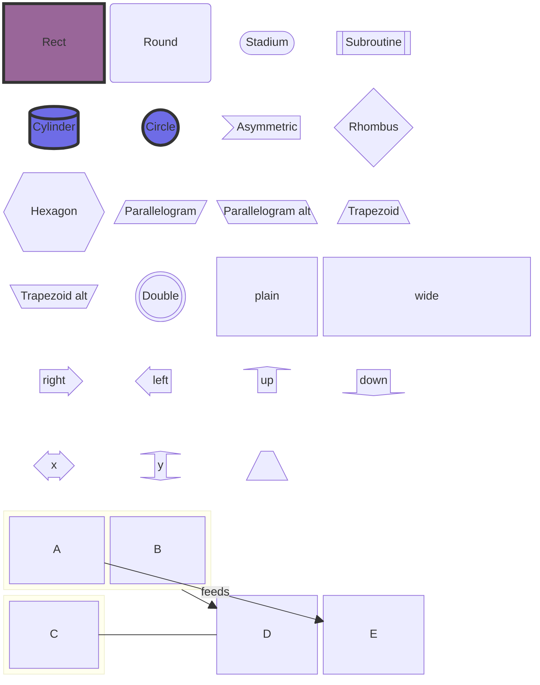
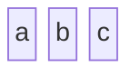

# Block diagram

## Keywords
`block` (older alias `block-beta`). Status: stable.

## When to use
Layouts where you place every box yourself on a column grid: system layers, network tiers, hardware blocks. Nearest alternative: `flowchart` when automatic layout is fine, or `architecture-beta` for icon-based cloud topology.

## Syntax
Blocks in row order, wrapped by `columns`:

```text
block
  columns 3
  a b c d
```

Width (column span) and labelled shapes:

```text
a["A label"] b:2 db[("Database")]
```

Composite block, optional id and width, own `columns`:

```text
block:group1:2
  columns 2
  h i j k
end
```

Space, block arrow, edges:

```text
space:2
arrow<["Label"]>(right)
A -- "text" --> B
```

Styling:

```text
style A fill:#969,stroke:#333,stroke-width:4px
classDef blue fill:#6e6ce6,stroke:#333
class A,B blue
```

## Features
| Feature id | Construct | Snippet |
|---|---|---|
| `block.keyword` | opener | `block` |
| `block.keyword-beta` | older alias opener | `block-beta` |
| `block.block-plain` | block from a bare id | `a b c` |
| `block.block-label` | block with a quoted label | `a["A label"]` |
| `block.columns` | number of grid columns | `columns 3` |
| `block.columns-auto` | automatic columns (default) | `columns auto` |
| `block.width` | block spanning N columns | `b:2` |
| `block.composite` | nested block without id | `block ... end` |
| `block.composite-id` | nested block with an id (edge target) | `block:ID ... end` |
| `block.composite-width` | nested block with id and width | `block:group1:2 ... end` |
| `block.composite-columns` | `columns` inside a nested block | `block:g columns 2 h i end` |
| `block.shape-rect` | rectangle (default) | `id1["Text"]` |
| `block.shape-round` | round edges | `id1("Text")` |
| `block.shape-stadium` | stadium | `id1(["Text"])` |
| `block.shape-subroutine` | subroutine | `id1[["Text"]]` |
| `block.shape-cylinder` | cylinder / database | `id1[("Database")]` |
| `block.shape-circle` | circle | `id1(("Text"))` |
| `block.shape-asymmetric` | asymmetric | `id1>"Text"]` |
| `block.shape-rhombus` | rhombus | `id1{"Text"}` |
| `block.shape-hexagon` | hexagon | `id1{{"Text"}}` |
| `block.shape-parallelogram` | parallelogram | `id1[/"Text"/]` |
| `block.shape-parallelogram-alt` | parallelogram, other slant | `id2[\"Text"\]` |
| `block.shape-trapezoid` | trapezoid | `A[/"Christmas"\]` |
| `block.shape-trapezoid-alt` | inverted trapezoid | `B[\"Go shopping"/]` |
| `block.shape-double-circle` | double circle | `id1((("Text")))` |
| `block.arrow-right` | block arrow pointing right | `ba1<["Label"]>(right)` |
| `block.arrow-left` | block arrow pointing left | `ba2<["Label"]>(left)` |
| `block.arrow-up` | block arrow pointing up | `ba3<["Label"]>(up)` |
| `block.arrow-down` | block arrow pointing down | `ba4<["Label"]>(down)` |
| `block.arrow-x` | horizontal double arrow | `ba5<["Label"]>(x)` |
| `block.arrow-y` | vertical double arrow | `ba6<["Label"]>(y)` |
| `block.arrow-combined` | combined directions | `ba7<["Label"]>(x, down)` |
| `block.space` | one-column empty space | `a space b` |
| `block.space-width` | empty space N columns wide | `space:3` |
| `block.edge-arrow` | edge with arrowhead | `A --> B` |
| `block.edge-line` | edge without arrowhead | `A --- B` |
| `block.edge-text` | edge with text | `A -- "X" --> B` |
| `block.edge-from-composite` | edge from a composite block id | `ID --> D` |
| `block.style` | inline style on one block | `style B fill:#969,stroke:#333,stroke-width:4px` |
| `block.class-def` | class definition | `classDef blue fill:#6e6ce6,stroke:#333,stroke-width:4px;` |
| `block.class` | apply a class to blocks | `class Backend,Database back` |
| `block.html-entity` | HTML entity in a label | `<["&nbsp;&nbsp;&nbsp;"]>(down)` |
| `block.comment` | line comment | `%% columns auto (default)` |

## Configuration and theming
Frontmatter `config.block` keys (12.0.0 defaults): `padding: 8`, `useMaxWidth: true`. The syntax page lists no block-specific config and no block `themeVariables`; blocks follow the theme's node colours (`primaryColor`, `primaryBorderColor`, `lineColor`, ...).

```yaml
---
config:
  block:
    padding: 16
---
```

`accTitle` / `accDescr` are not supported: `accTitle: T` is a parse error on line 1 with CLI 12.0.0.

## Traps
- `A - B` (single dash) is a lexical error; use `-->` or `---`.
- `style A fill#969;` (missing `:`) renders without error but applies no style.
- `title X` is not a title: it renders two blocks labelled `title` and `X`. There is no title statement; use frontmatter `title:`.
- `accTitle:` / `accDescr:` fail to parse.
- The `:::class` shorthand from flowchart is a lexical error; use `class id name`.
- `click` is not supported (parse error).
- An empty composite (`block:g` then `end`) is a parse error; give it at least one child.
- Blocks are placed left to right in source order and wrap at `columns`; nothing auto-arranges. Add `space` between blocks you want to connect with an edge so the arrow is visible.
- `==>`, `-.->`, `--o`, `--x`, `<-->` parse in 12.0.0 but are not on the syntax page; prefer `-->` / `---`.
- An edge to an undeclared id creates a new block for it, which shifts the grid.

```text
block
  A - B
  accTitle: T
  a:::foo
  click A "https://example.com"
```

## Complete example



Covers: every feature id except `block.keyword-beta` and `block.columns-auto` (exclusive with `block.keyword` and `columns 4`; next fence).



Covers: `block.keyword-beta`, `block.columns-auto`, `block.block-plain`.

## Builder
`candidate`: `scripts/render.py` has an IR builder for this type (target keyword(s) `block`). It has not been through the reliability bar yet; see [coverage.md](../coverage.md).
