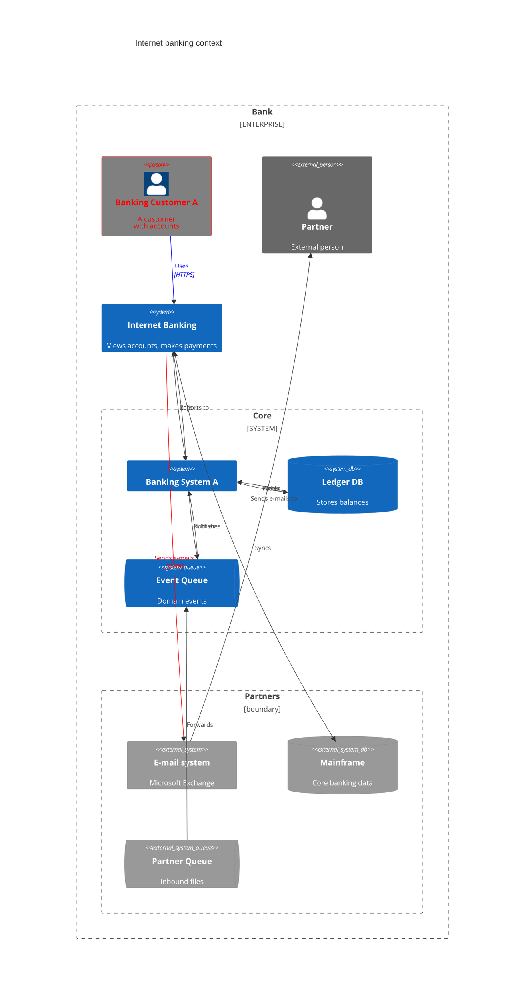
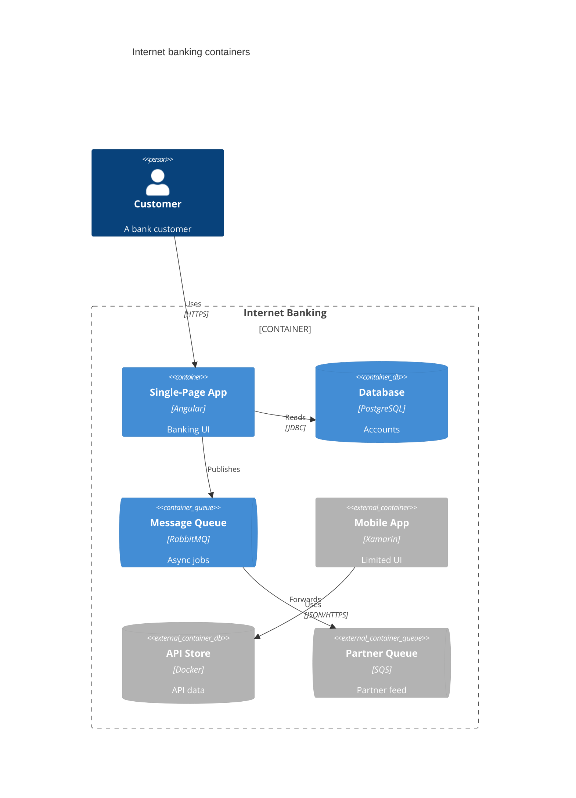
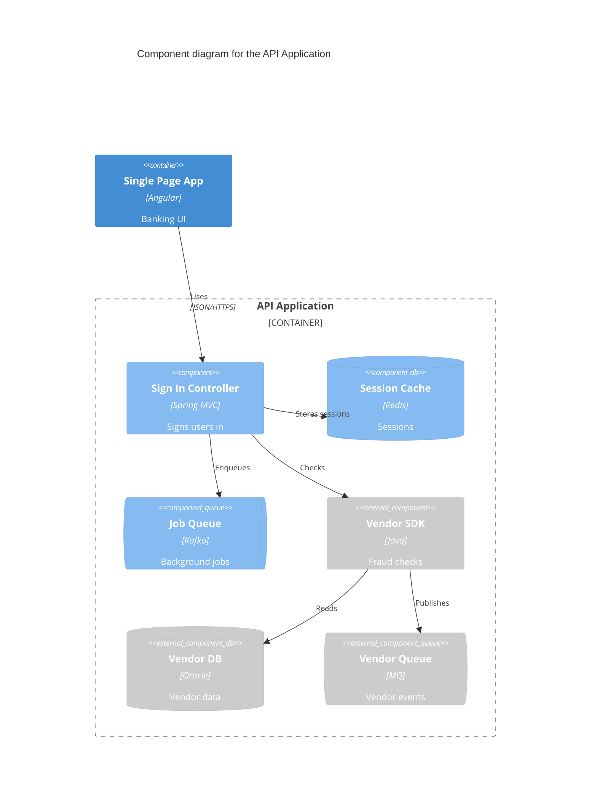
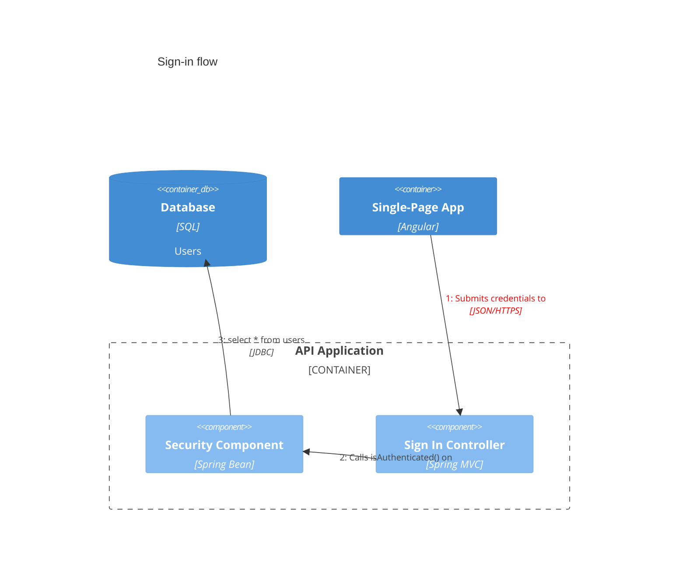
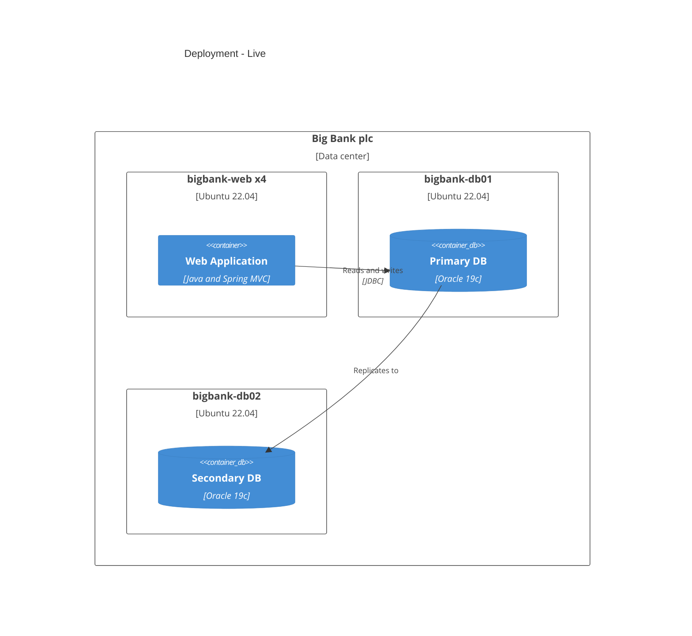

# C4 diagram

## Keywords
`C4Context`, `C4Container`, `C4Component`, `C4Dynamic`, `C4Deployment` (one opener per diagram, no aliases). Status: beta (the syntax page calls it experimental).

## When to use
Software architecture at one C4 level (context, container, component, runtime sequence, deployment) with the C4-PlantUML macro vocabulary. Nearest alternative: `architecture-beta` for cloud/service topology with icons, or `flowchart` when you need automatic layout control.

## Syntax
Opener, then optional title and accessibility lines:

```text
C4Context
title System Context
accTitle: Short title
accDescr: One-line description
```

Element macro, positional or `$named` arguments (named names start with `$`):

```text
Person(alias, "Label", "Description")
Container(alias, "Label", "Technology", "Description", $tags="v1", $link="https://example.com")
```

Boundary macro with a `{ ... }` body (must contain at least one element):

```text
System_Boundary(alias, "Label") {
  System(inner, "Inner")
}
```

Relationship macro:

```text
Rel(from, to, "Label", "Technology")
RelIndex(1, from, to, "Label")
```

Style and layout statements (write them after the elements and relationships they touch):

```text
UpdateElementStyle(alias, $bgColor="grey", $fontColor="red", $borderColor="red")
UpdateRelStyle(from, to, $textColor="blue", $lineColor="blue", $offsetX="5", $offsetY="-10")
UpdateLayoutConfig($c4ShapeInRow="3", $c4BoundaryInRow="1")
```

## Features
| Feature id | Construct | Snippet |
|---|---|---|
| `c4.keyword-c4context` | System Context opener | `C4Context` |
| `c4.keyword-c4container` | Container diagram opener | `C4Container` |
| `c4.keyword-c4component` | Component diagram opener | `C4Component` |
| `c4.keyword-c4dynamic` | Dynamic diagram opener | `C4Dynamic` |
| `c4.keyword-c4deployment` | Deployment diagram opener | `C4Deployment` |
| `c4.title` | diagram title | `title System Context` |
| `c4.acc-title` | accessible title | `accTitle: Banking context` |
| `c4.acc-descr` | accessible description, one line | `accDescr: Customers and systems` |
| `c4.acc-descr-block` | accessible description, multi-line | `accDescr { ... }` |
| `c4.comment` | line comment | `%% note` |
| `c4.person` | person | `Person(cust, "Customer", "desc")` |
| `c4.person-ext` | external person | `Person_Ext(p, "Partner")` |
| `c4.system` | software system | `System(sys, "Bank", "desc")` |
| `c4.system-db` | system database | `SystemDb(db, "Ledger")` |
| `c4.system-queue` | system queue | `SystemQueue(q, "Events")` |
| `c4.system-ext` | external system | `System_Ext(mail, "E-mail")` |
| `c4.system-db-ext` | external system database | `SystemDb_Ext(mf, "Mainframe")` |
| `c4.system-queue-ext` | external system queue | `SystemQueue_Ext(eq, "Partner queue")` |
| `c4.container` | container | `Container(spa, "SPA", "Angular", "desc")` |
| `c4.container-db` | container database | `ContainerDb(db, "DB", "SQL")` |
| `c4.container-queue` | container queue | `ContainerQueue(mq, "Queue", "RabbitMQ")` |
| `c4.container-ext` | external container | `Container_Ext(app, "Mobile", "Xamarin")` |
| `c4.container-db-ext` | external container database | `ContainerDb_Ext(api, "API DB")` |
| `c4.container-queue-ext` | external container queue | `ContainerQueue_Ext(xq, "Ext queue")` |
| `c4.component` | component | `Component(ctl, "Controller", "Spring MVC", "desc")` |
| `c4.component-db` | component database | `ComponentDb(cdb, "Cache", "Redis")` |
| `c4.component-queue` | component queue | `ComponentQueue(cq, "Jobs")` |
| `c4.component-ext` | external component | `Component_Ext(ce, "SDK")` |
| `c4.component-db-ext` | external component database | `ComponentDb_Ext(cde, "Vendor DB")` |
| `c4.component-queue-ext` | external component queue | `ComponentQueue_Ext(cqe, "Vendor queue")` |
| `c4.boundary` | generic boundary with a type label | `Boundary(b, "Zone", "boundary") { ... }` |
| `c4.enterprise-boundary` | enterprise boundary | `Enterprise_Boundary(b0, "Bank") { ... }` |
| `c4.system-boundary` | system boundary | `System_Boundary(b1, "Banking") { ... }` |
| `c4.container-boundary` | container boundary | `Container_Boundary(c1, "API") { ... }` |
| `c4.deployment-node` | deployment node | `Deployment_Node(dn, "Server", "Ubuntu") { ... }` |
| `c4.node` | short name of `Deployment_Node` | `Node(n, "Host", "Linux") { ... }` |
| `c4.node-l` | left-aligned node | `Node_L(nl, "Left") { ... }` |
| `c4.node-r` | right-aligned node | `Node_R(nr, "Right") { ... }` |
| `c4.nested-boundary` | boundaries and nodes nest | `Enterprise_Boundary(a, "A") { System_Boundary(b, "B") { ... } }` |
| `c4.rel` | relationship | `Rel(a, b, "Uses", "HTTPS")` |
| `c4.birel` | bidirectional relationship | `BiRel(a, b, "Syncs")` |
| `c4.rel-up` | relationship drawn upward | `Rel_Up(a, b, "Uses")` |
| `c4.rel-u` | short form of `Rel_Up` | `Rel_U(a, b, "Uses")` |
| `c4.rel-down` | relationship drawn downward | `Rel_Down(a, b, "Uses")` |
| `c4.rel-d` | short form of `Rel_Down` | `Rel_D(a, b, "Uses")` |
| `c4.rel-left` | relationship drawn leftward | `Rel_Left(a, b, "Uses")` |
| `c4.rel-l` | short form of `Rel_Left` | `Rel_L(a, b, "Uses")` |
| `c4.rel-right` | relationship drawn rightward | `Rel_Right(a, b, "Uses")` |
| `c4.rel-r` | short form of `Rel_Right` | `Rel_R(a, b, "Uses")` |
| `c4.rel-back` | relationship with reversed arrow | `Rel_Back(db, api, "Reads")` |
| `c4.rel-index` | indexed relationship (index ignored; order sets the number) | `RelIndex(1, a, b, "Calls")` |
| `c4.rel-technology` | technology argument on a relationship | `Rel(a, b, "Uses", "JSON/HTTPS")` |
| `c4.element-description` | description argument on an element | `System(s, "Bank", "Holds accounts")` |
| `c4.element-technology` | technology argument on container/component | `Container(c, "API", "Java")` |
| `c4.boundary-type` | third `?type` argument on `Boundary` / node | `Deployment_Node(d, "Box", "Ubuntu 22.04")` |
| `c4.positional-params` | optional args by position | `UpdateRelStyle(a, b, "red", "blue", "-40", "60")` |
| `c4.named-params` | optional args by `$name=` | `UpdateRelStyle(a, b, $offsetY="60")` |
| `c4.param-tags` | `$tags` argument (parsed, not rendered) | `Person(p, "P", "d", $tags="v1.0")` |
| `c4.param-link` | `$link` argument (parsed, not rendered) | `System(s, "S", "d", $link="https://example.com")` |
| `c4.param-sprite` | `$sprite` argument (parsed, not rendered) | `Person(p, "P", "d", $sprite="user")` |
| `c4.label-line-break` | `<br/>` inside a quoted label | `Person(p, "Line one <br/> line two")` |
| `c4.update-element-style` | restyle one element or boundary | `UpdateElementStyle(cust, $bgColor="grey")` |
| `c4.style-bg-color` | element fill | `$bgColor="grey"` |
| `c4.style-font-color` | element text colour | `$fontColor="red"` |
| `c4.style-border-color` | element border colour | `$borderColor="red"` |
| `c4.update-rel-style` | restyle one relationship | `UpdateRelStyle(a, b, $lineColor="blue")` |
| `c4.style-text-color` | relationship label colour | `$textColor="blue"` |
| `c4.style-line-color` | relationship line colour | `$lineColor="blue"` |
| `c4.style-offset-x` | relationship label x offset | `$offsetX="-50"` |
| `c4.style-offset-y` | relationship label y offset | `$offsetY="20"` |
| `c4.update-layout-config` | shapes / boundaries per row | `UpdateLayoutConfig($c4ShapeInRow="3", $c4BoundaryInRow="1")` |
| `c4.layout-shape-in-row` | shapes per row (default 4) | `$c4ShapeInRow="3"` |
| `c4.layout-boundary-in-row` | boundaries per row (default 2) | `$c4BoundaryInRow="1"` |

## Configuration and theming
Frontmatter `config.c4` keys (12.0.0 defaults):

| Key | Default | Notes |
|---|---|---|
| `wrap` | `true` | wraps element text; `false` (or top-level `wrap: false`) disables |
| `wrapPadding` | `10` | |
| `c4ShapeInRow` | `4` | same as `UpdateLayoutConfig` |
| `c4BoundaryInRow` | `2` | same as `UpdateLayoutConfig` |
| `width` / `height` | `216` / `60` | element box size |
| `c4ShapeMargin` / `c4ShapePadding` | `50` / `20` | |
| `diagramMarginX` / `diagramMarginY` | `50` / `10` | |
| `boxMargin` | `10` | |
| `nextLinePaddingX` | `0` | |
| `useMaxWidth` | `true` | |
| `<shape>FontSize` / `FontFamily` / `FontWeight` | `14` / `"Open Sans", sans-serif` / `normal` | per shape: `person`, `external_person`, `system`, `system_db`, ..., `boundary`; `messageFontSize` is `12` |
| `<shape>_bg_color` / `_border_color` | e.g. `person_bg_color: #08427B`, `system_bg_color: #1168BD`, `container_bg_color: #438DD5` | per shape colours |

```yaml
---
config:
  c4:
    wrap: false
    c4ShapeInRow: 3
---
```

Theming: C4 uses a fixed palette; `themeVariables` do not restyle it. Use `UpdateElementStyle` / `UpdateRelStyle` or the `*_bg_color` keys. `accTitle`, `accDescr` and `accDescr { }` parse. With CLI 12.0.0 `accDescr` reaches the SVG `<desc>`, but `accTitle` produces no SVG `<title>` (see Traps).

## Traps
- `direction` is not C4 syntax and fails to parse; place shapes by statement order and `UpdateLayoutConfig`.
- `Lay_U`, `Lay_D`, `Lay_L`, `Lay_R` (and long forms) are not supported: lexical error.
- `AddElementTag`, `AddRelTag`, `RoundedBoxShape()`, `DashedLine()` and the other tag/skin helpers are listed upstream as unfinished: lexical error.
- An unquoted LAST argument swallows the closing `)`. `Person(a, A)` fails; `Person(a, A, "desc")` or `Person(a, "A")` works. Quote every label.
- `UpdateLayoutConfig(2, 1)` with bare numbers fails; quote them: `UpdateLayoutConfig("2", "1")` or use `$c4ShapeInRow="2"`.
- A boundary with an empty body (`Boundary(b, "B") { }`) fails to parse; give it at least one element.
- `title` stops at `;` or `#`: `title A; B` is a lexical error.
- Escaped quotes inside a label (`"say \"hi\""`) fail; there is no escape inside C4 strings.
- `UpdateRelStyle(from, to, ...)` matches the first relationship with exactly that `from` and `to`; if none exists it is silently ignored. Same for `UpdateElementStyle` with an unknown alias.
- `accTitle:` and `title` share one slot: whichever comes last is drawn as the visible diagram title, and the 12.0.0 SVG has no `<title>` element (`accDescr` does reach `<desc>`).
- `RelIndex` ignores its index argument; numbering follows statement order.
- The parser accepts any macro under any opener (a `Component` in `C4Context` renders); the opener only names the diagram level.

```text
C4Context
direction LR
Person(a, A)
Lay_R(a, b)
UpdateLayoutConfig(2, 1)
```

## Complete example



Covers: `c4.keyword-c4context`, `c4.title`, `c4.acc-title`, `c4.acc-descr-block`, `c4.comment`, `c4.person`, `c4.person-ext`, `c4.system`, `c4.system-db`, `c4.system-queue`, `c4.system-ext`, `c4.system-db-ext`, `c4.system-queue-ext`, `c4.boundary`, `c4.enterprise-boundary`, `c4.system-boundary`, `c4.nested-boundary`, `c4.boundary-type`, `c4.rel`, `c4.birel`, `c4.rel-up`, `c4.rel-u`, `c4.rel-down`, `c4.rel-d`, `c4.rel-left`, `c4.rel-l`, `c4.rel-right`, `c4.rel-r`, `c4.rel-back`, `c4.rel-technology`, `c4.element-description`, `c4.positional-params`, `c4.named-params`, `c4.param-tags`, `c4.param-link`, `c4.param-sprite`, `c4.label-line-break`, `c4.update-element-style`, `c4.style-bg-color`, `c4.style-font-color`, `c4.style-border-color`, `c4.update-rel-style`, `c4.style-text-color`, `c4.style-line-color`, `c4.style-offset-x`, `c4.style-offset-y`, `c4.update-layout-config`, `c4.layout-shape-in-row`, `c4.layout-boundary-in-row`. The parser would accept every macro here, but each level's macros are shown under their own opener below.



Covers: `c4.keyword-c4container`, `c4.acc-descr`, `c4.container`, `c4.container-db`, `c4.container-queue`, `c4.container-ext`, `c4.container-db-ext`, `c4.container-queue-ext`, `c4.container-boundary`, `c4.element-technology`.



Covers: `c4.keyword-c4component`, `c4.component`, `c4.component-db`, `c4.component-queue`, `c4.component-ext`, `c4.component-db-ext`, `c4.component-queue-ext`.



Covers: `c4.keyword-c4dynamic`, `c4.rel-index`.



Covers: `c4.keyword-c4deployment`, `c4.deployment-node`, `c4.node`, `c4.node-l`, `c4.node-r`.

## Builder
`builder`: family `graph`, keywords `C4Context`, `C4Container`, `C4Component`, `C4Dynamic`, `C4Deployment`.

| Key | Type | Meaning |
|---|---|---|
| `nodes[]` | object, required | `{id, label, kind, description?, technology?, group?, tags?, link?, sprite?}` |
| `nodes[].kind` | enum | `person`, `person_ext`, `system`, `system_db`, `system_queue`, `system_ext`, `system_db_ext`, `system_queue_ext` (all levels); `container*` (Container, Component, Dynamic, Deployment); `component*` (Component, Dynamic) |
| `nodes[].technology` | text | containers and components only; without it a description is written as `$descr=` |
| `nodes[].tags`, `.link`, `.sprite` | text | `$tags=`, `$link=`, `$sprite=` (parsed, not drawn) |
| `groups[]` | object | `{id, label, kind, boundary_type?, technology?, description?, group?}`; kinds `enterprise_boundary`, `system_boundary`, `boundary` (Context), `container_boundary`, `boundary` (Container, Component, Dynamic; Container also `system_boundary`), `deployment_node`, `node`, `node_left`, `node_right` (Deployment) |
| `groups[].group` | group id | parent boundary; it must come earlier in the array; every boundary needs a child |
| `edges[]` | object | `{from, to, label, kind?, technology?, index?}`; `kind` `rel` (default), `birel`, `rel_up`, `rel_u`, `rel_down`, `rel_d`, `rel_left`, `rel_l`, `rel_right`, `rel_r`, `rel_back`, `rel_index` (C4Dynamic only, needs `index`) |
| `element_styles[]` | object | `{element, bg_color?, font_color?, border_color?, form?}` |
| `rel_styles[]` | object | `{from, to, text_color?, line_color?, offset_x?, offset_y?, form?}`; an edge `from` -> `to` must exist |
| `form` | enum | `named` (default, `$bgColor="..."`) or `positional` (needs every earlier parameter) |
| `layout` | object | `{shape_in_row?, boundary_in_row?}` -> `UpdateLayoutConfig` |
| `title` | text | `title` statement; C4 draws `accTitle` in the same slot, so `title` and `accessibility.title` cannot both be set |
| `config` | object | typed `config.c4`: `wrap`, `wrapPadding`, `c4ShapeInRow`, `c4BoundaryInRow`, `width`, `height`, margins, `useMaxWidth` |
| `accessibility`, `comment` | | `accTitle` / `accDescr`, `%%` line |

Nodes are written before nested boundaries at each level, each in input order. Shape text (`nodes[].label`, `.description`, `.technology`) may contain newlines (written as `<br/>`) but rejects `"`, `<`, `>`, entity codes and repeated spaces, which C4 shapes drop or decode. Boundary and relationship text encodes `"`, `#`, `<`, `>`. Colours are #hex or lowercase names. Examples: one fixture per keyword, such as [maximal.C4Context.json](../../tests/fixtures/c4/maximal.C4Context.json).
