# Class diagram

## Keywords

`classDiagram`. Status: stable.

## When to use

UML static structure: classes, members, and relationships between types. For data tables and
keys, use `erDiagram`; for behavior over time, use `stateDiagram-v2` or `sequenceDiagram`.

## Syntax

Classes and labels:

```text
class Animal
class Car["Car with *! symbols"]
class `Animal Class!`
```

Members, by colon or by block:

```text
Animal : +int age
class Duck{
  +String beakColor
  +swim() bool
}
```

Relationships: `[classA] "card1" [Arrow] "card2" [ClassB] : Label`:

```text
Customer "1" --> "*" Ticket : buys
```

Namespaces, annotations, notes, direction:

```text
namespace Auth["Authentication"] {
  class UserService
}
<<interface>> Shape
note for Duck "can fly"
direction RL
```

Interaction and styling:

```text
click Shape href "https://example.com" "tooltip"
style Animal fill:#f9f
cssClass "Animal,Mineral" className
```

## Features

| Feature id | Construct | Snippet |
|---|---|---|
| `classDiagram.keyword` | opening keyword | `classDiagram` |
| `classDiagram.class-keyword` | explicit class | `class Animal` |
| `classDiagram.class-via-relation` | classes defined by a relation | `Vehicle <\|-- Car` |
| `classDiagram.class-label` | display label | `class Animal["Animal with a label"]` |
| `classDiagram.class-backtick-name` | backtick-escaped name | ``class `Animal Class!` `` |
| `classDiagram.member-colon` | member by colon | `BankAccount : +String owner` |
| `classDiagram.member-block` | members in a block | `class BankAccount{ ... }` |
| `classDiagram.method` | method (has `()`) | `+deposit(amount)` |
| `classDiagram.method-return-type` | return type after `)` | `+deposit(amount) bool` |
| `classDiagram.generic-class` | generic class | `class Square~Shape~` |
| `classDiagram.generic-member` | generic member and return type | `List~int~ position` |
| `classDiagram.generic-nested` | nested generic | `getDistanceMatrix() List~List~int~~` |
| `classDiagram.visibility-public` | public | `+field` |
| `classDiagram.visibility-private` | private | `-field` |
| `classDiagram.visibility-protected` | protected | `#field` |
| `classDiagram.visibility-package` | package/internal | `~field` |
| `classDiagram.classifier-abstract` | abstract method | `someAbstractMethod()*` |
| `classDiagram.classifier-static-method` | static method | `someStaticMethod()$` |
| `classDiagram.classifier-static-field` | static field | `String someField$` |
| `classDiagram.rel-inheritance` | inheritance | `classA <\|-- classB` |
| `classDiagram.rel-composition` | composition | `classC *-- classD` |
| `classDiagram.rel-aggregation` | aggregation | `classE o-- classF` |
| `classDiagram.rel-association` | association | `classG --> classH` |
| `classDiagram.rel-link-solid` | solid link | `classI -- classJ` |
| `classDiagram.rel-dependency` | dependency | `classK ..> classL` |
| `classDiagram.rel-realization` | realization | `classM ..\|> classN` |
| `classDiagram.rel-link-dashed` | dashed link | `classO .. classP` |
| `classDiagram.rel-reversed` | arrowhead on the other side | `classA --\|> classB` |
| `classDiagram.rel-label` | relation label | `classA <\|-- classB : implements` |
| `classDiagram.two-way-inheritance` | two-way, `<\|` / `\|>` ends | `Animal <\|--\|> Zebra` |
| `classDiagram.two-way-composition` | two-way with `*` | `A *--* B` |
| `classDiagram.two-way-aggregation` | two-way with `o` | `A o--o B` |
| `classDiagram.two-way-association` | two-way with `<` and `>` | `A <--> B` |
| `classDiagram.two-way-realization` | two-way realization, dashed | `A <\|..\|> B` |
| `classDiagram.two-way-dashed` | dashed link in a two-way relation | `A <..> B` |
| `classDiagram.lollipop-left` | lollipop interface, left | `bar ()-- foo` |
| `classDiagram.lollipop-right` | lollipop interface, right | `foo --() bar` |
| `classDiagram.namespace` | namespace | `namespace BaseShapes { class Triangle }` |
| `classDiagram.namespace-label` | namespace display label | `namespace Auth["Authentication Service"] { ... }` |
| `classDiagram.namespace-dot-notation` | nested by dots | `namespace Company.Engineering.Backend { ... }` |
| `classDiagram.namespace-nested` | nested blocks | `namespace Platform { namespace Auth { ... } }` |
| `classDiagram.cardinality-1` | only 1 | `A "1" --> B` |
| `classDiagram.cardinality-0-1` | zero or one | `A "0..1" --> B` |
| `classDiagram.cardinality-1-many` | one or more | `A --> "1..*" B` |
| `classDiagram.cardinality-many` | many | `A --> "*" B` |
| `classDiagram.cardinality-n` | n | `A --> "n" B` |
| `classDiagram.cardinality-0-n` | zero to n | `A --> "0..n" B` |
| `classDiagram.cardinality-1-n` | one to n | `A --> "1..n" B` |
| `classDiagram.annotation-inline` | annotation on the class line | `class Shape <<interface>>` |
| `classDiagram.annotation-separate` | annotation on its own line | `<<interface>> Shape` |
| `classDiagram.annotation-nested` | annotation inside the block | `class Color{ <<enumeration>> ... }` |
| `classDiagram.comment` | line comment | `%% comment` |
| `classDiagram.direction` | diagram direction | `direction RL` |
| `classDiagram.click-href` | click to URL | `click Shape2 href "https://example.com" "tooltip"` |
| `classDiagram.click-call` | click to callback | `click Shape2 call callbackFunction() "tooltip"` |
| `classDiagram.link` | `link` action | `link Shape "https://example.com" "tooltip"` |
| `classDiagram.callback` | `callback` action | `callback Shape "callbackFunction" "tooltip"` |
| `classDiagram.note` | general note | `note "This is a general note"` |
| `classDiagram.note-for` | note for a class | `note for MyClass "line1<br>line2"` |
| `classDiagram.style` | inline node style | `style Animal fill:#f9f,stroke:#333` |
| `classDiagram.classdef` | class definition | `classDef someclass fill:#f96` |
| `classDiagram.classdef-multi` | several classes at once | `classDef a,b font-size:12pt` |
| `classDiagram.classdef-default` | default class for all nodes | `classDef default fill:#f96` |
| `classDiagram.cssclass` | attach a class | `cssClass "nodeId1" className` |
| `classDiagram.cssclass-list` | attach to several nodes | `cssClass "nodeId1,nodeId2" className` |
| `classDiagram.class-shorthand` | `:::` on a class statement | `class Animal:::someclass` |
| `classDiagram.class-shorthand-block` | `:::` with a member block | `class Animal:::someclass { ... }` |

## Configuration and theming

Frontmatter `config.class` keys. The syntax page documents `hideEmptyMembersBox` and
`hierarchicalNamespaces`; the rest are 12.0.0 schema defaults.

| Key | Default |
|---|---|
| `hideEmptyMembersBox` | `false` |
| `hierarchicalNamespaces` | `true` (`false` draws only declared namespaces, flat, fully qualified) |
| `theme` / `look` | `redux-color` / `neo` (v12 per-diagram defaults) |
| `htmlLabels` | `false` |
| `titleTopMargin` | `25` |
| `dividerMargin` / `padding` / `textHeight` | `10` / `5` / `10` |
| `arrowMarkerAbsolute` | `false` |
| `useMaxWidth` | `true` |

- Top-level `layout` defaults to ELK for class diagrams in v12; `theme: default`, `look: classic`,
  and `layout: dagre` restore the earlier appearance. `defaultRenderer` was removed in v12.
- The page documents no class-specific `themeVariables`. Notes and namespaces take theme styling
  only; `style` does not apply to them.
- `accTitle:` and `accDescr:` render with CLI 12.0.0. A frontmatter `title:` renders.
- `click`, `link`, and `callback` need `securityLevel: 'loose'`.

## Traps

A class name with a dash declares fine, but in a relation the `--` lexes as a link and fails.
Use backticks or an underscore.

```text
classDiagram
  my-class --> B
```

The `:::` shorthand cannot be combined with a relation statement. Declare the class first.

```text
classDiagram
  A:::foo --> B
  classDef foo fill:#f00
```

`classDef default` plus a backtick name with CSS-hostile characters such as `!` crashes the
renderer (`Failed to execute 'insertRule'`). Without `classDef default` the same name renders.

```text
classDiagram
  class `Animal Class!`
  classDef default fill:#eef
```

- `class My Class` does not error; it silently creates one class named `MyClass`. Use a label or backticks.
- Generics use `~`, not `<>`. The page says generics with a comma are unsupported; `class Map~K, V~`
  renders as `Map<K, V>` with CLI 12.0.0, but do not rely on it in members.
- A generic is not part of the class name: refer to `Square~Shape~` as `Square`.
- Return types need a space after `)`: `getPoints() List~int~`.
- Relation arrows are direction-sensitive: `A <|-- B` means B inherits from A.
- A lollipop interface is unique per edge; do not share one interface node across classes.

## Complete example

```mermaid
---
title: Class feature tour
---
classDiagram
  accTitle: Class feature tour
  accDescr: Every coexisting classDiagram construct.
  direction RL
  %% classes, labels, members
  class Animal["Animal with a label"]
  class `Animal Class`
  `my-class` --> Animal
  Vehicle <|-- Car
  class BankAccount
  BankAccount : +String owner
  BankAccount : -BigDecimal balance
  BankAccount : #deposit(amount) bool
  BankAccount : ~withdrawal(amount) int
  class Square~Shape~{
    int id
    List~int~ position
    +setPoints(List~int~ points)
    +getPoints() List~int~
    +someAbstractMethod()*
    +someStaticMethod()$
    String someField$
  }
  Square : +getDistanceMatrix() List~List~int~~
  %% relationships
  classA <|-- classB : implements
  classC *-- classD
  classE o-- classF
  classG --> classH
  classI -- classJ
  classK ..> classL
  classM ..|> classN
  classO .. classP
  classQ --|> classR
  Zebra <|--|> Horse
  T1 *--* T2
  T3 o--o T4
  T5 <--> T6
  T7 <|..|> T8
  T9 <..> T10
  bar ()-- foo
  Class01 --() baz
  %% cardinality
  Customer "1" --> "*" Ticket
  Student "0..1" --> "1..*" Course
  Galaxy "n" --> "0..n" Star : Contains
  Planet --> "1..n" Moon
  %% namespaces
  namespace BaseShapes {
    class Triangle
  }
  namespace Auth["Authentication Service"] {
    class UserService
  }
  namespace Company.Engineering.Backend {
    class Developer
  }
  namespace Platform {
    namespace Data {
      class Repository
    }
    class Gateway
  }
  Gateway --> Repository : delegates
  %% annotations
  class Shape <<interface>>
  class Base
  <<abstract>> Base
  class Color{
    <<enumeration>>
    RED
    BLUE
  }
  %% notes and interaction
  note "This is a general note"
  note for Square "line1<br>line2"
  link Shape "https://www.github.com" "This is a tooltip for a link"
  click Base href "https://www.github.com" "This is a tooltip for a link"
  callback Color "callbackFunction" "Callback tooltip"
  click Triangle call callbackFunction() "Callback tooltip"
  %% styling
  class Mineral:::someclass
  class Rock:::someclass {
    -int sizeInFeet
  }
  style Vehicle fill:#f9f,stroke:#333,stroke-width:4px
  classDef default fill:#eef
  classDef someclass fill:#f96
  classDef pink,blue color:#f9f
  cssClass "Car" pink
  cssClass "classA,classB" blue
```



Covers: every feature id.

## Builder

`builder`: family `graph`, keyword `classDiagram`. Example:
[maximal.json](../../tests/fixtures/classDiagram/maximal.json).

| Key | Type | Meaning |
|---|---|---|
| `title` | string | frontmatter `title:` |
| `config` | object | `theme`, `look`, `layout`, and `class.*` (the keys in the table above) |
| `accessibility` | `{title, description}` | `accTitle:` / `accDescr:` (a newline in `description` uses the block form) |
| `comment` | string | one `%%` line |
| `direction` | `TB` \| `BT` \| `LR` \| `RL` | `direction` |
| `nodes[]` | object | one class each (required, at least one) |
| `nodes[].id` | identifier | class name; with `backtick: true` words joined by single spaces, dots or dashes, emitted as `` `A B` `` |
| `nodes[].implicit` | boolean | no `class` line; the class comes from its relations (needs an edge; only `members` in colon form, a `separate` annotation and `style`) |
| `nodes[].label` | string | `class A["label"]` |
| `nodes[].generic` | string[] | `class A~K, V~` |
| `nodes[].annotation` | `{name, placement}` | `interface` \| `abstract` \| `service` \| `enumeration`; placement `block` (default), `inline`, `separate` |
| `nodes[].member_syntax` | `block` \| `colon` | members in `{ }` (default) or as `A : member` lines |
| `nodes[].members[]` | object | `kind` `attribute` (`visibility`, `type`, `name`, `classifier`) or `method` (`visibility`, `name`, `parameters[] {name, type}`, `return_type`, `classifier`) |
| `visibility` / `classifier` | enum | `public` `private` `protected` `package` / `static` `abstract` |
| type | string or `{name, args[]}` | `{"name": "List", "args": ["int"]}` is `List~int~`; nests |
| `nodes[].class` | classDef name | `class A:::name` |
| `nodes[].style` | style object | `style A ...` |
| `namespaces[]` | `{id, label, classes[], namespaces[]}` | `namespace` blocks; `id` may be dotted (`A.B`) |
| `edges[]` | `{from, to, kind, ends, from_card, to_card, label}` | relations |
| `edges[].kind` | enum | `inheritance` `composition` `aggregation` `association` `dependency` `realization` `link` `link_dashed` `lollipop` |
| `edges[].ends` | `from` \| `to` \| `both` | arrowhead side; default `from` for inheritance, composition, aggregation, lollipop and `to` for association, dependency, realization; not allowed on links |
| `edges[].from_card` / `to_card` | enum | `1` `0..1` `1..*` `*` `n` `0..n` `1..n` |
| `notes[]` | `{text, for}` | `note "..."` or `note for A "..."`; a newline becomes `<br>` |
| `interactions[]` | `{node, action, url, function, tooltip}` | action `href` / `link` (need `url`) or `call` / `callback` (need `function`); one per class |
| `class_defs[]` | `{names[], style}` | `classDef a,b ...`; `default` styles every class |
| `css_classes[]` | `{nodes[], class}` | `cssClass "A,B" name` |
| style object | object | `fill`, `stroke`, `color`, `strokeWidth`, `strokeDasharray`, `fontSize`, `fontWeight`, `fontStyle` |

Rejection rules:

- Labels, members, generics, edge labels, and notes encode `` " # ; < > & | ` { } [ ] ( ) : , % \ ~ ``
  as entity codes, which render back as the same characters. Member text also encodes `$ * + -`.
  The title is written as-is.
- Tooltips encode the same characters except `~`, and reject `<` and `>`. URLs must be `http(s)://` or `mailto:`, without spaces, quotes,
  `;`, `<`, `>`, brackets or braces. Colors are `#hex`, a name, or `rgb()`/`hsl()` without commas.
- Names reject these words, alone or as one word of a backtick or dotted name: `class`,
  `namespace`, `note`, `style`, `click`, `link`, `callback`, `call`, `href`, `classDef`, `cssClass`, `classDiagram`, `o`, `_blank`, `_self`, `_parent` and `_top`.
- These combinations are rejected because they do not parse: an `inline` annotation together with
  `class`, `style` on a backtick name, an empty namespace, and a generic with several arguments
  nested inside another generic.
