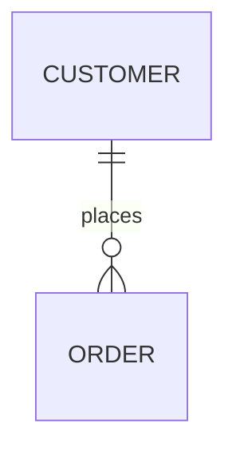
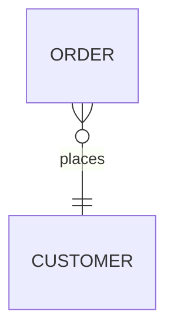
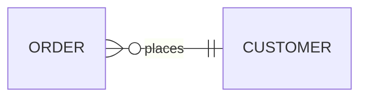

# Entity relationship diagram

## Keywords

`erDiagram`. Status: stable.

## When to use

Entities, their attributes and keys, and crow's-foot cardinality between them. For object
models with methods and inheritance, use `classDiagram`.

## Syntax

Statement: `<first-entity> [<relationship> <second-entity> : <relationship-label>]`. Only the
first entity is required; if any other part is given, all parts are required.

```text
CUSTOMER
CUSTOMER ||--o{ ORDER : places
PERSON many(0) optionally to 0+ NAMED-DRIVER : is
```

Attributes: `type name [keys] ["comment"]` inside a block:

```text
PERSON {
  string driversLicense PK "The license #"
  string? middleName
}
```

Aliases, direction, subgraphs:

```text
p[Person]
direction LR
subgraph id1 [title 1]
  CUSTOMER
end
```

Styling:

```text
style id1 fill:#f9f
classDef someclass fill:#f96
class id1,id2 someclass
CAR:::someclass
```

## Features

| Feature id | Construct | Snippet |
|---|---|---|
| `entityRelationshipDiagram.keyword` | opening keyword | `erDiagram` |
| `entityRelationshipDiagram.entity-only` | entity with no relationship | `CUSTOMER` |
| `entityRelationshipDiagram.relationship` | relationship with label | `CUSTOMER \|\|--o{ ORDER : places` |
| `entityRelationshipDiagram.label-quoted` | quoted multi-word label | `PRODUCT \|\|--o{ LINE_ITEM : "appears in"` |
| `entityRelationshipDiagram.entity-quoted-name` | name with spaces | `"name with space"` |
| `entityRelationshipDiagram.entity-unicode` | unicode name | `"This ❤ Unicode"` |
| `entityRelationshipDiagram.entity-markdown` | markdown name | `"This **is** _Markdown_"` |
| `entityRelationshipDiagram.cardinality-zero-or-one-left` | zero or one, left | `A \|o--\|\| B : r` |
| `entityRelationshipDiagram.cardinality-zero-or-one-right` | zero or one, right | `A \|\|--o\| B : r` |
| `entityRelationshipDiagram.cardinality-exactly-one-left` | exactly one, left | `A \|\|--o{ B : r` |
| `entityRelationshipDiagram.cardinality-exactly-one-right` | exactly one, right | `A }o--\|\| B : r` |
| `entityRelationshipDiagram.cardinality-zero-or-more-left` | zero or more, left | `A }o--\|\| B : r` |
| `entityRelationshipDiagram.cardinality-zero-or-more-right` | zero or more, right | `A \|\|--o{ B : r` |
| `entityRelationshipDiagram.cardinality-one-or-more-left` | one or more, left | `A }\|--\|\| B : r` |
| `entityRelationshipDiagram.cardinality-one-or-more-right` | one or more, right | `A \|\|--\|{ B : r` |
| `entityRelationshipDiagram.cardinality-reversed-marker` | right-side marker on the left | `PERSON o{--\|\| HOUSE : has` |
| `entityRelationshipDiagram.alias-one-or-zero` | word alias, zero or one | `A one or zero to 1 B : r` |
| `entityRelationshipDiagram.alias-zero-or-one` | word alias, zero or one | `A zero or one to 1 B : r` |
| `entityRelationshipDiagram.alias-one-or-more` | word alias, one or more | `A one or more to 1 B : r` |
| `entityRelationshipDiagram.alias-one-or-many` | word alias, one or more | `A one or many to 1 B : r` |
| `entityRelationshipDiagram.alias-many-1` | word alias, one or more | `A many(1) to 1 B : r` |
| `entityRelationshipDiagram.alias-1-plus` | word alias, one or more | `A 1+ to 1 B : r` |
| `entityRelationshipDiagram.alias-zero-or-more` | word alias, zero or more | `A zero or more to 1 B : r` |
| `entityRelationshipDiagram.alias-zero-or-many` | word alias, zero or more | `A zero or many to 1 B : r` |
| `entityRelationshipDiagram.alias-many-0` | word alias, zero or more | `A many(0) to 1 B : r` |
| `entityRelationshipDiagram.alias-0-plus` | word alias, zero or more | `A 0+ to 1 B : r` |
| `entityRelationshipDiagram.alias-only-one` | word alias, exactly one | `A only one to 1 B : r` |
| `entityRelationshipDiagram.alias-1` | word alias, exactly one | `A 1 to only one B : r` |
| `entityRelationshipDiagram.identifying` | identifying (solid) | `CAR \|\|--o{ NAMED-DRIVER : allows` |
| `entityRelationshipDiagram.non-identifying` | non-identifying (dashed) | `PERSON }o..o{ NAMED-DRIVER : is` |
| `entityRelationshipDiagram.identifying-alias-to` | `to` alias | `CAR 1 to zero or more NAMED-DRIVER : allows` |
| `entityRelationshipDiagram.non-identifying-alias-optionally-to` | `optionally to` alias | `PERSON many(0) optionally to 0+ NAMED-DRIVER : is` |
| `entityRelationshipDiagram.attributes` | attribute block | `CAR { string make }` |
| `entityRelationshipDiagram.attribute-type-params` | type with parens | `string(99) firstName` |
| `entityRelationshipDiagram.attribute-type-array` | type with brackets | `string[] parts` |
| `entityRelationshipDiagram.attribute-optional-type` | optional/nullable type | `string? middleName` |
| `entityRelationshipDiagram.attribute-name-asterisk` | `*` marks a primary key name | `int *id` |
| `entityRelationshipDiagram.key-pk` | primary key | `string registrationNumber PK` |
| `entityRelationshipDiagram.key-fk` | foreign key | `string carId FK` |
| `entityRelationshipDiagram.key-uk` | unique key | `string phone UK` |
| `entityRelationshipDiagram.key-multiple` | several keys | `string driverLicence PK, FK` |
| `entityRelationshipDiagram.attribute-comment` | attribute comment | `string firstName "Only 99 characters"` |
| `entityRelationshipDiagram.entity-alias` | display alias | `p[Person]` |
| `entityRelationshipDiagram.entity-alias-quoted` | quoted display alias | `a["Customer Account"]` |
| `entityRelationshipDiagram.direction-tb` | top to bottom | `direction TB` |
| `entityRelationshipDiagram.direction-bt` | bottom to top | `direction BT` |
| `entityRelationshipDiagram.direction-lr` | left to right | `direction LR` |
| `entityRelationshipDiagram.direction-rl` | right to left | `direction RL` |
| `entityRelationshipDiagram.subgraph` | subgraph, id is the title | `subgraph title1 ... end` |
| `entityRelationshipDiagram.subgraph-quoted` | multi-word id and title | `subgraph "Customer Domain"` |
| `entityRelationshipDiagram.subgraph-explicit-id` | id plus title | `subgraph id1 [title 1]` |
| `entityRelationshipDiagram.subgraph-nested` | nested subgraphs | `subgraph a ... subgraph b ... end ... end` |
| `entityRelationshipDiagram.subgraph-relationship` | relationship to a subgraph | `title1 \|\|--\|\| title2 : links` |
| `entityRelationshipDiagram.subgraph-quoted-reference` | quoted subgraph id in a relation | `"Customer Domain" \|\|--o{ ORDER : contains` |
| `entityRelationshipDiagram.subgraph-direction` | direction inside a subgraph | `direction TB` |
| `entityRelationshipDiagram.style` | inline node style | `style id1 fill:#f9f,stroke:#333` |
| `entityRelationshipDiagram.style-list` | style several nodes | `style id1,id2 stroke:#333` |
| `entityRelationshipDiagram.classdef` | class definition | `classDef someclass fill:#f96` |
| `entityRelationshipDiagram.classdef-multi` | several classes at once | `classDef a,b font-size:12pt` |
| `entityRelationshipDiagram.classdef-default` | default class | `classDef default fill:#f9f` |
| `entityRelationshipDiagram.class-apply` | attach class | `class nodeId1 className` |
| `entityRelationshipDiagram.class-apply-list` | attach to several nodes | `class nodeId1,nodeId2 className` |
| `entityRelationshipDiagram.class-apply-multi` | several classes at once | `class n1,n2 c1,c2` |
| `entityRelationshipDiagram.class-shorthand` | `:::` on an entity | `CAR:::someclass { ... }` |
| `entityRelationshipDiagram.class-shorthand-relationship` | `:::` in a relationship | `PERSON:::foo \|\|--\|\| CAR : owns` |
| `entityRelationshipDiagram.class-shorthand-multi` | `:::` with several classes | `HOUSE:::foo,bar` |

## Configuration and theming

Frontmatter `config.er` keys. The syntax page documents only top-level `layout` (ELK by default,
`dagre` for the classic engine); these are the 12.0.0 schema defaults.

| Key | Default |
|---|---|
| `theme` / `look` | `redux-color` / `neo` (v12 per-diagram defaults) |
| `layoutDirection` | `TB` |
| `diagramPadding` | `20` |
| `minEntityWidth` / `minEntityHeight` | `100` / `75` |
| `entityPadding` | `15` |
| `nodeSpacing` / `rankSpacing` | `140` / `80` |
| `stroke` / `fill` | `gray` / `honeydew` |
| `fontSize` | `12` |
| `titleTopMargin` | `25` |
| `useMaxWidth` | `true` |

- `theme: default`, `look: classic`, and `layout: dagre` restore the pre-v12 appearance.
- The page documents no ER-specific `themeVariables`.
- `accTitle:` and `accDescr:` render with CLI 12.0.0. A frontmatter `title:` renders.

## Traps

Unquoted cardinality words in a label, entity name, or subgraph title fail: `one`, `many`, `to`,
`1`, and phrases such as `has one` or `goes to`. Quote them: `: "has one"`, `["Box one"]`.

```text
erDiagram
  A ||--|| B : has one
  subgraph box1 [Box one]
    C
  end
```

A relationship needs a `: label`.

```text
erDiagram
  A ||--|| B
```

An attribute type must start with a letter, and a comment cannot contain `"`.

```text
erDiagram
  A {
    2int x "has "quote""
  }
```

A trailing `%%` after a statement fails; keep comments on their own line.

```text
erDiagram
  A ||--|| B : x %% c
```

- Keys (`PK`, `FK`, `UK`) do not support markdown or unicode.
- Subgraphs are referenced by id, never by title; a spaced id must be quoted in a relation.
- An alias (`p[Person]`) changes only the display; relations use the entity name `p`.

## Complete example

```mermaid
---
title: ER feature tour
---
erDiagram
  accTitle: ER feature tour
  accDescr: Every coexisting erDiagram construct.
  direction LR
  %% entities and labels
  LONELY
  "name with space"
  "This ❤ Unicode"
  "This **is** _Markdown_"
  CUSTOMER ||--o{ ORDER : places
  PRODUCT ||--o{ LINE_ITEM : "appears in"
  %% symbol cardinalities
  A1 |o--|| B1 : r
  A2 ||--o| B2 : r
  A3 }o--|| B3 : r
  A4 }|--|{ B4 : r
  A5 o{--|| B5 : r
  CAR ||--o{ NAMED-DRIVER : allows
  PERSON }o..o{ NAMED-DRIVER : is
  %% word aliases
  W1 one or zero to 1 X1 : r
  W2 zero or one to 1 X2 : r
  W3 one or more to 1 X3 : r
  W4 one or many to 1 X4 : r
  W5 many(1) to 1 X5 : r
  W6 1+ to 1 X6 : r
  W7 zero or more to 1 X7 : r
  W8 zero or many to 1 X8 : r
  W9 many(0) to 1 X9 : r
  W10 0+ to 1 X10 : r
  W11 only one to 1 X11 : r
  MANUFACTURER 1 to zero or more CAR : makes
  DRIVER many(0) optionally to 0+ CAR : drives
  %% attributes and keys
  CAR:::someclass {
    string registrationNumber PK
    string make
    string[] parts
  }
  PERSON {
    string driversLicense PK "The license #"
    string(99) firstName "Only 99 characters are allowed"
    string? middleName
    string phone UK
    int *id
  }
  NAMED-DRIVER {
    string carRegistrationNumber PK, FK
    string driverLicence FK
  }
  p[Person] {
    string firstName
  }
  a["Customer Account"] {
    string email
  }
  p ||--o| a : has
  %% subgraphs
  subgraph title1
    CUSTOMER
  end
  subgraph "Customer Domain"
    ORDER
  end
  subgraph id1 [title 1]
    direction TB
    S1 ||--|| S2 : links
    subgraph inner
      S3
    end
  end
  title1 ||--|| id1 : links
  "Customer Domain" ||--o{ LINE_ITEM : contains
  %% styling
  id2 ||--|| id3 : label
  style id2 fill:#f9f,stroke:#333,stroke-width:4px
  style id2,id3 stroke-dasharray: 5 5
  HOUSE:::foo,bar
  PERSON:::foo ||--|| HOUSE : owns
  class A1 foo
  class A2,B2 bar
  class A3,B3 foo,bar
  classDef default fill:#f9f
  classDef someclass fill:#f96
  classDef foo,bar stroke:#f00
```

Covers: every feature id except `entityRelationshipDiagram.direction-tb`, `entityRelationshipDiagram.direction-bt`,
`entityRelationshipDiagram.direction-rl` (one top-level direction per diagram; see below).



Covers: `entityRelationshipDiagram.direction-tb`.



Covers: `entityRelationshipDiagram.direction-bt`.



Covers: `entityRelationshipDiagram.direction-rl`.

## Builder

`candidate`: `scripts/render.py` has an IR builder for this type (target keyword(s) `erDiagram`). It has not been through the reliability bar yet; see [coverage.md](../coverage.md).
