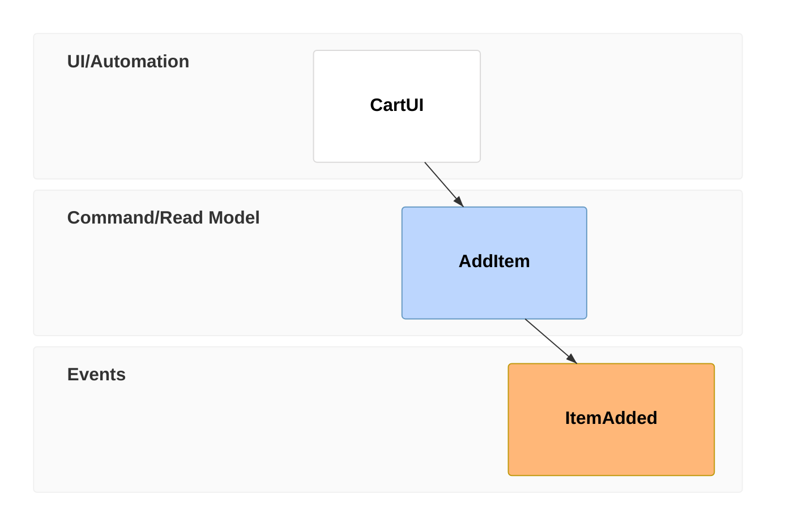
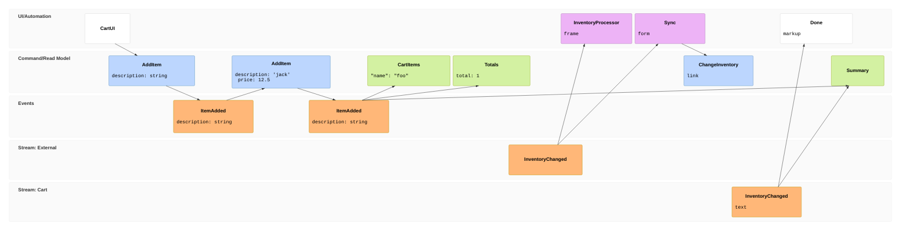

# Event modeling diagram

## Keywords

`eventmodeling` (no alias). Status: stable. The keyword has no `-beta` suffix and the
12.0.0 page has no beta warning, but the type is recent (v11.15.0+).

## When to use

Event Modeling timelines: UI and processors trigger commands, commands produce events, and
read models are built from events, laid out in inferred swimlanes. Nearest alternative:
`sequenceDiagram` (messages between participants, no lanes by entity type).

## Syntax

```text
eventmodeling
tf <n> <type> <[Namespace.]Entity> [{ inline data } | `type`{ … } | [[DataBlockId]]] [->> <n> ->> <n>]
timeframe <n> <type> <Entity> …
rf <n> <type> <Entity>
resetframe <n> <type> <Entity>
data <Id> [`type`]{
  key: value
}
```

Types: `ui`, `pcr`/`processor`, `cmd`/`command`, `rmo`/`readmodel`, `evt`/`event`.



## Features

| Feature id | Construct | Snippet |
|---|---|---|
| `eventmodeling.keyword` | diagram keyword | `eventmodeling` |
| `eventmodeling.timeframe-compact` | time frame, compact | `tf 01 ui CartUI` |
| `eventmodeling.timeframe-relaxed` | time frame, relaxed | `timeframe 01 ui CartUI` |
| `eventmodeling.resetframe-compact` | reset frame (breaks inference), compact | `rf 04 evt External.InventoryChanged` |
| `eventmodeling.resetframe-relaxed` | reset frame, relaxed | `resetframe 04 event External.InventoryChanged` |
| `eventmodeling.type-ui` | UI entity (UI/Automation lane) | `tf 01 ui CartUI` |
| `eventmodeling.type-pcr` | processor, compact | `tf 05 pcr InventoryProcessor` |
| `eventmodeling.type-processor` | processor, relaxed | `timeframe 05 processor InventoryProcessor` |
| `eventmodeling.type-cmd` | command, compact (Command/Read Model lane) | `tf 02 cmd AddItem` |
| `eventmodeling.type-command` | command, relaxed | `timeframe 02 command AddItem` |
| `eventmodeling.type-rmo` | read model, compact | `tf 02 rmo CartItems` |
| `eventmodeling.type-readmodel` | read model, relaxed | `timeframe 02 readmodel CartItems` |
| `eventmodeling.type-evt` | event, compact (Events lane) | `tf 03 evt ItemAdded` |
| `eventmodeling.type-event` | event, relaxed | `timeframe 03 event ItemAdded` |
| `eventmodeling.entity-reuse` | same entity at several points in time | `tf 05 evt ItemAdded` |
| `eventmodeling.namespace` | namespace prefix creates a new swimlane | `rf 01 evt Inventory.InventoryChanged` |
| `eventmodeling.inline-data` | inline data on a time frame | `tf 02 cmd AddItem { description: string }` |
| `eventmodeling.data-ref` | reference a data block | `tf 02 cmd AddItem [[AddItem01]]` |
| `eventmodeling.data-block` | separate data block | `data AddItem01 {` / `price: 20.4` / `}` |
| `eventmodeling.multiple-relations` | explicit relations to several frames | `tf 01 rmo CartUI ->> 02 ->> 03` |
| `eventmodeling.data-type-json` | data type `json` | ``tf 01 rmo U `json`{ "name": "foo" }`` |
| `eventmodeling.data-type-jsobj` | data type `jsobj` | ``tf 01 rmo U `jsobj`{ name: 1 }`` |
| `eventmodeling.data-type-figma` | data type `figma` | ``tf 01 ui U `figma`{ frame }`` |
| `eventmodeling.data-type-salt` | data type `salt` | ``tf 01 ui U `salt`{ form }`` |
| `eventmodeling.data-type-uri` | data type `uri` | ``tf 01 ui U `uri`{ link }`` |
| `eventmodeling.data-type-md` | data type `md` | ``tf 01 ui U `md`{ text }`` |
| `eventmodeling.data-type-html` | data type `html` | ``tf 01 ui U `html`{ markup }`` |
| `eventmodeling.data-type-text` | data type `text` (also on data blocks) | ``data D `text`{`` … `}` |

## Configuration and theming

The syntax page documents no `config.eventmodeling` keys and no themeVariables. Data types
get no special rendering yet.

`accTitle:` and `accDescr:` are not supported: either line fails with CLI 12.0.0. A `title`
statement fails too; frontmatter `title:` renders. Whole-line and trailing `%%` comments
render.

## Traps

Parse errors make the CLI exit 0 with an error SVG, so `check.sh` reports
`FAIL line unknown`. Bisect by deleting lines.

Entity identifiers are bare words: letters, digits, and `_` (`Cart_UI2` works), plus `.`
for namespaces (`A.B.C` works). Hyphens, spaces, quotes, and a leading digit all fail:

```text
eventmodeling
tf 01 ui Cart-UI
tf 02 ui "Cart UI"
tf 03 ui Cart UI
tf 04 ui 3Cart
```

Frame numbers must be digits (`1` and `01` both work; `a1` fails). Keywords are lowercase
(`TF` fails), and the type is a fixed list (`view` fails):

```text
eventmodeling
tf a1 ui CartUI
TF 01 ui CartUI
tf 02 view CartUI
```

Unknown data types and one-line data blocks fail. A data block body starts on the next
line; a block id cannot contain `-`.

```text
eventmodeling
tf 01 cmd Add `yaml`{ a: 1 }
data D { a: 1 }
data D-1 {
  a: 1
}
```

No `title` and no accessibility lines:

```text
eventmodeling
title Cart
accTitle: Cart
accDescr: Cart flow
tf 01 ui CartUI
```

- Duplicate frame numbers, `[[refs]]` to undefined blocks, and `->>` to missing frames do
  not fail the render; nothing checks them.
- Compact and relaxed tokens mix freely (`tf 01 command X`, `timeframe 02 evt Y`).
- Inline data may nest braces and hold `'`, `:`, `(`, `#`, `&`, `<`, `>` in strings.
- Inline data allows a space after the type tag (`` `json` { … } ``).
- Frame order in the text is the timeline order; numbers are ids, not positions.
- `->>` needs no space before the number (`->>02`).

## Complete example



Covers: every feature id.

## Builder

`candidate`: `scripts/render.py` has an IR builder for this type (target keyword(s) `eventmodeling`). It has not been through the reliability bar yet; see [coverage.md](../coverage.md).
