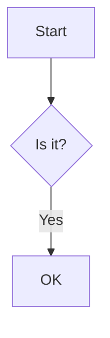
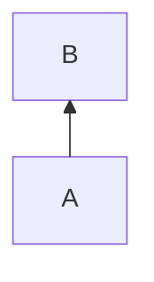
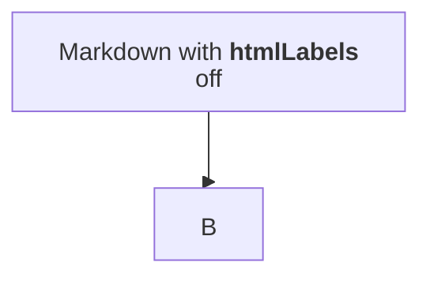
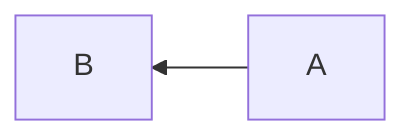

# Flowchart

## Keywords

`flowchart` (alias `graph`; the legacy `flowchart-elk` still parses). Status: stable.

## When to use

Control flow, process steps, decisions, and any boxes-and-arrows graph. For actor handoffs where
message order matters, use `sequenceDiagram`; for lanes per actor, use `swimlane-beta`.

## Syntax

Header and direction (`TB`, `TD`, `BT`, `RL`, `LR`):

```text
flowchart LR
```

Nodes, classic shapes, and typed shapes:

```text
id
id1[Text in a box]
id2@{ shape: doc, label: "Document" }
```

Links, with optional text, edge id, and chaining:

```text
A --> B
A -- text --> B
A -->|text| B
A e1@--> B
a --> b & c --> d
```

Subgraphs, with optional explicit id and direction:

```text
subgraph ide1 [Title]
  direction TB
  a1 --> a2
end
```

Edge and node metadata:

```text
e1@{ animate: true, curve: linear }
ide1@{ view: collapsed }
```

Styling and interaction:

```text
style id fill:#f9f
classDef name fill:#f96
class id name
linkStyle 0 stroke:#f00
click id href "https://example.com" "tooltip" _blank
```

### ISO 5807 symbol mapping

ISO 5807:1985 defines documentation symbols and conventions for information-processing
flowcharts. Apply this profile whenever a Mermaid `flowchart` represents program, system, or
data-processing control flow. It does not prescribe sequence, ER, class, state, C4, or Gantt
diagrams.

> [!IMPORTANT]
> Mermaid is a rendering language, not an ISO-conformance tool. Use this profile's semantic
> shapes and conventions and validate the render. Keep the standard as an authoring constraint;
> do not mention it in reader-facing prose unless the user asks for it or it is material to the
> document's purpose.

| Meaning | Use in Mermaid | Convention |
|---|---|---|
| Start / end | `([Start])`, `([End])` or `shape: stadium` | One clear entry; explicit terminal exit(s). |
| Process | `[Perform operation]` or `shape: rect` | Imperative, action-oriented label. |
| Decision | `{Condition?}` or `shape: diamond` | State a question; label every outgoing branch. |
| Input / output | `[/Receive input/]` or `shape: lean-r` | Use only for data entering or leaving the process. |
| Predefined process | `[[Invoke named subprocess]]` or `shape: subproc` | Name the separately defined routine. |
| Document | `shape: doc` | Use when the artifact itself is a document. |
| Data store | `[(Store)]` or `shape: cyl` / `datastore` | Name persistent storage and show reads/writes clearly. |
| Connector | `((A))` or `shape: circle` | Use sparingly to avoid long or crossing connectors. |

Use legacy notation only when the live Mermaid documentation confirms it renders in the target
version; otherwise prefer the current typed shape syntax. See
`reference/syntax/flowchart.md` for authoritative syntax.

Conventions:

- Prefer a single top-to-bottom primary flow; use left-to-right only when it materially improves
  legibility. Arrowheads show direction.
- Keep one action or decision per symbol. Avoid overloaded labels and decorative shapes.
- Every decision has explicit, understandable branch labels. Make error and retry paths visible
  when they affect behavior.
- Avoid crossing lines. Split a dense chart, use sub-processes, or use connectors rather than
  creating visually ambiguous routes.
- Use a legend only when non-standard colors, styles, or symbols are unavoidable; never make
  color the sole carrier of meaning.
- For multiple-actor handoffs, prefer a Mermaid swimlane diagram if the target renderer supports
  it, or a `sequenceDiagram` when message order, not control flow, is the question.

Source: [ISO 5807:1985](https://www.iso.org/standard/11955.html).

## Features

| Feature id | Construct | Snippet |
|---|---|---|
| `flowchart.keyword-flowchart` | opening keyword | `flowchart LR` |
| `flowchart.keyword-graph` | alias keyword | `graph TD` |
| `flowchart.keyword-flowchart-elk` | legacy ELK keyword (still parses) | `flowchart-elk BT` |
| `flowchart.direction-tb` | top to bottom | `flowchart TB` |
| `flowchart.direction-td` | top-down (same as TB) | `flowchart TD` |
| `flowchart.direction-bt` | bottom to top | `flowchart BT` |
| `flowchart.direction-rl` | right to left | `flowchart RL` |
| `flowchart.direction-lr` | left to right | `flowchart LR` |
| `flowchart.node-id` | bare node, id is the text | `id` |
| `flowchart.node-text` | node with text (rectangle) | `id1[Text]` |
| `flowchart.node-unicode-text` | quoted unicode text | `id["This ❤ Unicode"]` |
| `flowchart.node-quoted-special-chars` | quotes protect `()` etc. | `id1["The (text)"]` |
| `flowchart.entity-codes` | entity codes in labels | `A["quote:#quot; heart:#9829;"]` |
| `flowchart.node-round` | round edges | `id1(Text)` |
| `flowchart.node-stadium` | stadium | `id1([Text])` |
| `flowchart.node-subroutine` | subroutine | `id1[[Text]]` |
| `flowchart.node-cylinder` | cylinder | `id1[(Database)]` |
| `flowchart.node-circle` | circle | `id1((Text))` |
| `flowchart.node-asymmetric` | asymmetric (flag) | `id1>Text]` |
| `flowchart.node-rhombus` | rhombus / decision | `id1{Text}` |
| `flowchart.node-hexagon` | hexagon | `id1{{Text}}` |
| `flowchart.node-parallelogram` | parallelogram | `id1[/Text/]` |
| `flowchart.node-parallelogram-alt` | parallelogram alt | `id1[\Text\]` |
| `flowchart.node-trapezoid` | trapezoid | `A[/Christmas\]` |
| `flowchart.node-trapezoid-alt` | trapezoid alt | `B[\Go shopping/]` |
| `flowchart.node-double-circle` | double circle | `id1(((Text)))` |
| `flowchart.shape-syntax` | typed shape with label | `A@{ shape: rect, label: "Text" }` |
| `flowchart.shape-rect` | process | `A@{ shape: rect }` |
| `flowchart.shape-rounded` | event | `A@{ shape: rounded }` |
| `flowchart.shape-stadium` | terminal point | `A@{ shape: stadium }` |
| `flowchart.shape-subproc` | subprocess | `A@{ shape: subproc }` |
| `flowchart.shape-cyl` | database | `A@{ shape: cyl }` |
| `flowchart.shape-circle` | start | `A@{ shape: circle }` |
| `flowchart.shape-odd` | odd | `A@{ shape: odd }` |
| `flowchart.shape-diamond` | decision | `A@{ shape: diamond }` |
| `flowchart.shape-hex` | prepare conditional | `A@{ shape: hex }` |
| `flowchart.shape-lean-r` | data input/output | `A@{ shape: lean-r }` |
| `flowchart.shape-lean-l` | data output/input | `A@{ shape: lean-l }` |
| `flowchart.shape-datastore` | datastore | `A@{ shape: datastore }` |
| `flowchart.shape-trap-b` | priority action | `A@{ shape: trap-b }` |
| `flowchart.shape-trap-t` | manual operation | `A@{ shape: trap-t }` |
| `flowchart.shape-dbl-circ` | stop | `A@{ shape: dbl-circ }` |
| `flowchart.shape-text` | text block | `A@{ shape: text }` |
| `flowchart.shape-notch-rect` | card | `A@{ shape: notch-rect }` |
| `flowchart.shape-lin-rect` | lined/shaded process | `A@{ shape: lin-rect }` |
| `flowchart.shape-sm-circ` | small start | `A@{ shape: sm-circ }` |
| `flowchart.shape-framed-circle` | framed stop | `A@{ shape: framed-circle }` |
| `flowchart.shape-fork` | fork/join | `A@{ shape: fork }` |
| `flowchart.shape-hourglass` | collate | `A@{ shape: hourglass }` |
| `flowchart.shape-comment` | comment (curly brace) | `A@{ shape: comment }` |
| `flowchart.shape-brace-r` | comment right | `A@{ shape: brace-r }` |
| `flowchart.shape-braces` | comment, both braces | `A@{ shape: braces }` |
| `flowchart.shape-bolt` | communication link | `A@{ shape: bolt }` |
| `flowchart.shape-doc` | document | `A@{ shape: doc }` |
| `flowchart.shape-delay` | delay | `A@{ shape: delay }` |
| `flowchart.shape-das` | direct access storage | `A@{ shape: das }` |
| `flowchart.shape-lin-cyl` | disk storage | `A@{ shape: lin-cyl }` |
| `flowchart.shape-curv-trap` | display | `A@{ shape: curv-trap }` |
| `flowchart.shape-div-rect` | divided process | `A@{ shape: div-rect }` |
| `flowchart.shape-tri` | extract | `A@{ shape: tri }` |
| `flowchart.shape-win-pane` | internal storage | `A@{ shape: win-pane }` |
| `flowchart.shape-f-circ` | junction | `A@{ shape: f-circ }` |
| `flowchart.shape-lin-doc` | lined document | `A@{ shape: lin-doc }` |
| `flowchart.shape-notch-pent` | loop limit | `A@{ shape: notch-pent }` |
| `flowchart.shape-flip-tri` | manual file | `A@{ shape: flip-tri }` |
| `flowchart.shape-sl-rect` | manual input | `A@{ shape: sl-rect }` |
| `flowchart.shape-docs` | multi-document | `A@{ shape: docs }` |
| `flowchart.shape-processes` | multi-process | `A@{ shape: processes }` |
| `flowchart.shape-flag` | paper tape | `A@{ shape: flag }` |
| `flowchart.shape-bow-rect` | stored data | `A@{ shape: bow-rect }` |
| `flowchart.shape-cross-circ` | summary | `A@{ shape: cross-circ }` |
| `flowchart.shape-tag-doc` | tagged document | `A@{ shape: tag-doc }` |
| `flowchart.shape-tag-rect` | tagged process | `A@{ shape: tag-rect }` |
| `flowchart.shape-manual-file` | alias of `flip-tri` | `A@{ shape: manual-file }` |
| `flowchart.shape-manual-input` | alias of `sl-rect` | `A@{ shape: manual-input }` |
| `flowchart.shape-procs` | alias of `processes` | `A@{ shape: procs }` |
| `flowchart.shape-paper-tape` | alias of `flag` | `A@{ shape: paper-tape }` |
| `flowchart.icon-shape` | icon node | `A@{ icon: "fa:user", label: "User" }` |
| `flowchart.icon-form-square` | icon background square | `form: "square"` |
| `flowchart.icon-form-circle` | icon background circle | `form: "circle"` |
| `flowchart.icon-form-rounded` | icon background rounded | `form: "rounded"` |
| `flowchart.icon-pos-t` | icon label on top | `pos: "t"` |
| `flowchart.icon-pos-b` | icon label at bottom (default) | `pos: "b"` |
| `flowchart.icon-height` | icon height (min 48) | `h: 60` |
| `flowchart.image-shape` | image node | `A@{ img: "https://mermaid.js.org/favicon.svg", label: "Img" }` |
| `flowchart.image-pos-t` | image label on top | `pos: "t"` |
| `flowchart.image-pos-b` | image label at bottom (default) | `pos: "b"` |
| `flowchart.image-width` | image width | `w: 60` |
| `flowchart.image-height` | image height | `h: 60` |
| `flowchart.image-constraint-on` | keep aspect ratio | `constraint: "on"` |
| `flowchart.image-constraint-off` | free size (default) | `constraint: "off"` |
| `flowchart.link-arrow` | arrow link | `A-->B` |
| `flowchart.link-open` | open link | `A --- B` |
| `flowchart.link-open-text-inline` | open link, inline text | `A-- text ---B` |
| `flowchart.link-open-text-pipe` | open link, pipe text | `A---\|text\|B` |
| `flowchart.link-arrow-text-pipe` | arrow, pipe text | `A-->\|text\|B` |
| `flowchart.link-arrow-text-inline` | arrow, inline text | `A-- text -->B` |
| `flowchart.link-dotted` | dotted arrow | `A-.->B` |
| `flowchart.link-dotted-open` | dotted, no arrow | `A-.-B` |
| `flowchart.link-dotted-text` | dotted with text | `A-. text .-> B` |
| `flowchart.link-thick` | thick arrow | `A ==> B` |
| `flowchart.link-thick-open` | thick, no arrow | `A === B` |
| `flowchart.link-thick-text` | thick with text | `A == text ==> B` |
| `flowchart.link-invisible` | invisible link | `A ~~~ B` |
| `flowchart.link-circle` | circle edge | `A --o B` |
| `flowchart.link-cross` | cross edge | `A --x B` |
| `flowchart.link-multi-circle` | circle both ends | `A o--o B` |
| `flowchart.link-multi-arrow` | arrow both ends | `B <--> C` |
| `flowchart.link-multi-cross` | cross both ends | `C x--x D` |
| `flowchart.link-chaining` | chained links | `A -- t1 --> B -- t2 --> C` |
| `flowchart.link-ampersand` | `&` fan-in/fan-out | `A & B --> C & D` |
| `flowchart.link-length-normal` | longer open link | `A ---- B` |
| `flowchart.link-length-normal-arrow` | longer arrow | `A ---> B` |
| `flowchart.link-length-thick` | longer thick | `A ==== B` |
| `flowchart.link-length-thick-arrow` | longer thick arrow | `A ===> B` |
| `flowchart.link-length-dotted` | longer dotted | `A -..- B` |
| `flowchart.link-length-dotted-arrow` | longer dotted arrow | `A -..-> B` |
| `flowchart.link-length-with-text` | extra dashes right of text | `B -- No ----> E` |
| `flowchart.edge-id` | edge id | `A e1@--> B` |
| `flowchart.edge-animate` | animate an edge | `e1@{ animate: true }` |
| `flowchart.edge-animation-fast` | fast animation | `e1@{ animation: fast }` |
| `flowchart.edge-animation-slow` | slow animation | `e1@{ animation: slow }` |
| `flowchart.edge-class-animation` | animate via classDef on edge id | `class e1 animate` |
| `flowchart.edge-curve-basis` | per-edge curve | `e1@{ curve: basis }` |
| `flowchart.edge-curve-bumpx` | per-edge curve | `e1@{ curve: bumpX }` |
| `flowchart.edge-curve-bumpy` | per-edge curve | `e1@{ curve: bumpY }` |
| `flowchart.edge-curve-cardinal` | per-edge curve | `e1@{ curve: cardinal }` |
| `flowchart.edge-curve-catmullrom` | per-edge curve | `e1@{ curve: catmullRom }` |
| `flowchart.edge-curve-linear` | per-edge curve | `e1@{ curve: linear }` |
| `flowchart.edge-curve-monotonex` | per-edge curve | `e1@{ curve: monotoneX }` |
| `flowchart.edge-curve-monotoney` | per-edge curve | `e1@{ curve: monotoneY }` |
| `flowchart.edge-curve-natural` | per-edge curve | `e1@{ curve: natural }` |
| `flowchart.edge-curve-step` | per-edge curve | `e1@{ curve: step }` |
| `flowchart.edge-curve-stepafter` | per-edge curve | `e1@{ curve: stepAfter }` |
| `flowchart.edge-curve-stepbefore` | per-edge curve | `e1@{ curve: stepBefore }` |
| `flowchart.subgraph` | subgraph | `subgraph one ... end` |
| `flowchart.subgraph-explicit-id` | subgraph id plus title | `subgraph ide1 [one]` |
| `flowchart.subgraph-edges` | links to/from subgraphs | `one --> two` |
| `flowchart.subgraph-direction` | direction inside a subgraph | `direction TB` |
| `flowchart.subgraph-collapsed` | collapse a subgraph to one node | `one@{ view: collapsed }` |
| `flowchart.subgraph-expanded` | explicit default view | `one@{ view: expanded }` |
| `flowchart.markdown-node-label` | markdown string in a node | ``a("`The **cat**`")`` |
| `flowchart.markdown-edge-label` | markdown string on an edge | ``A -- "`**bold**`" --> B`` |
| `flowchart.markdown-subgraph-label` | markdown subgraph title | ``subgraph "`**Two**`"`` |
| `flowchart.click-callback` | click to JS callback | `click A callback "Tooltip"` |
| `flowchart.click-call` | click with `call` | `click C call callback() "Tooltip"` |
| `flowchart.click-url` | click to URL | `click B "https://example.com" "Tooltip"` |
| `flowchart.click-href` | click with `href` | `click D href "https://example.com" "Tooltip"` |
| `flowchart.click-target-self` | link target | `click A "https://example.com" _self` |
| `flowchart.click-target-blank` | link target | `click A "https://example.com" _blank` |
| `flowchart.click-target-parent` | link target | `click A "https://example.com" _parent` |
| `flowchart.click-target-top` | link target | `click A "https://example.com" _top` |
| `flowchart.comment` | line comment | `%% comment` |
| `flowchart.statement-semicolon` | optional trailing semicolon | `A-->B;` |
| `flowchart.linkstyle-index` | style link by order number | `linkStyle 3 stroke:#ff3,stroke-width:4px` |
| `flowchart.linkstyle-list` | style several links | `linkStyle 1,2 color:blue` |
| `flowchart.linkstyle-default` | style all links | `linkStyle default stroke:#888` |
| `flowchart.style-node` | inline node style | `style id1 fill:#f9f,stroke:#333` |
| `flowchart.classdef` | class definition | `classDef cls fill:#f9f` |
| `flowchart.classdef-multi` | several classes at once | `classDef a,b font-size:12pt` |
| `flowchart.classdef-default` | default class for all nodes | `classDef default fill:#eee` |
| `flowchart.class-apply` | attach class | `class nodeId1 cls` |
| `flowchart.class-apply-list` | attach to several nodes | `class n1,n2 cls` |
| `flowchart.class-shorthand` | `:::` shorthand | `A:::cls --> B` |
| `flowchart.class-shorthand-ampersand` | `:::` with `&` | `A:::foo & B:::bar --> C` |
| `flowchart.fontawesome-fa` | Font Awesome icon in label | `B["fa:fa-twitter text"]` |
| `flowchart.fontawesome-fab` | brands prefix | `C["fab:fa-github"]` |
| `flowchart.fontawesome-fas` | solid prefix | `C["fas:fa-user"]` |
| `flowchart.fontawesome-far` | regular prefix | `C["far:fa-bell"]` |
| `flowchart.fontawesome-fal` | light prefix | `C["fal:fa-star"]` |
| `flowchart.fontawesome-fad` | duotone prefix | `C["fad:fa-camera"]` |
| `flowchart.fontawesome-fak` | custom kit prefix | `E(fak:fa-custom-icon-name)` |

## Configuration and theming

Frontmatter `config.flowchart` keys with their 12.0.0 schema defaults. The syntax page itself
documents `curve`, `htmlLabels`, `markdownAutoWrap` (top level), and top-level `layout`.

| Key | Default |
|---|---|
| `theme` / `look` | `redux-color` / `neo` (v12 per-diagram defaults) |
| `curve` | `basis` (also `bumpX`, `bumpY`, `cardinal`, `catmullRom`, `linear`, `monotoneX`, `monotoneY`, `natural`, `step`, `stepAfter`, `stepBefore`) |
| `htmlLabels` | `null` (inherits top-level `htmlLabels`) |
| `nodeSpacing` / `rankSpacing` | `50` / `50` |
| `padding` / `diagramPadding` | `15` / `8` |
| `wrappingWidth` / `minNodeWidth` | `120` / `120` |
| `titleTopMargin` | `25` |
| `subGraphTitleMargin` | `{ top: 0, bottom: 0 }` |
| `inheritDir` | `false` |
| `useMaxWidth` | `true` |

- Top-level `layout` defaults to ELK for flowcharts in v12; `layout: dagre` restores the old engine.
  `defaultRenderer` was removed in v12.
- `theme: default` plus `look: classic` plus `layout: dagre` reproduces the pre-v12 appearance.
- Top-level `markdownAutoWrap: false` disables markdown-string wrapping.
- The page documents no flowchart-specific `themeVariables`.
- `accTitle:` and `accDescr:` (single line or `accDescr { ... }`) render with CLI 12.0.0.
- `click` callbacks and links need `securityLevel: 'loose'`; they are inert under `strict`.

## Traps

Lowercase `end` as a node id breaks the parser. Use `End`, `END`, or a quoted label.

```text
flowchart TD
  A --> end
```

A node id starting with `o` or `x` right after a link becomes an edge marker. `dev---ops`
renders as a circle edge from `dev` to a node `ps`, with no error. Add a space: `dev --- ops`.

A trailing `%%` comment after a statement fails to parse; comments must be on their own line.

```text
flowchart TD
  A --> B %% comment
```

Unquoted parentheses or braces inside a label fail. Quote the label: `A["Order (paid)"]`.

```text
flowchart LR
  A[Order (paid)] --> B
```

Keyword-like ids fail. `graph --> style` does not parse; rename the ids.

An unknown `shape:` name is a parse error, not a fallback to `rect`.

```text
flowchart RL
  A@{ shape: nosuch }
```

- Commas inside a `classDef` value (for example `stroke-dasharray: 9,5`) must be escaped as `\,`.
- A subgraph's `direction` is ignored when any of its nodes link to something outside it.
- Hex colors are fine in `style`, `classDef`, and `linkStyle`.
- Markdown strings render with default `htmlLabels`; the page's samples set `htmlLabels: false`.
- External CSS on node classes is overridden by Mermaid's scoped `!important` styles; use `classDef`.

## Complete example

```mermaid
flowchart LR
  accTitle: Flowchart feature tour
  accDescr: Every coexisting flowchart construct in one diagram.
  %% classic node shapes
  id
  id1[Text in a box]
  uni["This ❤ Unicode"]
  qt["The (text) in the box"]
  ent["A double quote:#quot;"] --> ent2["A dec char:#9829;"]
  n1(Round) --> n2([Stadium]) --> n3[[Subroutine]] --> n4[(Database)]
  n4 --> n5((Circle)) --> n6>Asymmetric] --> n7{Rhombus} --> n8{{Hexagon}}
  n8 --> n9[/Parallelogram/] --> n10[\Parallelogram alt\] --> n11[/Trapezoid\]
  n11 --> n12[\Trapezoid alt/] --> n13(((Double circle)))
  %% typed shapes
  s1@{ shape: rect, label: "rect" }
  s2@{ shape: rounded, label: "rounded" }
  s3@{ shape: stadium, label: "stadium" }
  s4@{ shape: subproc, label: "subproc" }
  s5@{ shape: cyl, label: "cyl" }
  s6@{ shape: circle, label: "circle" }
  s7@{ shape: odd, label: "odd" }
  s8@{ shape: diamond, label: "diamond" }
  s9@{ shape: hex, label: "hex" }
  s10@{ shape: lean-r, label: "lean-r" }
  s11@{ shape: lean-l, label: "lean-l" }
  s12@{ shape: datastore, label: "datastore" }
  s13@{ shape: trap-b, label: "trap-b" }
  s14@{ shape: trap-t, label: "trap-t" }
  s15@{ shape: dbl-circ, label: "dbl-circ" }
  s16@{ shape: text, label: "text" }
  s17@{ shape: notch-rect, label: "notch-rect" }
  s18@{ shape: lin-rect, label: "lin-rect" }
  s19@{ shape: sm-circ, label: "sm-circ" }
  s20@{ shape: framed-circle, label: "framed-circle" }
  s21@{ shape: fork, label: "fork" }
  s22@{ shape: hourglass, label: "hourglass" }
  s23@{ shape: comment, label: "comment" }
  s24@{ shape: brace-r, label: "brace-r" }
  s25@{ shape: braces, label: "braces" }
  s26@{ shape: bolt, label: "bolt" }
  s27@{ shape: doc, label: "doc" }
  s28@{ shape: delay, label: "delay" }
  s29@{ shape: das, label: "das" }
  s30@{ shape: lin-cyl, label: "lin-cyl" }
  s31@{ shape: curv-trap, label: "curv-trap" }
  s32@{ shape: div-rect, label: "div-rect" }
  s33@{ shape: tri, label: "tri" }
  s34@{ shape: win-pane, label: "win-pane" }
  s35@{ shape: f-circ, label: "f-circ" }
  s36@{ shape: lin-doc, label: "lin-doc" }
  s37@{ shape: notch-pent, label: "notch-pent" }
  s38@{ shape: flip-tri, label: "flip-tri" }
  s39@{ shape: sl-rect, label: "sl-rect" }
  s40@{ shape: docs, label: "docs" }
  s41@{ shape: processes, label: "processes" }
  s42@{ shape: flag, label: "flag" }
  s43@{ shape: bow-rect, label: "bow-rect" }
  s44@{ shape: cross-circ, label: "cross-circ" }
  s45@{ shape: tag-doc, label: "tag-doc" }
  s46@{ shape: tag-rect, label: "tag-rect" }
  s47@{ shape: manual-file, label: "manual-file" }
  s48@{ shape: manual-input, label: "manual-input" }
  s49@{ shape: procs, label: "procs" }
  s50@{ shape: paper-tape, label: "paper-tape" }
  %% icon and image shapes
  i1@{ icon: "fa:user", form: "square", label: "Square", pos: "t", h: 60 }
  i2@{ icon: "fa:user", form: "circle", label: "Circle", pos: "b" }
  i3@{ icon: "fa:user", form: "rounded", label: "Rounded" }
  im1@{ img: "https://mermaid.js.org/favicon.svg", label: "Top", pos: "t", w: 60, h: 60, constraint: "on" }
  im2@{ img: "https://mermaid.js.org/favicon.svg", label: "Bottom", pos: "b", h: 60, constraint: "off" }
  %% links
  L1-->L2
  L2 --- L3
  L3-- open text ---L4
  L4---|pipe text|L5
  L5-->|pipe text|L6
  L6-- inline text -->L7
  L7-.->L8
  L8-.-L9
  L9-. dotted text .-> L10
  L10 ==> L11
  L11 === L12
  L12 == thick text ==> L13
  L13 ~~~ L14
  L14 --o L15
  L15 --x L16
  L16 o--o L17
  L17 <--> L18
  L18 x--x L19
  L19 -- t1 --> L20 -- t2 --> L21
  L21 & L22 --> L23 & L24
  L24 ---- L25
  L25 ---> L26
  L26 ==== L27
  L27 ===> L28
  L28 -..- L29
  L29 -..-> L30
  L30 -- No ----> L31;
  %% edge ids, animation, and curves
  E1 a1@--> E2
  E1 a2@--> E3
  E1 a3@--> E4
  E1 a4@--> E5
  a1@{ animate: true }
  a2@{ animation: fast }
  a3@{ animation: slow }
  classDef animate stroke-dasharray: 9\,5,stroke-dashoffset: 900,animation: dash 25s linear infinite;
  class a4 animate
  C0 c1@--> C1
  C0 c2@--> C2
  C0 c3@--> C3
  C0 c4@--> C4
  C0 c5@--> C5
  C0 c6@--> C6
  C0 c7@--> C7
  C0 c8@--> C8
  C0 c9@--> C9
  C0 c10@--> C10
  C0 c11@--> C11
  C0 c12@--> C12
  c1@{ curve: basis }
  c2@{ curve: bumpX }
  c3@{ curve: bumpY }
  c4@{ curve: cardinal }
  c5@{ curve: catmullRom }
  c6@{ curve: linear }
  c7@{ curve: monotoneX }
  c8@{ curve: monotoneY }
  c9@{ curve: natural }
  c10@{ curve: step }
  c11@{ curve: stepAfter }
  c12@{ curve: stepBefore }
  %% subgraphs and markdown strings
  subgraph one
    a("`The **cat**
    in the hat`") -- "`Bold **edge label**`" --> b{{"`The *dog*`"}}
  end
  subgraph ide1 ["`**Two**`"]
    direction TB
    t1 --> t2
  end
  subgraph grp [Collapsed group]
    g1 --> g2
  end
  subgraph keep [Expanded group]
    k1 --> k2
  end
  one --> ide1
  L1 --> grp
  grp@{ view: collapsed }
  keep@{ view: expanded }
  %% fontawesome
  f1["fa:fa-twitter for peace"]
  f2["fab:fa-github brands"]
  f3["fas:fa-user solid"]
  f4["far:fa-bell regular"]
  f5["fal:fa-star light"]
  f6["fad:fa-camera duotone"]
  f7(fak:fa-custom-icon-name)
  f1 --> f2 --> f3 --> f4 --> f5 --> f6 --> f7
  %% styling
  S1:::someclass --> S2
  S3:::foo & S4:::bar --> S5:::foobar
  style id1 fill:#f9f,stroke:#333,stroke-width:4px
  classDef someclass fill:#f96
  classDef foo,bar stroke:#f00
  classDef foobar stroke:#00f
  classDef default stroke-width:2px
  class id,uni hl
  class qt hl
  classDef hl fill:#ffd
  linkStyle 3 stroke:#ff3,stroke-width:4px,color:red;
  linkStyle 1,2 color:blue;
  linkStyle default stroke:#888
  %% interaction
  click L1 callback "Tooltip for a callback"
  click L2 call callback() "Tooltip for a callback"
  click L3 "https://www.github.com" "Tooltip for a link"
  click L4 href "https://www.github.com" "Tooltip for a link"
  click L5 "https://www.github.com" _self
  click L6 "https://www.github.com" "New tab" _blank
  click L7 href "https://www.github.com" _parent
  click L8 href "https://www.github.com" "Top frame" _top
```

Covers: every feature id except `flowchart.keyword-graph`, `flowchart.keyword-flowchart-elk`,
`flowchart.direction-tb`, `flowchart.direction-td`, `flowchart.direction-bt`, `flowchart.direction-rl`
(a diagram has one header direction; see the fences below).



Covers: `flowchart.keyword-graph`, `flowchart.direction-td`.



Covers: `flowchart.keyword-flowchart-elk`, `flowchart.direction-bt`.



Covers: `flowchart.direction-tb` (plus the frontmatter config keys).



Covers: `flowchart.direction-rl`.

## Builder

`candidate`: `scripts/render.py` has an IR builder for this type (target keyword(s) `flowchart`). It has not been through the reliability bar yet; see [coverage.md](../coverage.md).
