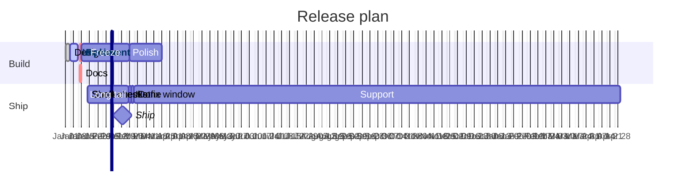

# Gantt

## Keywords
`gantt`. Status: stable.

## When to use
A project schedule: tasks as bars on a date axis, with dependencies, sections, milestones and excluded days.
Nearest alternative: `timeline` when events have no duration or dependency.

## Syntax
Header statements, one per line after `gantt`:

```text
title <text>
dateFormat <dayjs input format>
axisFormat <d3 time format>
tickInterval <N><millisecond|second|minute|hour|day|week|month>
weekday <monday..sunday>
excludes <weekends | dayname | YYYY-MM-DD ...>
weekend <friday|saturday>
todayMarker <css> | off
```

Sections and tasks (tags first, then id, start, end):

```text
section <name>
<title> :[tags,] [id,] [start,] <end>
```

Start is a date or `after id [id2 ...]`. End is a date, a length (`3d`), or `until id`.

Interaction:

```text
click <taskId> href "<url>"
click <taskId> call <fn>(<args>)
```

## Features
| Feature id | Construct | Snippet |
|---|---|---|
| `gantt.title` | chart title | `title Release plan` |
| `gantt.date-format` | input date format | `dateFormat YYYY-MM-DD` |
| `gantt.date-format-unix` | Unix timestamp input (bar-chart trick) | `dateFormat X` |
| `gantt.axis-format` | axis label format | `axisFormat %b %d` |
| `gantt.tick-interval` | axis tick interval | `tickInterval 1week` |
| `gantt.weekday` | first day of week-based ticks | `weekday monday` |
| `gantt.excludes-weekends` | exclude weekends | `excludes weekends` |
| `gantt.excludes-date` | exclude a specific date | `excludes 2024-01-15` |
| `gantt.excludes-dayname` | exclude a weekday by name | `excludes friday` |
| `gantt.excludes-multiple-lines` | several `excludes` lines concatenate | `excludes weekends` + `excludes 2024-01-15` |
| `gantt.weekend-friday` | weekend is Friday and Saturday | `weekend friday` |
| `gantt.weekend-saturday` | weekend is Saturday and Sunday (default) | `weekend saturday` |
| `gantt.section` | section of tasks | `section Build` |
| `gantt.task` | task with title and metadata | `Design :des1, 2024-01-01, 3d` |
| `gantt.task-no-section` | tasks without any section | `Task A : 10m` |
| `gantt.tag-done` | done tag | `:done, des1, 2024-01-01, 3d` |
| `gantt.tag-active` | active tag | `:active, impl, after des1, 1w` |
| `gantt.tag-crit` | critical tag | `:crit, rev, after impl, 36h` |
| `gantt.tag-combined` | several tags on one task | `:crit, active, 3d` |
| `gantt.milestone` | milestone (instant) | `:milestone, ship, 2024-02-20, 0d` |
| `gantt.vert` | vertical marker line | `:vert, v1, 2024-02-10, 0d` |
| `gantt.task-id` | task id (first of three items) | `:des1, 2024-01-01, 3d` |
| `gantt.start-date` | explicit start date | `:2024-01-20, 90m` |
| `gantt.end-date` | explicit end date | `:des1, 2024-01-01, 2024-01-05` |
| `gantt.end-only` | end only; starts after preceding task | `:2024-03-01` |
| `gantt.length-only` | length only; starts after preceding task | `:24d` |
| `gantt.after` | start after another task | `:after des1, 5d` |
| `gantt.after-multiple` | start after the latest of several tasks | `:after des1 impl, 2d` |
| `gantt.until` | end when another task starts | `:until ship` |
| `gantt.duration-ms` | milliseconds | `500ms` |
| `gantt.duration-s` | seconds | `30s` |
| `gantt.duration-m` | minutes | `90m` |
| `gantt.duration-h` | hours | `36h` |
| `gantt.duration-d` | days | `3d` |
| `gantt.duration-w` | weeks | `1w` |
| `gantt.duration-month` | months (capital `M`) | `1M` |
| `gantt.duration-y` | years | `1y` |
| `gantt.duration-decimal` | decimal length | `1.5d` |
| `gantt.today-marker-style` | style the today marker | `todayMarker stroke-width:5px,stroke:#0f0` |
| `gantt.today-marker-off` | hide the today marker | `todayMarker off` |
| `gantt.click-href` | link a task | `click impl href "https://example.com"` |
| `gantt.click-call` | callback on a task | `click rev call showTask("rev")` |
| `gantt.comment` | comment line | `%% a comment` |
| `gantt.acc-title` | accessible title | `accTitle: Release plan` |
| `gantt.acc-descr` | accessible description | `accDescr: Build and ship` |
| `gantt.acc-descr-block` | multi-line accessible description | `accDescr { ... }` |

## Configuration and theming
Frontmatter `config.gantt` keys (defaults from the Mermaid 12.0.0 default config):

| Key | Default | Meaning |
|---|---|---|
| `useMaxWidth` | true | scale to container width |
| `titleTopMargin` | 25 | margin above the title |
| `barHeight` | 20 | bar height |
| `barGap` | 4 | gap between bars |
| `topPadding` | 50 | space above the chart |
| `leftPadding` | 75 | section label width on the left |
| `rightPadding` | 75 | section label width on the right |
| `gridLineStartPadding` | 35 | grid line start offset |
| `fontSize` | 11 | task font size |
| `sectionFontSize` | 11 | section font size |
| `numberSectionStyles` | 4 | alternating section styles |
| `axisFormat` | `%Y-%m-%d` | axis format (same as the statement) |
| `tickInterval` | auto | tick interval (same as the statement) |
| `topAxis` | false | also draw date labels at the top |
| `displayMode` | `""` | `compact` puts several tasks on one row |
| `weekday` | `sunday` | start of week-based ticks |
| `useWidth` | unset | fixed render width |

`displayMode: compact` also works as a top-level frontmatter key (the page shows it there).
Theming is CSS classes (`.grid .tick`, `.taskText`, `.taskTextOutsideRight`, `.taskTextOutsideLeft`,
`todayMarker`) via `themeCSS`; the page documents no gantt-specific `themeVariables`.
`accTitle`, `accDescr` and `accDescr { }` render with CLI 12.0.0.

## Traps
A colon in a task title is read as the start of the metadata. With CLI 12.0.0 the renderer
crashes with `TypeError: Cannot read properties of undefined (reading 'type')`. Quoting does not help:

```text
gantt
    dateFormat YYYY-MM-DD
    section S
    Review: security :done, t1, 2024-01-01, 3d
    "Review: security" :done, t2, 2024-01-01, 3d
```

Fix: drop the colon or use the entity `#58;` (`Review#58; security :done, t1, 2024-01-01, 3d` renders).
A colon in `title` or a `section` name is fine.

Tags must come before the id. A tag after the id crashes with the same `TypeError`:

```text
gantt
    dateFormat YYYY-MM-DD
    A :t1, done, 2024-01-01, 3d
```

Silent failures that `check.sh` does not catch (the diagram still renders):

- A length without a unit (`3`) or with junk (`3dX`) is an invalid token; the page says the task gets zero length.
- `excludes weekdays` is not supported and is ignored.
- `after zz` with an unknown id is accepted.
- A start date that does not match `dateFormat` is accepted; check the bar position visually.
- `tickInterval 1decade` or `1year` is not matched by the pattern and is ignored.

`M` is months and `m` is minutes in lengths. `click` only works in a page with
`securityLevel: 'loose'`; it renders inert in CLI output.

## Complete example



Covers: every feature id except `gantt.weekend-saturday`, `gantt.task-no-section`, `gantt.today-marker-off`,
`gantt.date-format-unix` (exclusive: one weekend setting, one today-marker setting, one `dateFormat`),
and `gantt.acc-descr-block` (a diagram carries one description).

```mermaid
gantt
    accDescr {
        A short schedule
        without sections
    }
    dateFormat HH:mm
    axisFormat %H:%M
    excludes weekends
    weekend saturday
    todayMarker off
    Initial milestone : milestone, m1, 17:49, 2m
    Task A : 10m
    Task B : 5m
```



Covers: `gantt.weekend-saturday`, `gantt.task-no-section`, `gantt.today-marker-off`, `gantt.acc-descr-block`.

```mermaid
gantt
    title Days since last update
    dateFormat X
    axisFormat %s
    section Issue19062
    71   : 0, 71
    section Issue19401
    36   : 0, 36
```



Covers: `gantt.date-format-unix`.

## Builder
`builder`: family `timeline`, keyword `gantt`. Tasks are rendered in input order; every value is validated before any line is emitted.

| IR key | Type | Meaning |
|---|---|---|
| `title`, `comment` | string | `title` line, `%%` comment |
| `accessibility` | `{title, description}` | `accTitle`, `accDescr` (a newline gives the block form) |
| `dateFormat`, `axisFormat` | string | header statements; `#` and `;` rejected |
| `tickInterval` | string | `<N><millisecond\|second\|minute\|hour\|day\|week\|month>` |
| `weekday` / `weekend` | enum | `monday`..`sunday` / `friday`, `saturday` |
| `excludes` | string[] | one `excludes` line each: `weekends`, a day name, or `YYYY-MM-DD` |
| `todayMarker` | `"off"` or `{stroke, strokeWidth, opacity}` | typed style (`#hex` color, `Npx`, 0..1) |
| `config.gantt` | object | typed keys from Configuration (`displayMode`, `topAxis`, `barHeight`, ...) |
| `bars` | task[] | tasks before any section |
| `sections[].name`, `sections[].bars` | string, task[] | sections |
| task `label` | string | task title |
| task `id` | identifier | needs `start` or `after` |
| task `tags` | enum[] | `active`, `done`, `crit`, `milestone`, `vert` |
| task `start` / `after` | date / id[] | start date, or the latest end of earlier tasks |
| task `end` / `duration` / `until` | date / length / id | exactly one; length is `<n>(ms\|s\|m\|h\|d\|w\|M\|y)`, decimals allowed |
| task `href`, `call` | URL, `{function, args[]}` | `click` lines; need an `id` |

Example: [maximal.json](../../tests/fixtures/gantt/maximal.json) (plus `maximal.unix.json` for `dateFormat X`,
`weekend saturday`, `todayMarker off` and the block description).

Rejected: a label that starts with a statement keyword (`title `, `section `, `excludes `, a `YYYY-MM-DD` date, ...),
the first task without `start`, an `id` without `start`/`after`, `after` naming a later task, an `until` chain that
makes a task depend on itself, `active` with `done`, `milestone` with `active`/`done`. `: # ; % " < > &` in text are
written as entity codes and render as typed.
