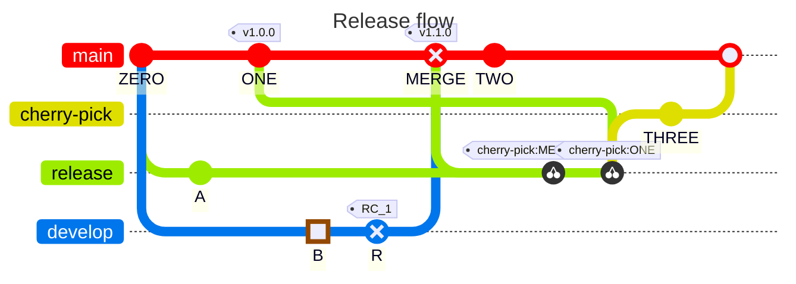
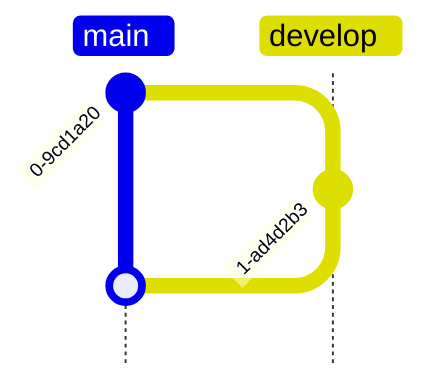
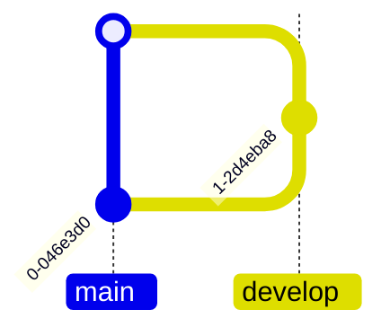
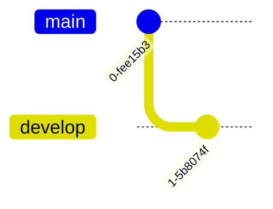

# Git graph

## Keywords
`gitGraph` (case-sensitive), optionally with an orientation: `gitGraph LR:`, `gitGraph TB:`, `gitGraph BT:`,
or a bare colon `gitGraph:`. Status: stable.

## When to use
A branching strategy: commits on branches, checkouts, merges and cherry-picks in the order they happen.
Nearest alternative: `flowchart` when the history is not linear git operations (arbitrary DAGs).

## Syntax
Opening line:

```text
gitGraph [LR:|TB:|BT:]
```

Commits (attributes in any order, values quoted except `type`):

```text
commit [id: "<id>"] [type: NORMAL|REVERSE|HIGHLIGHT] [tag: "<tag>"]
```

Branches:

```text
branch <name> [order: <n>]
checkout <name>
switch <name>
```

Merge and cherry-pick:

```text
merge <branch> [id: "<id>"] [tag: "<tag>"] [type: <TYPE>]
cherry-pick id: "<commit id>" [parent: "<parent id>"]
```

## Features
| Feature id | Construct | Snippet |
|---|---|---|
| `gitgraph.commit` | commit on the current branch | `commit` |
| `gitgraph.commit-id` | custom commit id | `commit id: "Alpha"` |
| `gitgraph.commit-type-normal` | normal commit (solid circle, default) | `commit type: NORMAL` |
| `gitgraph.commit-type-reverse` | reverse commit (crossed circle) | `commit type: REVERSE` |
| `gitgraph.commit-type-highlight` | highlight commit (filled rectangle) | `commit type: HIGHLIGHT` |
| `gitgraph.commit-tag` | tag on a commit | `commit tag: "v1.0.0"` |
| `gitgraph.commit-combined-attributes` | id, type and tag together | `commit id: "R" type: REVERSE tag: "RC_1"` |
| `gitgraph.branch` | create and switch to a branch | `branch develop` |
| `gitgraph.branch-quoted-name` | keyword-like branch name in quotes | `branch "cherry-pick"` |
| `gitgraph.branch-order` | explicit branch order | `branch test1 order: 3` |
| `gitgraph.checkout` | switch to an existing branch | `checkout main` |
| `gitgraph.switch` | alias of `checkout` | `switch develop` |
| `gitgraph.merge` | merge a branch into the current one | `merge develop` |
| `gitgraph.merge-attributes` | merge with id, tag and type | `merge dev id: "M1" tag: "t" type: REVERSE` |
| `gitgraph.cherry-pick` | cherry-pick a commit by id | `cherry-pick id: "A"` |
| `gitgraph.cherry-pick-parent` | cherry-pick a merge commit with its parent | `cherry-pick id: "MERGE" parent: "B"` |
| `gitgraph.orientation-lr` | left to right (default) | `gitGraph LR:` |
| `gitgraph.orientation-tb` | top to bottom | `gitGraph TB:` |
| `gitgraph.orientation-bt` | bottom to top | `gitGraph BT:` |
| `gitgraph.keyword-colon` | keyword with a bare colon | `gitGraph:` |
| `gitgraph.frontmatter-title` | diagram title in frontmatter | `title: Example Git diagram` |
| `gitgraph.comment` | comment line | `%% a comment` |
| `gitgraph.acc-title` | accessible title | `accTitle: Release flow` |
| `gitgraph.acc-descr` | accessible description | `accDescr: main and develop` |
| `gitgraph.acc-descr-block` | multi-line accessible description | `accDescr { ... }` |

## Configuration and theming
Frontmatter `config.gitGraph` keys (Mermaid 12.0.0 default config; the first five are on the page):

| Key | Default | Meaning |
|---|---|---|
| `showBranches` | true | draw branch names and lines |
| `showCommitLabel` | true | draw commit labels |
| `mainBranchName` | `main` | name of the root branch |
| `mainBranchOrder` | 0 | position of the root branch |
| `parallelCommits` | false | commits the same distance from the parent share a level |
| `rotateCommitLabel` | true | 45-degree labels; `false` for horizontal |
| `titleTopMargin` | 25 | margin above the title |
| `diagramPadding` | 8 | outer padding |
| `useMaxWidth` | true | scale to container width |
| `arrowMarkerAbsolute` | false | absolute arrow marker URLs |
| `nodeLabel` | `{width: 75, height: 100, x: -25, y: 0}` | label box geometry |

themeVariables (up to 8 branches, then cyclic): `git0`..`git7` (branch colors), `gitBranchLabel0`..`gitBranchLabel7`,
`gitInv0`..`gitInv7` (highlight commits), `commitLabelColor`, `commitLabelBackground`, `commitLabelFontSize`,
`tagLabelColor`, `tagLabelBackground`, `tagLabelBorder`, `tagLabelFontSize`.
`accTitle`, `accDescr` and `accDescr { }` render with CLI 12.0.0.

## Traps
The keyword is `gitGraph`. Lowercase `gitgraph` is `UnknownDiagramError` even though the page prose says "gitgraph".

Ids and tags must be quoted, and `type` values are uppercase. These emit an error SVG
(the CLI exits 0; `check.sh` rejects it):

```text
gitGraph
    commit id: alpha
    commit type: highlight
```

A branch named after a keyword must be quoted (`branch "cherry-pick"`); unquoted it emits an error SVG:

```text
gitGraph
    commit
    branch cherry-pick
```

Semantic errors throw at render time, with these messages in CLI 12.0.0:

| Input | Error |
|---|---|
| `checkout nope` | Trying to checkout branch which is not yet created |
| `branch dev` twice | Trying to create an existing branch |
| `merge nope` | Branch to be merged (nope) does not exist |
| `merge main` on main | Cannot merge branch 'main' into itself |
| `merge dev` with no new commits on either side | Both branches have same head |
| `cherry-pick id: "a"` where `a` is on the current branch | Source commit is already on current branch |
| `cherry-pick id: "zz"` (unknown id) | Source commit id should exist and provided |
| cherry-pick of a merge commit without `parent:` | an immediate parent commit must be specified |

Silent: duplicate commit ids render without error. Branch names with `/` (`feature/login`) are fine.

## Complete example



Covers: every feature id except `gitgraph.orientation-tb`, `gitgraph.orientation-bt`, `gitgraph.keyword-colon`
(one orientation per diagram) and `gitgraph.acc-descr-block` (a diagram carries one description).



Covers: `gitgraph.orientation-tb`, `gitgraph.acc-descr-block`.



Covers: `gitgraph.orientation-bt`.



Covers: `gitgraph.keyword-colon`.

## Builder
`candidate`: `scripts/render.py` has an IR builder for this type (target keyword(s) `gitGraph`). It has not been through the reliability bar yet; see [coverage.md](../coverage.md).
