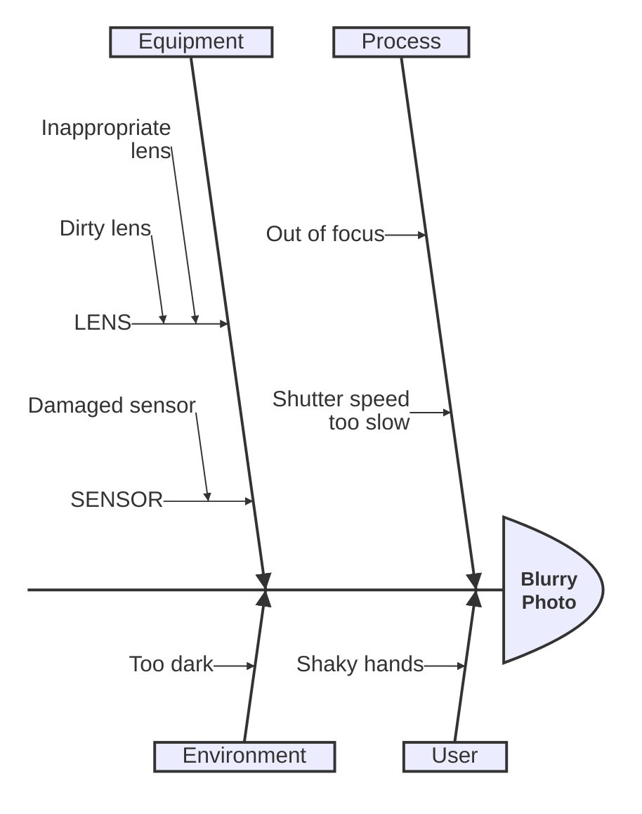
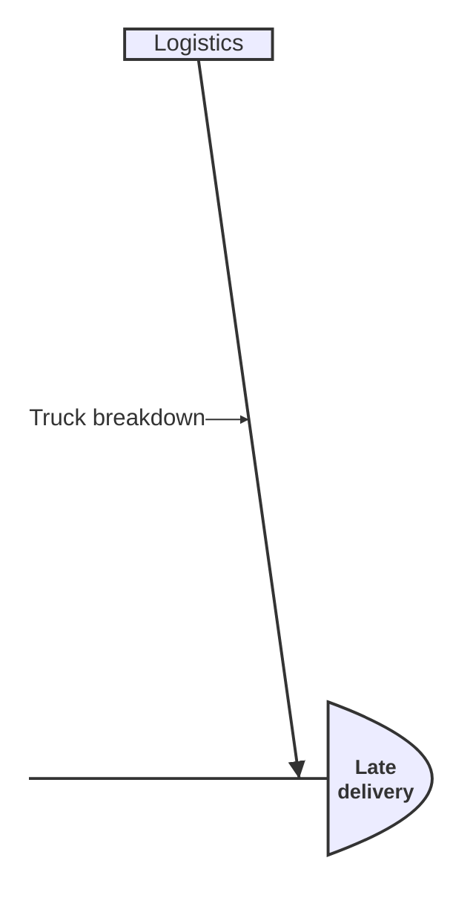

# Ishikawa

## Keywords
`ishikawa-beta`. CLI 12.0.0 also accepts the bare `ishikawa` (the detector and lexer match `ishikawa(-beta)?`; the page documents only `ishikawa-beta`). Status: beta.

## When to use
A fishbone (cause-and-effect) diagram: one effect at the head, cause categories as bones, sub-causes nested under them.
Nearest alternative: `mindmap` for a free hierarchy without the fishbone layout, or `treeView` for a file-like tree.

## Syntax
Keyword, then the effect on the first content line, then indented causes:

```text
ishikawa-beta
    <effect>
    <category>
        <cause>
            <sub-cause>
```

Comment line:

```text
    %% comment
```

## Features
| Feature id | Construct | Snippet |
|---|---|---|
| `ishikawa.effect` | first content line is the effect (fish head) | `Blurry Photo` |
| `ishikawa.category` | cause at the base indentation (main bone) | `Process` |
| `ishikawa.cause` | cause indented under a category | `Out of focus` |
| `ishikawa.nested-cause` | deeper indentation nests further (sub-bones) | `LENS` then `Dirty lens` indented below |
| `ishikawa.comment` | `%%` comment line (lexer rule; not on the page) | `%% a comment` |
| `ishikawa.keyword-alias` | bare `ishikawa` keyword (accepted, undocumented) | `ishikawa` |

## Configuration and theming
Frontmatter `config.ishikawa` keys (Mermaid 12.0.0 default config; the page documents none):

| Key | Default | Meaning |
|---|---|---|
| `diagramPadding` | 20 | padding around the whole diagram, px |
| `useMaxWidth` | true | scale to container width |

The page documents no themeVariables. The 12.0.0 renderer and styles read the global `lineColor` (bones, arrow),
`mainBkg` (head and label box fill), `textColor`, `fontFamily` and `fontSize`. `look: handDrawn` renders (rough.js path).
`accTitle` and `accDescr` are NOT supported: the grammar has no such rules, so `accTitle: Fish` becomes the effect
text (if first) or a cause, and the SVG gets no `<title>` or `<desc>`.

## Traps
There is no `title` statement. The first content line is always the effect, whatever it says:

```text
ishikawa-beta
    title Blurry Photo
    Process
        Out of focus
```

renders the effect as the text `title Blurry Photo`. The effect text is also used as the diagram title internally.

Quotes are not stripped: `"Blurry Photo"` renders with the quote marks. Markdown strings (`` "`**x**`" ``) are not
supported and render literally.

Indentation is relative to the first cause line. Without any indentation every line after the effect becomes a
category and nothing nests:

```text
ishikawa-beta
Effect
Process
Out of focus
```

renders two categories and no causes, silently. Any line indented less than the first category is clamped to
category level.

HTML-ish text is escaped: `C < D` renders as `C &lt; D` (double escaped). Avoid `<` and `>` in labels.
Colons, parentheses and brackets in labels are fine (`Cat: one`, `Out (x) [y]` render as written).

## Complete example



Covers: every feature id except `ishikawa.keyword-alias`.



Covers: `ishikawa.keyword-alias`, `ishikawa.effect`, `ishikawa.category`, `ishikawa.cause`.

## Builder
`builder`: family `tree`, keywords `ishikawa-beta` and `ishikawa` (the alias). No accessibility keys: the grammar has none.

| Key | Type | Meaning |
|---|---|---|
| `effect` | string, required | the fish head (first content line) |
| `causes` | array of cause | main bones (categories) |
| `causes[].label` | string, required | cause text |
| `causes[].children` | array of cause | sub-causes, nested to any depth |
| `comment` | string | one `%%` line after the keyword |

Every key is validated; an unknown key fails at its JSON path. Labels are one line and reject `<` (rendered double-escaped),
`%%`, entity-like text such as `#amp;`, and a leading `ishikawa` word (lexed as the keyword).
Example: [maximal.json](../../tests/fixtures/ishikawa/maximal.json).
