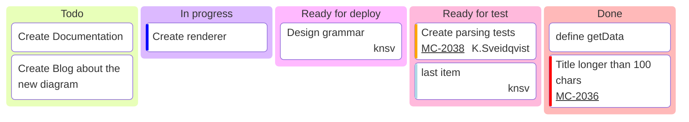

# Kanban

## Keywords
`kanban`. Status: stable.

## When to use
A board of work items in workflow columns (Todo, In progress, Done), with optional assignee, ticket and priority per card.
Nearest alternative: `mindmap` for a free hierarchy, or `block` for an arbitrary grid.

## Syntax
Columns at one indentation, cards indented under them:

```text
kanban
  <columnId>[<Column title>]
    <taskId>[<Task description>]
```

Card metadata:

```text
<taskId>[<description>]@{ assigned: '<who>', ticket: <id>, priority: '<level>' }
```

## Features
| Feature id | Construct | Snippet |
|---|---|---|
| `kanban.column` | column with id and title | `todo[Todo]` |
| `kanban.column-bare-text` | column given as plain text | `Todo` |
| `kanban.column-title-only` | column with a title and no id | `[In progress]` |
| `kanban.task` | card with id and description | `docs[Create Documentation]` |
| `kanban.task-title-only` | card with a description and no id | `[Create Documentation]` |
| `kanban.metadata` | metadata block on a card | `t1[A]@{ assigned: 'knsv' }` |
| `kanban.metadata-assigned` | assignee | `@{ assigned: 'knsv' }` |
| `kanban.metadata-ticket` | ticket number (linked via `ticketBaseUrl`) | `@{ ticket: MC-2037 }` |
| `kanban.priority-very-high` | priority Very High | `@{ priority: 'Very High' }` |
| `kanban.priority-high` | priority High | `@{ priority: 'High' }` |
| `kanban.priority-low` | priority Low | `@{ priority: 'Low' }` |
| `kanban.priority-very-low` | priority Very Low | `@{ priority: 'Very Low' }` |
| `kanban.metadata-combined` | several keys in one block | `@{ ticket: MC-2038, assigned: 'K.S', priority: 'High' }` |
| `kanban.comment` | comment line | `%% a comment` |

## Configuration and theming
Frontmatter `config.kanban` keys (Mermaid 12.0.0 default config; the page documents only `ticketBaseUrl`):

| Key | Default | Meaning |
|---|---|---|
| `ticketBaseUrl` | `""` | link for `ticket:`; `#TICKET#` is replaced by the ticket value |
| `padding` | 8 | card padding |
| `sectionWidth` | 200 | column width |
| `useMaxWidth` | true | scale to container width |

With `ticketBaseUrl: 'https://x.atlassian.net/browse/#TICKET#'` a card with `ticket: MC-1` gets a link to
`https://x.atlassian.net/browse/MC-1` (checked in the 12.0.0 SVG).
The page documents no themeVariables; the 12.0.0 renderer reads `cScale0`..`cScale11`, `cScaleLabel0`..`cScaleLabel11`
and `cScaleInv*` for column colors.
`accTitle` and `accDescr` are NOT supported: CLI 12.0.0 renders them without error as extra columns titled
`accTitle: ...` and `accDescr: ...`, and emits no `<title>` or `<desc>`.

## Traps
Indentation decides column vs card. Without indentation every line is a column, silently:

```text
kanban
todo[Todo]
t1[A]
```

renders two columns, `Todo` and `A`, and no card.

Brackets inside an unquoted description are a parse error; quote the description:

```text
kanban
  todo[Todo]
    t1[Fix [x] bug]
```

`t1["Fix [x] bug"]` renders. A bare card with parentheses is read as a shape: `Fix foo(x)` renders
a card with the text `x`, and `Fix foo(x) now` is a parse error. Give every card an id and brackets.

`:::class` after a card is a parse error, and there is no `classDef` statement in kanban.

Silent: duplicate card ids, a priority outside the four allowed values (`'Urgent'`, lowercase `high`),
and unknown metadata keys all render without error. Unknown keys are dropped.

## Complete example



Covers: every feature id.

## Builder
`candidate`: `scripts/render.py` has an IR builder for this type (target keyword(s) `kanban`). It has not been through the reliability bar yet; see [coverage.md](../coverage.md).
