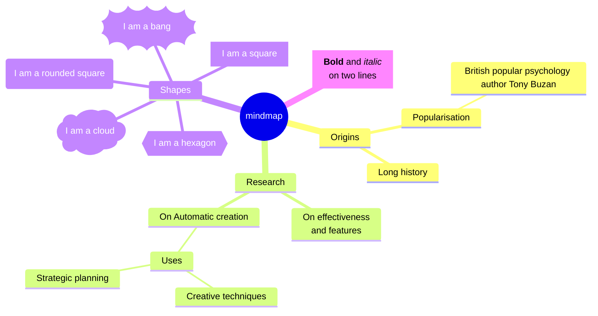

# Mindmap

## Keywords
`mindmap`. Status: stable (the page calls the diagram experimental; only the icon integration is the unstable part).

## When to use
A hierarchy of ideas around one central concept, defined as an indented outline.
Nearest alternative: `treeView` for a file-tree style hierarchy, or `flowchart` when nodes need cross-links.

## Syntax
One root, children by indentation (relative to the previous lines):

```text
mindmap
  <root>
    <child>
      <grandchild>
```

A node with an id and a shape:

```text
<id>[<text>]   <id>(<text>)   <id>((<text>))   <id>))<text>((   <id>)<text>(   <id>
```

Decorations on the line after a node:

```text
::icon(<icon classes>)
:::<class> [<class> ...]
```

## Features
| Feature id | Construct | Snippet |
|---|---|---|
| `mindmap.root` | single root node | `root((mindmap))` |
| `mindmap.indentation-hierarchy` | children by indentation | `Root` / `  A` / `    B` |
| `mindmap.unclear-indentation` | in-between indent attaches to the nearest shallower node | `      C` under `A` |
| `mindmap.shape-default` | default shape (plain text) | `I am the default shape` |
| `mindmap.shape-square` | square | `id[I am a square]` |
| `mindmap.shape-rounded` | rounded square | `id(I am a rounded square)` |
| `mindmap.shape-circle` | circle | `id((I am a circle))` |
| `mindmap.shape-bang` | bang | `id))I am a bang((` |
| `mindmap.shape-cloud` | cloud | `id)I am a cloud(` |
| `mindmap.shape-hexagon` | hexagon | `id{{I am a hexagon}}` |
| `mindmap.icon` | icon on the preceding node | `::icon(fa fa-book)` |
| `mindmap.class` | CSS classes on the preceding node | `:::urgent large` |
| `mindmap.markdown-string` | markdown string (bold, italics, newlines, auto-wrap) | ``id1["`**Root** with`"]`` |
| `mindmap.line-break` | `<br/>` in a plain label | `On effectiveness<br/>and features` |
| `mindmap.comment` | comment line | `%% a comment` |

## Configuration and theming
Frontmatter `config.mindmap` keys (Mermaid 12.0.0 default config; the page documents none):

| Key | Default | Meaning |
|---|---|---|
| `padding` | 10 | node padding |
| `maxNodeWidth` | 200 | max node width before wrapping |
| `layoutAlgorithm` | `cose-bilkent` | layout engine |
| `useMaxWidth` | true | scale to container width |

The page shows top-level `config.layout: tidy-tree` for a Tidy Tree layout; it needs the tidy-tree layout registered
by the integrator. CLI 12.0.0 renders it without error.
The page documents no themeVariables; the 12.0.0 renderer reads `cScale0`..`cScale11`, `cScaleLabel0`..`cScaleLabel11`
and `cScaleInv*` for branch colors. Classes from `:::` and icon fonts for `::icon()` must be supplied by the host page.
`accTitle` and `accDescr` are NOT supported: as the first line after `mindmap` they become a second root
(error below); indented under the root they render silently as nodes with the text `accTitle: ...`.

## Traps
Exactly one root. A second line at root indentation throws
`There can be only one root. No parent could be found for ("Other")`:

```text
mindmap
  Root
  Other
```

The same error hits `accTitle:` placed before the root, and any `classDef` line (there is no `classDef` in mindmap).

`:::class` on the same line as the node is a parse error; put it on its own line after the node:

```text
mindmap
  Root
    A[A]:::urgent
```

Shape delimiters inside plain text change the meaning, with no error:

| Line | Rendered |
|---|---|
| `Call foo(x)` | rounded node with text `x` (id `Call foo`) |
| `see [docs]` | square node with text `docs` |
| `a["quoted [x] and (y)"]` | `quoted [x] and (y)` |

Parentheses inside a bracketed label are a parse error, as are parentheses inside a cloud label:

```text
mindmap
  Root
    a[Call foo(x)]
    b)cloud text with (paren)(
```

Quote labels that contain brackets or parentheses: `a["Call foo(x)"]`.
Mixed tabs and spaces render without error in CLI 12.0.0, but the resulting levels are hard to predict; use spaces only.

## Complete example



Covers: every feature id. The root uses the circle shape; `Strategic planning` shows the unclear-indentation rule
(it attaches to `Uses`).

## Builder
`candidate`: `scripts/render.py` has an IR builder for this type (target keyword(s) `mindmap`). It has not been through the reliability bar yet; see [coverage.md](../coverage.md).
