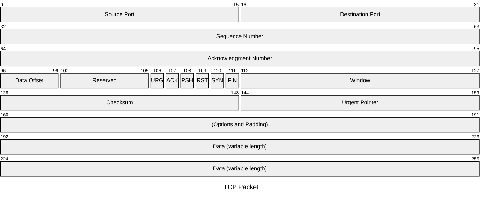
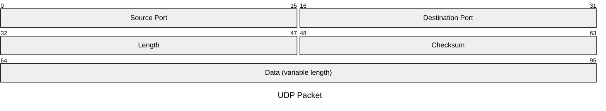

# Packet diagram

## Keywords
`packet` (older alias `packet-beta`). Status: stable (v11.0.0+).

## When to use
Bit-level layout of a network packet, frame, register or binary header. Nearest alternative: `block` when the fields are not bit-addressed.

## Syntax
Fields, one per line, contiguous from bit 0:

```text
packet
start: "Field"          %% single bit
start-end: "Field"      %% inclusive range
+count: "Field"         %% next count bits (v11.7.0+)
```

Title, as a statement or frontmatter:

```text
packet
title UDP Packet
```

## Features
| Feature id | Construct | Snippet |
|---|---|---|
| `packet.keyword` | opener | `packet` |
| `packet.keyword-beta` | older alias opener | `packet-beta` |
| `packet.field-range` | multi-bit field by start and end | `0-15: "Source Port"` |
| `packet.field-single-bit` | single-bit field | `106: "URG"` |
| `packet.field-bit-count` | field by bit count from the previous end | `+16: "Source Port"` |
| `packet.field-bit-count-single` | one-bit field by count | `+1: "Flag"` |
| `packet.mixed-notation` | counts and explicit ranges mixed | `+16: "A"` then `16-31: "B"` |
| `packet.row-wrap` | field longer than a row wraps to the next | `192-255: "Data (variable length)"` |
| `packet.title` | title statement | `title UDP Packet` |
| `packet.frontmatter-title` | title in frontmatter | `title: "TCP Packet"` |
| `packet.comment` | `%%` comment, own line or after a field | `0: "x" %% Single-bit block` |
| `packet.acc-title` | accessible title | `accTitle: TCP header` |
| `packet.acc-descr` | accessible description, one line | `accDescr: Fields of a TCP header` |
| `packet.acc-descr-block` | accessible description, multi-line | `accDescr { ... }` |

## Configuration and theming
Frontmatter `config.packet` keys (12.0.0 defaults):

| Key | Default | Notes |
|---|---|---|
| `bitsPerRow` | `32` | bits per row |
| `bitWidth` | `32` | pixel width of one bit |
| `rowHeight` | `32` | |
| `showBits` | `true` | draws start/end bit numbers above each field |
| `paddingX` / `paddingY` | `5` / `5` | |
| `useMaxWidth` | `true` | |

```yaml
---
config:
  packet:
    bitsPerRow: 16
    showBits: false
---
```

themeVariables: the 12.0.0 styles read `themeVariables.packet.*` (`byteFontSize`, `startByteColor`, `endByteColor`, `labelColor`, `labelFontSize`, `titleColor`, `titleFontSize`, `blockStrokeColor`, `blockStrokeWidth`, `blockFillColor`), but the syntax page says they are not propagated, and a frontmatter test with CLI 12.0.0 confirmed they have no effect. `accTitle`, `accDescr` and `accDescr { }` are supported (SVG `<title>` / `<desc>`).

## Traps
- Fields must be contiguous from bit 0. A gap (`0-15` then `20-31`), an overlap, or a first field not at 0 fails: "Packet block 20 - 31 is not contiguous. It should start from 16."
- `+0: "x"` fails ("Cannot have a zero bit field"); `15-0: "x"` fails ("End must be greater than start").
- Labels must be quoted; `0-15: A` produces an error SVG while the CLI exits 0 (`check.sh` catches it). Single quotes are accepted.
- Ranges are inclusive: `0-15` is 16 bits; `+16` after it starts at 16.
- `themeVariables.packet` has no effect in 12.0.0 (see above).

```text
packet
0-15: "A"
20-31: B
+0: "zero"
```

## Complete example



Covers: every feature id except `packet.keyword-beta`, `packet.title` and `packet.acc-descr` (the title statement would compete with the frontmatter title, and `accDescr` has one form per diagram; next fence).



Covers: `packet.keyword-beta`, `packet.title`, `packet.acc-descr`, `packet.field-bit-count`, `packet.field-range`, `packet.mixed-notation`.

## Builder
`candidate`: `scripts/render.py` has an IR builder for this type (target keyword(s) `packet`). It has not been through the reliability bar yet; see [coverage.md](../coverage.md).
