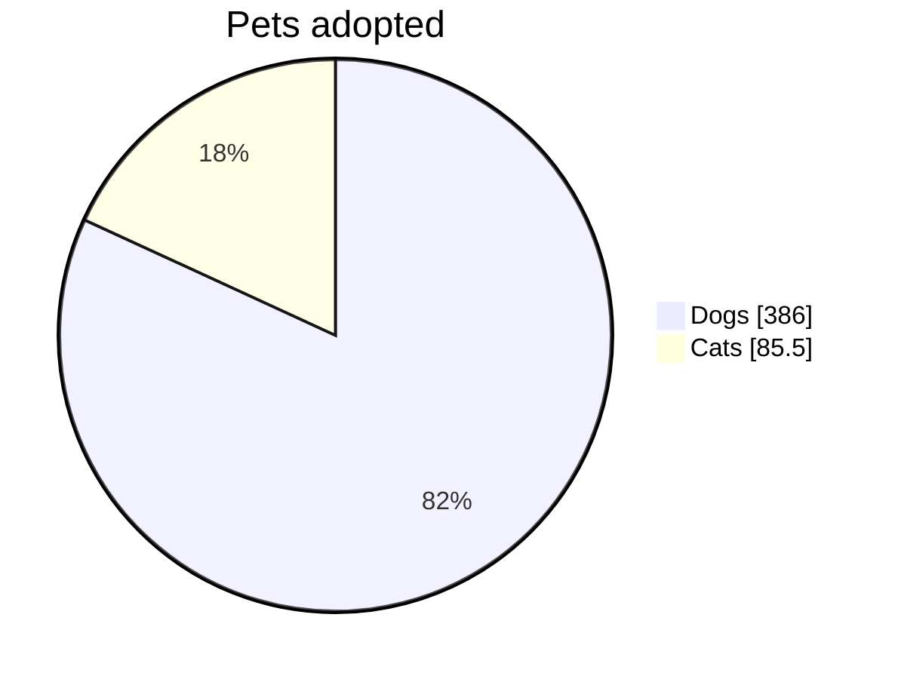
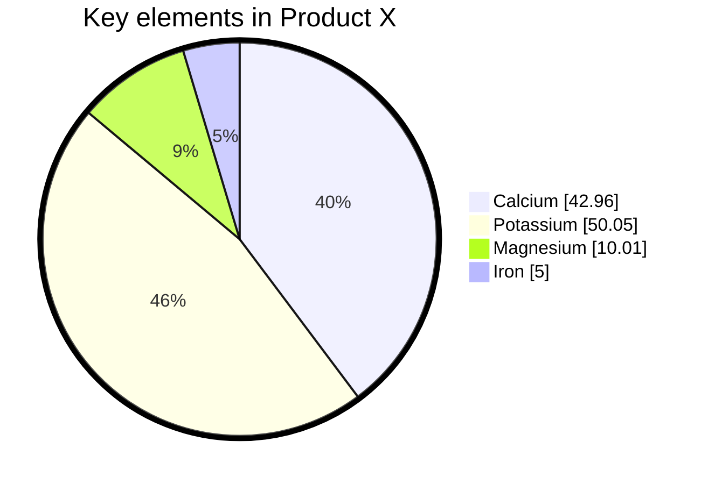
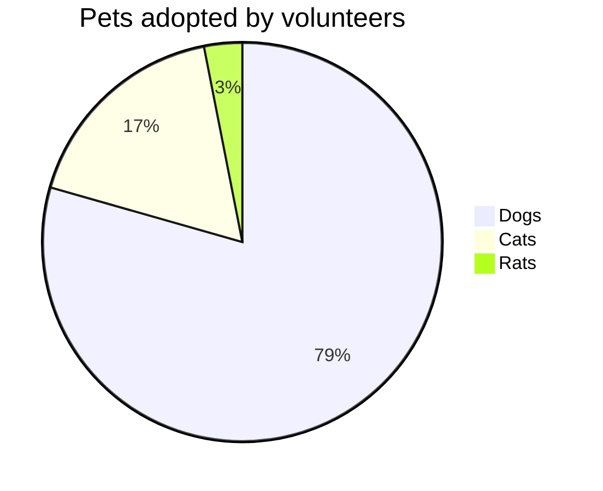

# Pie chart

## Keywords
`pie`. Status: stable.

## When to use
Show how a whole splits into a few positive parts (proportions of one total).
Nearest alternative: `treemap` for nested proportions, `xyChart` (bar) to compare absolute values.

## Syntax

Opening line, with optional `showData` and an inline title:

```text
pie [showData] [title <text>]
```

Title on its own line:

```text
title <text>
```

One slice per line, label in double quotes, a number >= 0:

```text
"<label>" : <value>
```



## Features
| Feature id | Construct | Snippet |
|---|---|---|
| `pie.keyword` | opening keyword | `pie` |
| `pie.show-data` | print each value after its legend text | `pie showData` |
| `pie.title-inline` | title on the opening line | `pie title Pets adopted` |
| `pie.title-statement` | title on its own line | `title Pets adopted` |
| `pie.slice` | one slice: quoted label, colon, value | `"Dogs" : 386` |
| `pie.slice-decimal` | decimal value (two places documented) | `"Iron" : 42.96` |

## Configuration and theming

Frontmatter `config.pie` keys (defaults from the syntax page; `useMaxWidth` from the 12.0.0 schema):

| Key | Default | Meaning |
|---|---|---|
| `textPosition` | `0.75` | Radial position of slice labels, 0.0 centre to 1.0 edge |
| `donutHole` | `0` | Donut hole ratio, `0` to `0.9` |
| `legendPosition` | `right` | `top`, `bottom`, `left`, `right`, `center` |
| `highlightSlice` | none (`""`) | Label of a slice to highlight, or `hover` to highlight on hover |
| `useMaxWidth` | `true` | Scale SVG to container width (schema, not on the page) |

Theme variables the syntax page documents:

| Variable | Meaning |
|---|---|
| `pieOuterStrokeWidth` | Width of the outer circle stroke, e.g. `"5px"` |

The 12.0.0 theme source also defines `pie1`..`pie12`, `pieOpacity`, `pieStrokeColor`,
`pieStrokeWidth`, `pieOuterStrokeColor`, `pieTitleTextSize`, `pieTitleTextColor`,
`pieSectionTextSize`, `pieSectionTextColor`, `pieLegendTextSize`, `pieLegendTextColor`
(not on the syntax page).

Accessibility: `accTitle: ...`, `accDescr: ...` and `accDescr { ... }` render with CLI 12.0.0
(not documented on the pie page).

## Traps

- Labels must be double or single quoted. An unquoted label gives an error SVG:

```text
pie
    Dogs : 386
```

- Negative values throw `Negative values are not allowed in pie charts`. Zero renders (an empty slice).
- Numbers need a leading digit: `.5` and `1e3` fail. Write `0.5`, `1000`.
- `showData` must come right after `pie`. `pie title X showData` renders `X showData` as the title.
- A duplicate label is silently dropped: the first value wins.
- `donutHole`, `legendPosition`, `highlightSlice` are frontmatter config, not diagram statements.

## Complete example



Covers: every feature id except `pie.title-inline` (one title per diagram), plus every `config.pie` key except `useMaxWidth`.



Covers: `pie.keyword`, `pie.title-inline`, `pie.slice`.

## Builder
`builder`: family `chart`, keyword `pie`.

| Key | Type | Meaning |
|---|---|---|
| `slices` | array, 1+ | `{label, value}`; `value` is a number >= 0 |
| `title` | string | Chart title |
| `titlePlacement` | `statement` (default) \| `inline` | Own `title` line, or `pie title ...` |
| `showData` | boolean | `pie showData` |
| `accessibility` | object | `{title, description}` -> `accTitle`, `accDescr` |
| `config` | object | Frontmatter: `theme`, `pie.{textPosition, donutHole, legendPosition, highlightSlice, useMaxWidth}`, `themeVariables.{pieOuterStrokeWidth, pie1..pie12, ...}` |

Example: [maximal.json](../../tests/fixtures/pie/maximal.json). Rejected: a duplicate slice label
(Mermaid would drop it), a negative value, and a `highlightSlice` that is not `hover` or the label
of a slice (a label that needs entity codes cannot be highlighted). Free text is written with Mermaid entity codes (`#quot;`, `#59;`, `#lt;`, ...), which render back to the original characters; leading or trailing spaces, control characters and line breaks (except in `accessibility.description`) are rejected.
