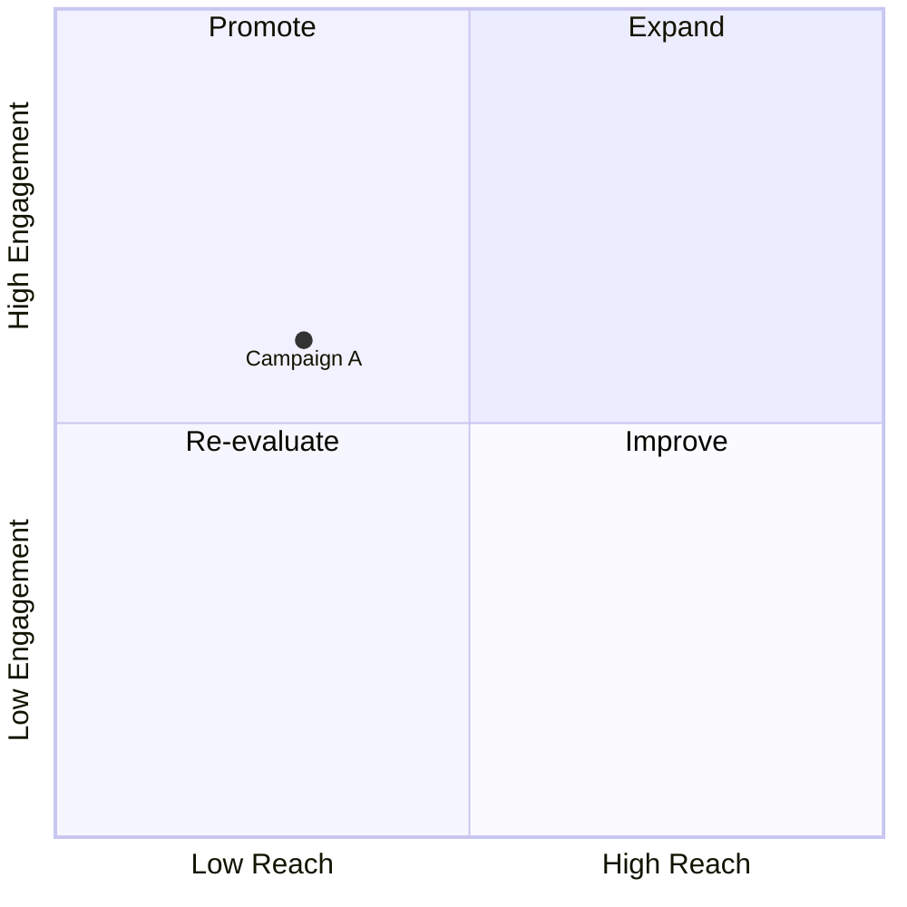
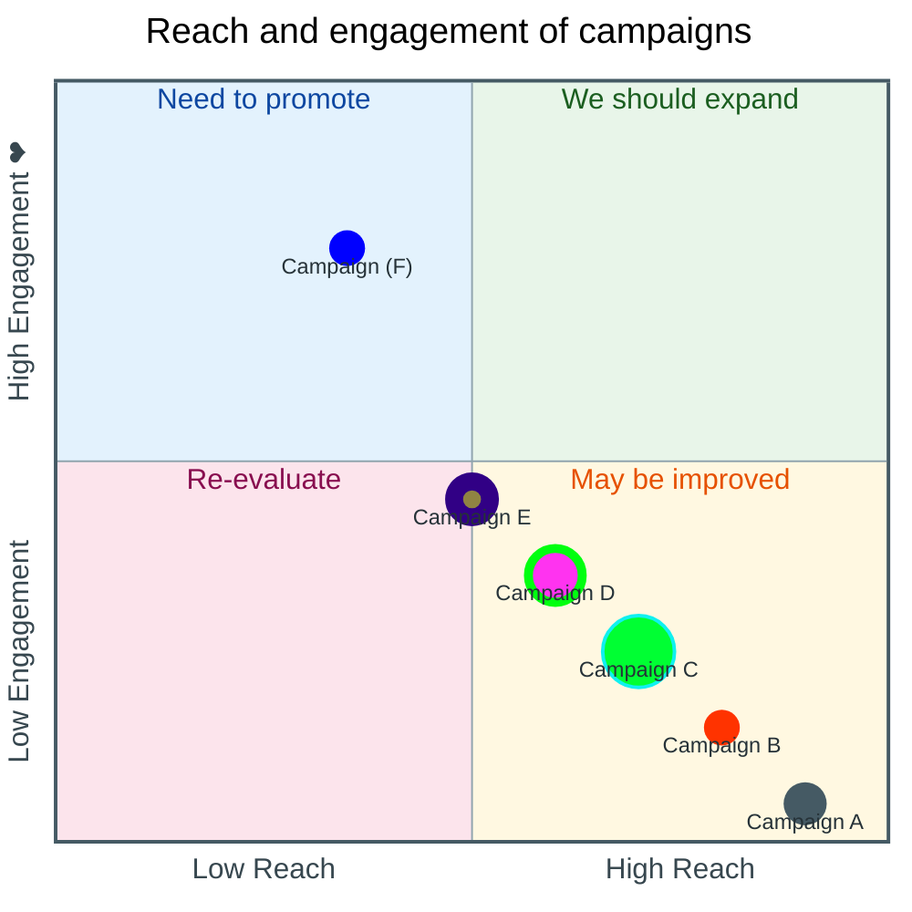
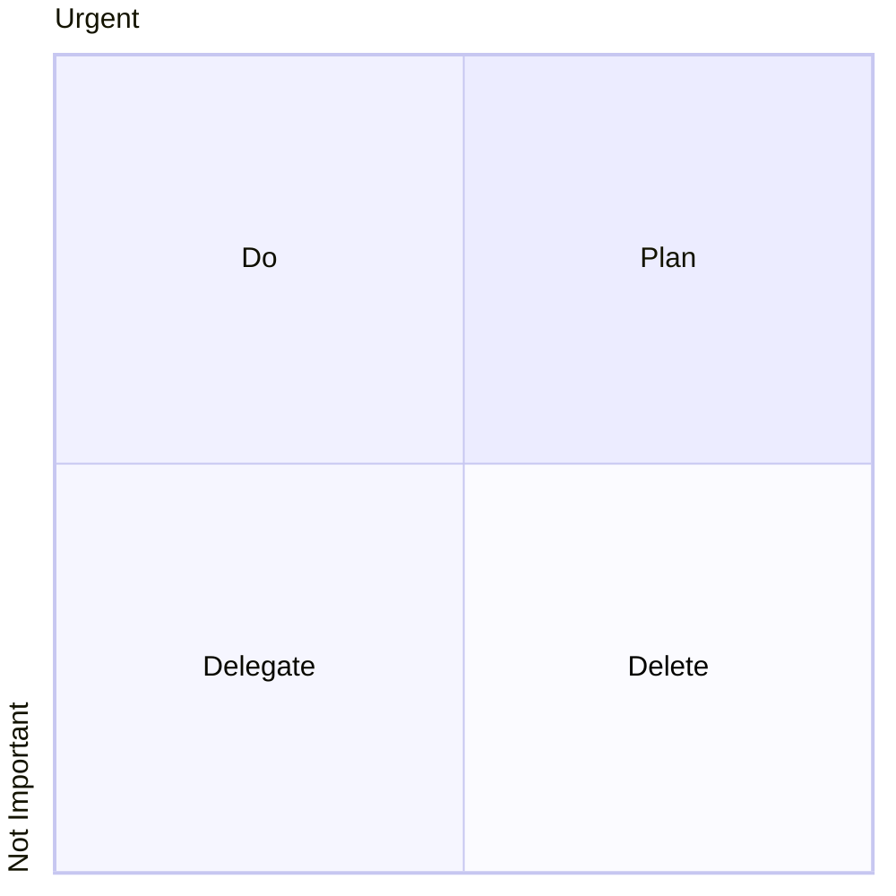

# Quadrant chart

## Keywords
`quadrantChart`. Status: stable.

## When to use
Place items on a two-criteria 2x2 grid (effort vs impact, reach vs engagement) to prioritise them.
Nearest alternative: `xyChart` for real numeric axes, `cynefin` for a sense-making framework.

## Syntax

```text
quadrantChart
    title <text>
    x-axis <left text> [--> <right text>]
    y-axis <bottom text> [--> <top text>]
    quadrant-1 <text>
    quadrant-2 <text>
    quadrant-3 <text>
    quadrant-4 <text>
    <point text>[:::<class>]: [<x>, <y>] [<style>: <value>, ...]
    classDef <class> <style>: <value>, ...
```

Quadrant numbering: 1 top right, 2 top left, 3 bottom left, 4 bottom right. `x` and `y` are in 0..1.



## Features
| Feature id | Construct | Snippet |
|---|---|---|
| `quadrantChart.keyword` | opening keyword | `quadrantChart` |
| `quadrantChart.title` | chart title | `title Reach and engagement` |
| `quadrantChart.x-axis-both` | x-axis left and right text | `x-axis Low Reach --> High Reach` |
| `quadrantChart.x-axis-left-only` | x-axis left text only | `x-axis Low Reach` |
| `quadrantChart.y-axis-both` | y-axis bottom and top text | `y-axis Low --> High` |
| `quadrantChart.y-axis-bottom-only` | y-axis bottom text only | `y-axis Low` |
| `quadrantChart.quadrant-1` | top right quadrant text | `quadrant-1 We should expand` |
| `quadrantChart.quadrant-2` | top left quadrant text | `quadrant-2 Need to promote` |
| `quadrantChart.quadrant-3` | bottom left quadrant text | `quadrant-3 Re-evaluate` |
| `quadrantChart.quadrant-4` | bottom right quadrant text | `quadrant-4 May be improved` |
| `quadrantChart.quoted-text` | quoted text (axis, quadrant, point) | `y-axis Not Important --> "Important ❤"` |
| `quadrantChart.point` | data point, x and y in 0..1 | `Campaign A: [0.3, 0.6]` |
| `quadrantChart.point-radius` | direct style: point radius | `A: [0.9, 0.0] radius: 12` |
| `quadrantChart.point-color` | direct style: point fill | `B: [0.8, 0.1] color: #ff3300` |
| `quadrantChart.point-stroke-color` | direct style: border colour | `C: [0.7, 0.2] stroke-color: #10f0f0, stroke-width: 2px` |
| `quadrantChart.point-stroke-width` | direct style: border width | `D: [0.6, 0.3] stroke-width: 5px` |
| `quadrantChart.point-class` | class shorthand on a point | `E:::class1: [0.5, 0.4]` |
| `quadrantChart.class-def` | shared point class | `classDef class1 color: #109060, radius : 10` |

Style precedence: direct styles, then class styles, then theme.

## Configuration and theming

Frontmatter `config.quadrantChart` keys (defaults from the syntax page; `useMaxWidth` from the 12.0.0 schema):

| Key | Default | Meaning |
|---|---|---|
| `chartWidth` | `500` | Chart width |
| `chartHeight` | `500` | Chart height |
| `titlePadding` | `10` | Top and bottom padding of the title |
| `titleFontSize` | `20` | Title font size |
| `quadrantPadding` | `5` | Padding outside all quadrants |
| `quadrantTextTopPadding` | `5` | Quadrant text top padding when drawn on top |
| `quadrantLabelFontSize` | `16` | Quadrant text font size |
| `quadrantInternalBorderStrokeWidth` | `1` | Border width inside the quadrants |
| `quadrantExternalBorderStrokeWidth` | `2` | Outer border width |
| `xAxisLabelPadding` | `5` | Top and bottom padding of x-axis text |
| `xAxisLabelFontSize` | `16` | X-axis text font size |
| `xAxisPosition` | `'top'` | `top` or `bottom`; forced to bottom when there are points |
| `yAxisLabelPadding` | `5` | Left and right padding of y-axis text |
| `yAxisLabelFontSize` | `16` | Y-axis text font size |
| `yAxisPosition` | `'left'` | `left` or `right` |
| `pointTextPadding` | `5` | Gap between a point and its text |
| `pointLabelFontSize` | `12` | Point text font size |
| `pointRadius` | `5` | Point radius |
| `useMaxWidth` | `true` | Scale SVG to container width (schema, not on the page) |

Theme variables (`config.themeVariables`):

| Variable | Meaning |
|---|---|
| `quadrant1Fill` | Fill of the top right quadrant |
| `quadrant2Fill` | Fill of the top left quadrant |
| `quadrant3Fill` | Fill of the bottom left quadrant |
| `quadrant4Fill` | Fill of the bottom right quadrant |
| `quadrant1TextFill` | Text colour of the top right quadrant |
| `quadrant2TextFill` | Text colour of the top left quadrant |
| `quadrant3TextFill` | Text colour of the bottom left quadrant |
| `quadrant4TextFill` | Text colour of the bottom right quadrant |
| `quadrantPointFill` | Point fill |
| `quadrantPointTextFill` | Point text colour |
| `quadrantXAxisTextFill` | X-axis text colour |
| `quadrantYAxisTextFill` | Y-axis text colour |
| `quadrantInternalBorderStrokeFill` | Inner border colour |
| `quadrantExternalBorderStrokeFill` | Outer border colour |
| `quadrantTitleFill` | Title colour |

Point style keys (direct or `classDef`): `color`, `radius`, `stroke-width`, `stroke-color`
(`stroke-color` has no effect without `stroke-width`).

Accessibility: `accTitle: ...`, `accDescr: ...` and `accDescr { ... }` render with CLI 12.0.0.

## Traps

- Coordinates outside 0..1 are a lexical error, and so is a missing leading digit (`.3`):

```text
quadrantChart
    A: [1.2, 0.6]
```

- `stroke-width` needs a unit: `stroke-width: 5` throws `InvalidStyleError`; write `5px`.
- A trailing comma after the last style is a parse error: `A: [0.3, 0.6] radius: 12,`.
- Parentheses or a colon in unquoted text fail (`Point (one): [...]`, `quadrant-1 We should: expand`).
  Quote the text: `"Point (one)": [0.1, 0.6]`.
- With points present, `xAxisPosition: top` is ignored; the x-axis renders at the bottom.

## Complete example



Covers: every feature id except `quadrantChart.x-axis-left-only`, `quadrantChart.y-axis-bottom-only` (one axis statement each), plus every `config.quadrantChart` key and theme variable.



Covers: `quadrantChart.keyword`, `quadrantChart.x-axis-left-only`, `quadrantChart.y-axis-bottom-only`, `quadrantChart.quadrant-1` to `quadrantChart.quadrant-4` (no points, so texts render centred).

## Builder
`candidate`: `scripts/render.py` has an IR builder for this type (target keyword(s) `quadrantChart`). It has not been through the reliability bar yet; see [coverage.md](../coverage.md).
