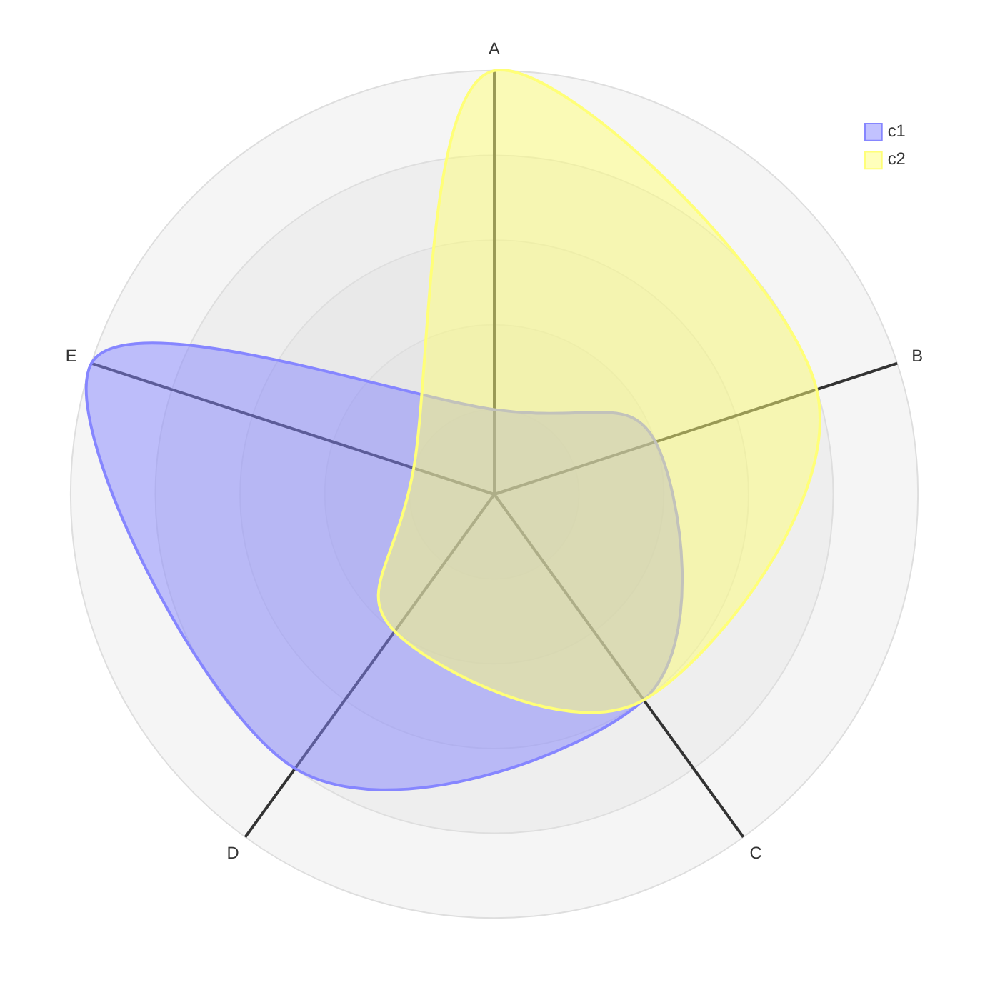
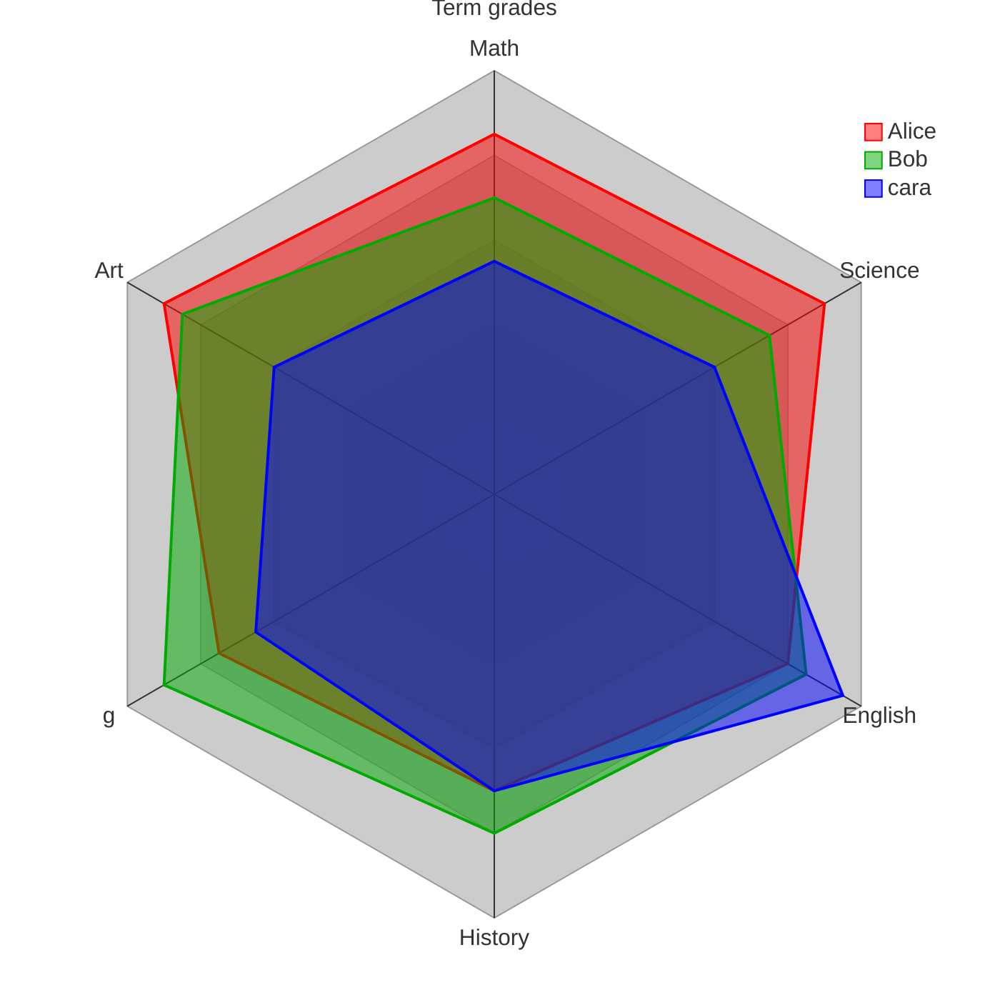
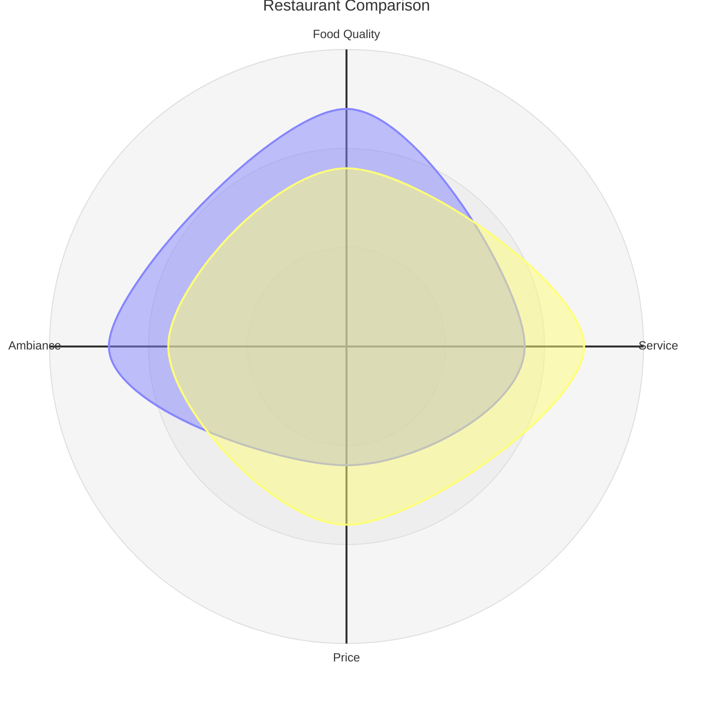

# Radar diagram

## Keywords
`radar-beta`. Status: beta.

## When to use
Compare a few entities across the same set of 3 to ~8 dimensions (skills, product scores).
Nearest alternative: `xyChart` (grouped bars) when the dimensions are many or need exact values.

## Syntax

```text
radar-beta
    title <text>
    axis <id>["<label>"], <id>["<label>"], ...
    curve <id>["<label>"]{<v1>, <v2>, ...}, <id>{...}
    curve <id>{ <axisId>: <v>, <axisId>: <v>, ... }
    showLegend true|false
    max <n>
    min <n>
    graticule circle|polygon
    ticks <n>
```

Positional curve values follow the axis order. Key-value curves name every axis.



## Features
| Feature id | Construct | Snippet |
|---|---|---|
| `radar.keyword` | opening keyword | `radar-beta` |
| `radar.title` | diagram title | `title Restaurant Comparison` |
| `radar.axis` | axis with an id only | `axis A, B, C` |
| `radar.axis-label` | axis with id and label | `axis m["Math"]` |
| `radar.axis-multi` | several axes on one line, several `axis` lines | `axis id2["Label2"], id3["Label3"]` |
| `radar.curve` | curve with positional values | `curve c1{1, 2, 3}` |
| `radar.curve-label` | curve with id and label | `curve a["Alice"]{85, 90, 80}` |
| `radar.curve-multi` | several curves on one line | `curve id2["Label2"]{4, 5, 6}, id3{7, 8, 9}` |
| `radar.curve-key-value` | curve values keyed by axis id | `curve id4{ axis3: 30, axis1: 20, axis2: 10 }` |
| `radar.show-legend` | show or hide the legend (default shown) | `showLegend true` |
| `radar.max` | maximum of the scale (default from data) | `max 100` |
| `radar.min` | minimum of the scale (default `0`) | `min 0` |
| `radar.graticule-circle` | circular graticule (default) | `graticule circle` |
| `radar.graticule-polygon` | polygon graticule | `graticule polygon` |
| `radar.ticks` | number of concentric rings (default `5`) | `ticks 5` |

## Configuration and theming

Frontmatter `config.radar` keys (defaults from the syntax page):

| Key | Default | Meaning |
|---|---|---|
| `width` | `600` | Diagram width |
| `height` | `600` | Diagram height |
| `marginTop` | `50` | Top margin |
| `marginBottom` | `50` | Bottom margin |
| `marginLeft` | `50` | Left margin |
| `marginRight` | `50` | Right margin |
| `axisScaleFactor` | `1` | Scale factor for the axes |
| `axisLabelFactor` | `1.05` | Axis label position factor |
| `curveTension` | `0.17` | Tension of the rounded curves |

Global theme variables (`config.themeVariables.*`, defaults depend on the theme):

| Variable | Meaning |
|---|---|
| `fontSize` | Title font size |
| `titleColor` | Title colour |
| `cScale${i}` | Colour of the i-th curve (`cScale0`, `cScale1`, ... usually up to 12) |

Radar style options (`config.themeVariables.radar.*`):

| Variable | Default | Meaning |
|---|---|---|
| `axisColor` | `black` | Axis line colour |
| `axisStrokeWidth` | `1` | Axis line width |
| `axisLabelFontSize` | `12px` | Axis label font size |
| `curveOpacity` | `0.7` | Curve fill opacity |
| `curveStrokeWidth` | `2` | Curve line width |
| `graticuleColor` | `black` | Graticule colour |
| `graticuleOpacity` | `0.5` | Graticule opacity |
| `graticuleStrokeWidth` | `1` | Graticule line width |
| `legendBoxSize` | `10` | Legend box size |
| `legendFontSize` | `14px` | Legend font size |

Accessibility: `accTitle: ...`, `accDescr: ...` and `accDescr { ... }` render with CLI 12.0.0.
A frontmatter `title:` also renders.

## Traps

- The keyword is `radar-beta`; bare `radar` is `UnknownDiagramError`.
- A curve whose value count differs from the axis count renders without error but the curve is
  not drawn. Count axes across every `axis` line.
- A key-value curve must name every axis, or it throws `Missing entry for axis <id>`.
- Negative numbers fail (in a curve or in `min`):

```text
radar-beta
    axis A, B, C
    curve c1{-1, 2, 3}
```

- Axis and curve ids must be bare words; `axis "A"` fails. Put text in the label: `A["My label"]`.
- `showLegend` takes lowercase `true` / `false`; `True` fails. `graticule` takes only `circle` or `polygon`.

## Complete example



Covers: every feature id except `radar.graticule-circle` (one graticule per diagram), plus every `config.radar` key and theme variable.



Covers: `radar.keyword`, `radar.title`, `radar.axis-label`, `radar.curve-label`, `radar.show-legend`, `radar.max`, `radar.graticule-circle`, `radar.ticks`.

## Builder
`builder`: family `chart`, keyword `radar-beta`.

| Key | Type | Meaning |
|---|---|---|
| `axes` | array, 1+ | `{id, label?}`, all written on one `axis` line |
| `curves` | array, 1+ | `{id, label?, values}` (one number >= 0 per axis, in axis order) or `{id, label?, entries: [{axis, value}]}`; all on one `curve` line |
| `title` | string | Chart title |
| `showLegend` | boolean | `showLegend true\|false` |
| `max`, `min` | number >= 0 | Scale range, `min < max` |
| `graticule` | `circle` \| `polygon` | Grid shape |
| `ticks` | integer >= 1 | Number of rings |
| `accessibility` | object | `{title, description}` |
| `config` | object | Frontmatter: `theme`, `radar.*`, `themeVariables.{fontSize, titleColor, cScale0..11, radar.*}` |

Example: [maximal.json](../../tests/fixtures/radar/maximal.json). Ids are bare identifiers and must
not be a radar keyword (`axis`, `curve`, `max`, `min`, `title`, `ticks`, `graticule`, `showLegend`,
`true`, `false`, `circle`, `polygon`). Rejected: a value count that differs from the axis count
(Mermaid would drop the curve), `entries` that miss or repeat an axis, negative values. Free text is written with Mermaid entity codes (`#quot;`, `#59;`, `#lt;`, ...), which render back to the original characters; leading or trailing spaces, control characters and line breaks (except in `accessibility.description`) are rejected.
