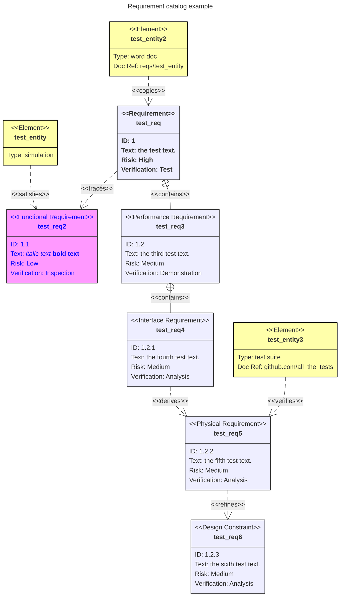
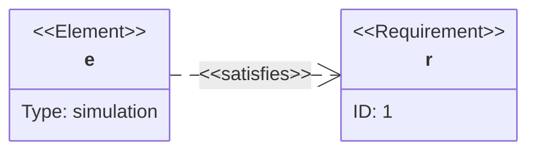
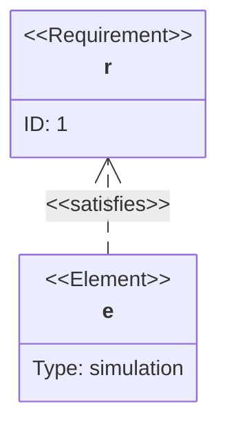
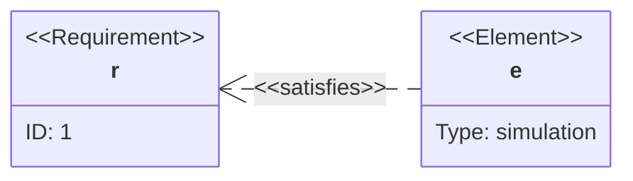

# Requirement diagram

## Keywords
`requirementDiagram` (no alias). Status: stable.

## When to use
SysML v1.6-style requirements, the elements that satisfy or verify them, and the typed links between them. Nearest alternative: `classDiagram` or `flowchart` for traceability graphs that do not need SysML fields.

## Syntax
Requirement (`<type>` is one of six SysML kinds; every field is optional):

```text
<type> user_defined_name {
    id: user_defined_id
    text: user_defined text
    risk: <Low | Medium | High>
    verifymethod: <Analysis | Inspection | Test | Demonstration>
}
```

Element:

```text
element user_defined_name {
    type: user_defined_type
    docref: user_defined_ref
}
```

Relationship, either direction:

```text
{source} - <type> -> {destination}
{destination} <- <type> - {source}
```

Direction and styling:

```text
direction LR
style test_req fill:#ffa,stroke:#000
classDef important fill:#f96,stroke:#333
class test_req,test_entity important
test_entity:::important
```

## Features
| Feature id | Construct | Snippet |
|---|---|---|
| `requirementDiagram.keyword` | opener | `requirementDiagram` |
| `requirementDiagram.type-requirement` | requirement | `requirement r1 { ... }` |
| `requirementDiagram.type-functional` | functional requirement | `functionalRequirement r2 { ... }` |
| `requirementDiagram.type-interface` | interface requirement | `interfaceRequirement r3 { ... }` |
| `requirementDiagram.type-performance` | performance requirement | `performanceRequirement r4 { ... }` |
| `requirementDiagram.type-physical` | physical requirement | `physicalRequirement r5 { ... }` |
| `requirementDiagram.type-design-constraint` | design constraint | `designConstraint r6 { ... }` |
| `requirementDiagram.field-id` | requirement id | `id: 1.2.1` |
| `requirementDiagram.field-text` | requirement text | `text: the test text.` |
| `requirementDiagram.risk-low` | risk Low | `risk: low` |
| `requirementDiagram.risk-medium` | risk Medium | `risk: medium` |
| `requirementDiagram.risk-high` | risk High | `risk: high` |
| `requirementDiagram.verify-analysis` | verification Analysis | `verifymethod: analysis` |
| `requirementDiagram.verify-inspection` | verification Inspection | `verifymethod: inspection` |
| `requirementDiagram.verify-test` | verification Test | `verifymethod: test` |
| `requirementDiagram.verify-demonstration` | verification Demonstration | `verifymethod: demonstration` |
| `requirementDiagram.element` | element | `element test_entity { ... }` |
| `requirementDiagram.element-type` | element type | `type: simulation` |
| `requirementDiagram.element-docref` | element document reference | `docRef: reqs/test_entity` |
| `requirementDiagram.quoted-text` | quoted user text | `type: "test suite"` |
| `requirementDiagram.markdown-text` | markdown inside quotes | `text: "*italic* **bold**"` |
| `requirementDiagram.quoted-name` | quoted (markdown) node name | `requirement "__test_req__" { ... }` |
| `requirementDiagram.rel-contains` | contains | `r1 - contains -> r3` |
| `requirementDiagram.rel-copies` | copies | `e2 - copies -> r1` |
| `requirementDiagram.rel-derives` | derives | `r4 - derives -> r5` |
| `requirementDiagram.rel-satisfies` | satisfies | `e1 - satisfies -> r2` |
| `requirementDiagram.rel-verifies` | verifies | `e3 - verifies -> r5` |
| `requirementDiagram.rel-refines` | refines | `r5 - refines -> r6` |
| `requirementDiagram.rel-traces` | traces | `r1 - traces -> r2` |
| `requirementDiagram.rel-reverse` | destination-first form | `r1 <- copies - e2` |
| `requirementDiagram.direction-tb` | top to bottom (default) | `direction TB` |
| `requirementDiagram.direction-bt` | bottom to top | `direction BT` |
| `requirementDiagram.direction-lr` | left to right | `direction LR` |
| `requirementDiagram.direction-rl` | right to left | `direction RL` |
| `requirementDiagram.style` | direct style on nodes | `style r1,e1 fill:#ffa,stroke:#000, color: green` |
| `requirementDiagram.class-def` | class definition | `classDef important fill:#f96,stroke:#333` |
| `requirementDiagram.class-def-default` | `default` class applied to all nodes | `classDef default fill:#f9f,stroke:#333` |
| `requirementDiagram.class` | apply classes to a list of nodes | `class r1,e1 important` |
| `requirementDiagram.class-shorthand-definition` | `:::` on the definition | `requirement r1:::important { ... }` |
| `requirementDiagram.class-shorthand-statement` | `:::` after the definition | `e1:::important` |
| `requirementDiagram.acc-title` | accessible title | `accTitle: Checkout requirements` |
| `requirementDiagram.acc-descr` | accessible description, one line | `accDescr: Requirements and elements` |
| `requirementDiagram.acc-descr-block` | accessible description, multi-line | `accDescr { ... }` |
| `requirementDiagram.comment` | line comment | `%% note` |

## Configuration and theming
v12.0.0 defaults for this type: theme `redux-color`, look `neo`, layout ELK. Restore the old appearance with frontmatter `theme: default`, `look: classic`, `layout: dagre`, or scope theme and look to the type with `mermaid.initialize({ requirement: { theme: 'default', look: 'classic' } })`.

Frontmatter `config.requirement` keys (12.0.0 defaults):

| Key | Default |
|---|---|
| `theme` / `look` | `redux-color` / `neo` |
| `rect_fill` | `#f9f9f9` |
| `text_color` | `#333` |
| `rect_border_size` / `rect_border_color` | `0.5px` / `#bbb` |
| `rect_min_width` / `rect_min_height` | `200` / `200` |
| `fontSize` | `14` |
| `rect_padding` | `10` |
| `line_height` | `20` |
| `useMaxWidth` | `true` |

```yaml
---
config:
  theme: default
  look: classic
  layout: dagre
---
```

themeVariables (read by the 12.0.0 styles, not listed on the syntax page): `requirementBackground`, `requirementBorderColor`, `requirementBorderSize`, `requirementTextColor`, `relationColor`, `relationLabelBackground`, `relationLabelColor`. `accTitle`, `accDescr` and `accDescr { }` are supported.

## Traps
- No `title` statement: `title X` is a parse error. Use frontmatter `title:`.
- A relationship to an undeclared node crashes the layout (ELK: "Id must be a string or an integer: 'null'"; dagre: `TypeError ... 'shape'`). Declare both ends.
- Unquoted user text stops at keywords and punctuation: `text: a: b` fails. Quote it: `text: "a: b"`.
- Names with `-` fail (`requirement my-req`); use `_` or a quoted name.
- `risk` and `verifymethod` accept only the listed values (case-insensitive); `risk: extreme` is a parse error.
- `click` is not supported (parse error).
- `classDef default` restyles every node; define specific classes and `style` lines after it.
- `:::a:::b` is a parse error; give several classes as `:::a,b`.

```text
requirementDiagram
title X
requirement my-req {
text: a: b
risk: extreme
}
e - verifies -> missing
```

## Complete example



Covers: every feature id except `requirementDiagram.acc-descr`, `requirementDiagram.direction-bt`, `requirementDiagram.direction-lr`, `requirementDiagram.direction-rl` (one `accDescr` form and one direction per diagram; next fences).



Covers: `requirementDiagram.acc-descr`, `requirementDiagram.direction-lr`.



Covers: `requirementDiagram.direction-bt`.



Covers: `requirementDiagram.direction-rl`.

## Builder
`builder`: family `requirement-links`, keyword `requirementDiagram`.

| Key | Type | Meaning |
|---|---|---|
| `requirements[]` | object, required | `{id, type?, name?, req_id?, text?, risk?, verify_method?, classes?, markdown?}` |
| `requirements[].type` | enum | `requirement` (default), `functionalRequirement`, `interfaceRequirement`, `performanceRequirement`, `physicalRequirement`, `designConstraint` |
| `.risk`, `.verify_method` | enum | `low`, `medium`, `high`; `analysis`, `inspection`, `test`, `demonstration` |
| `.req_id`, `.text` | text | the `id:` and `text:` fields, always quoted |
| `elements[]` | object | `{id, name?, type?, docref?, classes?, markdown?}` |
| `id` | identifier | bare node name and the IR reference; not a lexer keyword (case-insensitive: `element`, `text`, `high`, `test`, ...) |
| `name` | text | quoted node name used instead of `id` in the source |
| `markdown` | boolean | keep `*` and `_` as Markdown in this node's text; otherwise they are encoded so they show as typed |
| `classes[]` | class names | `:::a,b` on the definition |
| `links[]` | `{from, to, kind, reverse?}` | `contains`, `copies`, `derives`, `satisfies`, `verifies`, `refines`, `traces`; `reverse` writes `to <- kind - from` |
| `direction` | enum | `TB`, `BT`, `LR`, `RL` |
| `title` | text | frontmatter `title:` |
| `class_defs[]`, `class_assignments[]`, `styles[]` | typed | `{name, style}`; `{nodes[], classes[], shorthand?}` (`shorthand` writes `node:::a,b`, one node); `{nodes[], style}` with the same style object as [block](block.md#builder) |
| `accessibility`, `comment` | | `accTitle` / `accDescr`, `%%` line |

Text is quoted Markdown with HTML: `"`, `#`, `<`, `>`, `&`, `\` (and `*`, `_` unless `markdown`) become entity codes, so the visible text is what you typed. Rejected: links or classes to undeclared ids and two nodes with the same emitted name. Example: [maximal.json](../../tests/fixtures/requirementDiagram/maximal.json), plus `maximal.direction-*.json` for the other directions and one-line `accDescr`.
