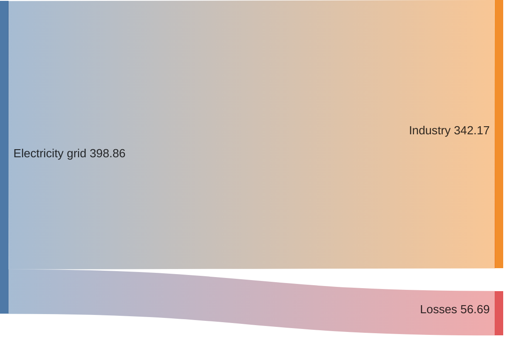
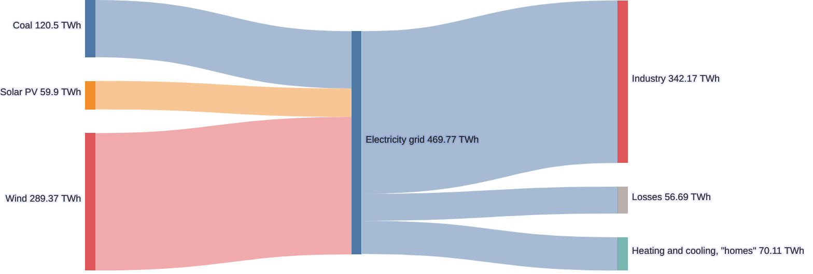
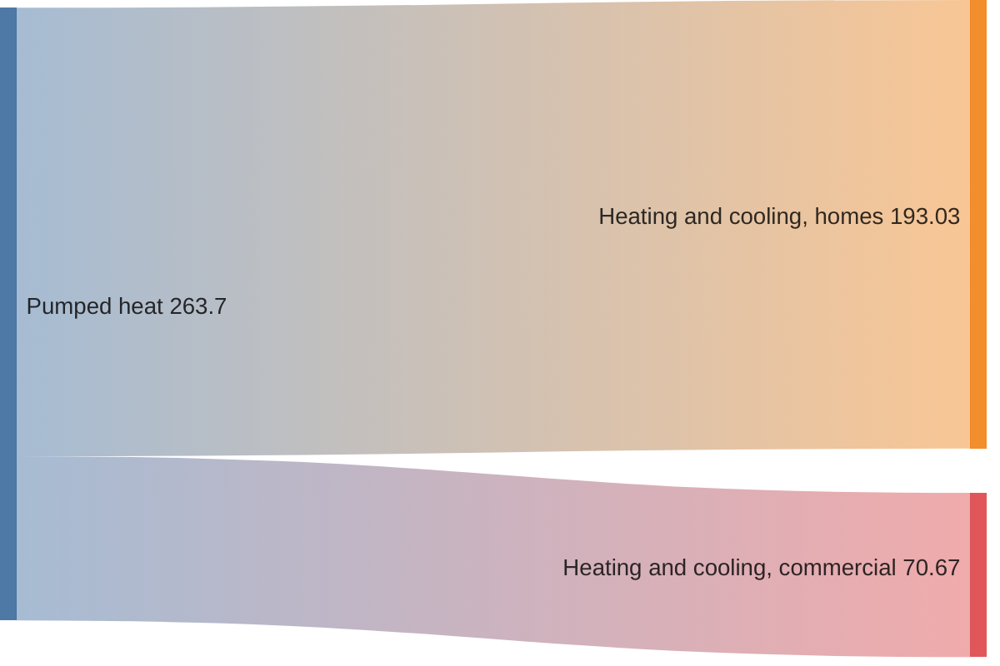

# Sankey diagram

## Keywords
`sankey` (alias `sankey-beta`). Status: beta (the page calls it experimental).

## When to use
Show quantities flowing from sources to targets, with link width proportional to the value.
Nearest alternative: `flowchart` for flows without quantities, `treemap` for a static hierarchy of sizes.

## Syntax

Keyword, then CSV rows with exactly three columns: source, target, value.

```text
sankey

<source>,<target>,<value>
```

A cell containing a comma is wrapped in double quotes; a double quote inside it is doubled:

```text
Pumped heat,"Heating and cooling, ""homes""",193.026
```



## Features
| Feature id | Construct | Snippet |
|---|---|---|
| `sankey.keyword` | opening keyword | `sankey` |
| `sankey.keyword-beta` | older alias keyword | `sankey-beta` |
| `sankey.link-row` | one link: source, target, value | `Bio-conversion,Losses,26.862` |
| `sankey.empty-line` | blank lines between rows | `(empty line)` |
| `sankey.quoted-comma` | double-quoted cell containing a comma | `Pumped heat,"Heating and cooling, homes",193.026` |
| `sankey.escaped-quote` | doubled double quote inside a quoted cell | `"Heating and cooling, ""homes"""` |
| `sankey.comment` | comment line | `%% source,target,value` |

## Configuration and theming

Frontmatter `config.sankey` keys. The page documents the keys; defaults marked "schema" come from
the 12.0.0 config schema because the page does not state them.

| Key | Default | Meaning |
|---|---|---|
| `width` | `600` (schema) | Diagram width |
| `height` | `400` (schema) | Diagram height |
| `linkColor` | `gradient` (schema) | `source`, `target`, `gradient`, or a hex colour such as `"#a1a1a1"` |
| `nodeAlignment` | `justify` (schema) | `justify`, `center`, `left`, `right` |
| `showValues` | `true` (schema) | Print values next to node labels |
| `labelStyle` | `legacy` | `legacy` plain labels, or `outlined` labels with a background stroke |
| `nodeWidth` | `10` | Node rectangle width in px |
| `nodePadding` | `12` | Vertical gap between nodes in px |
| `nodeColors` | none | Map of node name to CSS colour (hex, `rgb()`, `hsl()`, named) |
| `prefix` | `""` (schema, not on the page) | Text before each shown value |
| `suffix` | `""` (schema, not on the page) | Text after each shown value |
| `useMaxWidth` | `true` (schema, not on the page) | Scale SVG to container width |

Theme variables: the syntax page documents none.

Accessibility: `accTitle` and `accDescr` are NOT supported; both give a parse error with CLI 12.0.0.
A frontmatter `title:` renders.

## Traps

- Exactly three columns per row. Two or four columns are parse errors.
- Single quotes do not protect a comma; only double quotes do:

```text
sankey

'Agri, waste',Bio-conversion,1
```

- A cycle (`A,B,1` then `B,A,1`) throws `circular link`.
- Negative values do not error but break the layout (a misplaced node). Keep values >= 0.
- `accTitle:` / `accDescr:` lines are parsed as CSV and fail.
- Rows can be indented and the blank line after `sankey` is optional; a single quote inside an
  unquoted cell (`Agricultural 'waste'`) is fine.

## Complete example



Covers: every feature id except `sankey.keyword-beta` (alternative opening keyword), plus every `config.sankey` key.



Covers: `sankey.keyword-beta`, `sankey.link-row`, `sankey.empty-line`, `sankey.quoted-comma`.

## Builder
`candidate`: `scripts/render.py` has an IR builder for this type (target keyword(s) `sankey`). It has not been through the reliability bar yet; see [coverage.md](../coverage.md).
