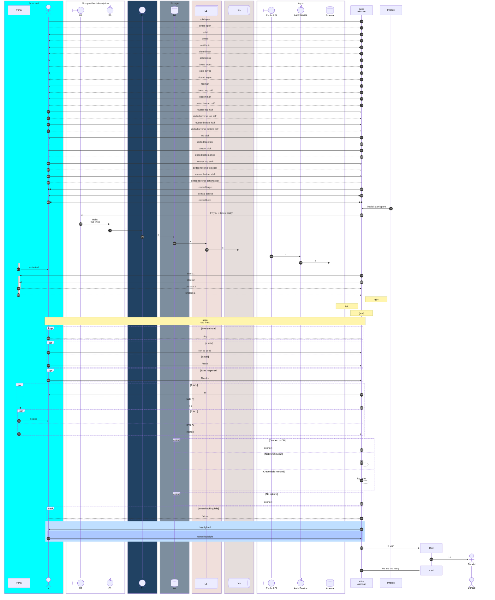
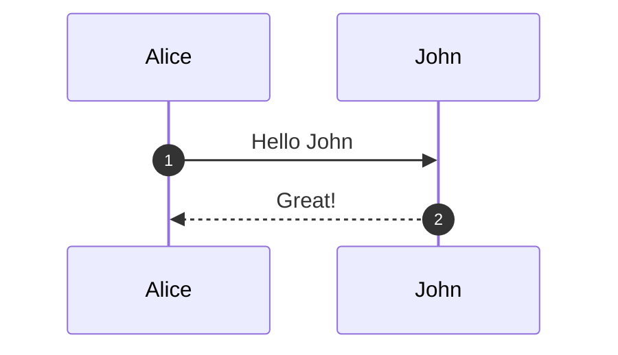

# Sequence diagram

## Keywords

`sequenceDiagram`. Status: stable.

## When to use

Message order between participants over time: requests, responses, async calls, and alternatives.
When control flow matters more than who sends what, use `flowchart`; for a code-like notation, use `zenuml`.

## Syntax

Participants, optionally typed and aliased:

```text
participant A as Alice
actor B
participant DB@{ "type": "database", "alias": "Orders DB" }
```

Messages: `[Actor][Arrow][Actor]:Message text`, with optional `+`/`-` activation and `()` central connection:

```text
A->>+B: Request
B-->>-A: Response
A->>()B: Central
```

Lifecycle and grouping:

```text
create participant C
destroy C
box Aqua Group
  participant A
end
```

Notes and blocks (every block closes with `end`):

```text
Note over A,B: Text
loop Every minute
  A->>B: Ping
end
```

Numbering and menus:

```text
autonumber 10 5
link A: Dashboard @ https://example.com
```

## Features

| Feature id | Construct | Snippet |
|---|---|---|
| `sequenceDiagram.keyword` | opening keyword | `sequenceDiagram` |
| `sequenceDiagram.implicit-participant` | participant created by a message | `Alice->>John: Hi` |
| `sequenceDiagram.participant` | explicit participant (sets order) | `participant Alice` |
| `sequenceDiagram.actor` | actor symbol | `actor Bob` |
| `sequenceDiagram.type-boundary` | boundary symbol | `participant A@{ "type" : "boundary" }` |
| `sequenceDiagram.type-control` | control symbol | `participant A@{ "type" : "control" }` |
| `sequenceDiagram.type-entity` | entity symbol | `participant A@{ "type" : "entity" }` |
| `sequenceDiagram.type-database` | database symbol | `participant A@{ "type" : "database" }` |
| `sequenceDiagram.type-collections` | collections symbol | `participant A@{ "type" : "collections" }` |
| `sequenceDiagram.type-queue` | queue symbol | `participant A@{ "type" : "queue" }` |
| `sequenceDiagram.alias-as` | external alias | `participant A as Alice` |
| `sequenceDiagram.alias-type-as` | typed participant with `as` | `participant API@{ "type": "boundary" } as Public API` |
| `sequenceDiagram.alias-inline` | alias inside the config object | `participant API@{ "type": "boundary", "alias": "Public API" }` |
| `sequenceDiagram.alias-precedence` | `as` wins over inline alias | `participant X@{ "alias": "In" } as Out` |
| `sequenceDiagram.alias-line-break` | line break in an alias | `participant A as Alice<br/>Johnson` |
| `sequenceDiagram.create-participant` | create on a message | `create participant Carl` |
| `sequenceDiagram.create-actor` | create actor with alias | `create actor D as Donald` |
| `sequenceDiagram.destroy` | destroy sender or recipient | `destroy Carl` |
| `sequenceDiagram.box-color-description` | box with color and label | `box Aqua Group Description` |
| `sequenceDiagram.box-description-only` | box without color | `box Group without description` |
| `sequenceDiagram.box-rgb` | rgb box color | `box rgb(33,66,99)` |
| `sequenceDiagram.box-rgba` | rgba box color | `box rgba(33,66,99,0.5)` |
| `sequenceDiagram.box-hsl` | hsl box color | `box hsl(10, 40%, 90%)` |
| `sequenceDiagram.box-hsla` | hsla box color | `box hsla(10, 40%, 90%, 0.5)` |
| `sequenceDiagram.box-transparent` | force transparent when label is a color | `box transparent Aqua` |
| `sequenceDiagram.arrow-solid-open` | solid, no arrow | `A->B: m` |
| `sequenceDiagram.arrow-dotted-open` | dotted, no arrow | `A-->B: m` |
| `sequenceDiagram.arrow-solid` | solid arrowhead | `A->>B: m` |
| `sequenceDiagram.arrow-dotted` | dotted arrowhead | `A-->>B: m` |
| `sequenceDiagram.arrow-solid-bidirectional` | solid, both heads | `A<<->>B: m` |
| `sequenceDiagram.arrow-dotted-bidirectional` | dotted, both heads | `A<<-->>B: m` |
| `sequenceDiagram.arrow-solid-cross` | solid with cross | `A-xB: m` |
| `sequenceDiagram.arrow-dotted-cross` | dotted with cross | `A--xB: m` |
| `sequenceDiagram.arrow-solid-async` | solid open arrow (async) | `A-)B: m` |
| `sequenceDiagram.arrow-dotted-async` | dotted open arrow (async) | `A--)B: m` |
| `sequenceDiagram.half-solid-top` | top half arrowhead | `A-\|\B: m` |
| `sequenceDiagram.half-dotted-top` | dotted top half | `A--\|\B: m` |
| `sequenceDiagram.half-solid-bottom` | bottom half arrowhead | `A-\|/B: m` |
| `sequenceDiagram.half-dotted-bottom` | dotted bottom half | `A--\|/B: m` |
| `sequenceDiagram.half-solid-reverse-top` | reverse top half | `A/\|-B: m` |
| `sequenceDiagram.half-dotted-reverse-top` | dotted reverse top half | `A/\|--B: m` |
| `sequenceDiagram.half-solid-reverse-bottom` | reverse bottom half | `A\\|-B: m` |
| `sequenceDiagram.half-dotted-reverse-bottom` | dotted reverse bottom half | `A\\|--B: m` |
| `sequenceDiagram.stick-solid-top` | top stick half | `A-\\B: m` |
| `sequenceDiagram.stick-dotted-top` | dotted top stick | `A--\\B: m` |
| `sequenceDiagram.stick-solid-bottom` | bottom stick half | `A-//B: m` |
| `sequenceDiagram.stick-dotted-bottom` | dotted bottom stick | `A--//B: m` |
| `sequenceDiagram.stick-solid-reverse-top` | reverse top stick | `A//-B: m` |
| `sequenceDiagram.stick-dotted-reverse-top` | dotted reverse top stick | `A//--B: m` |
| `sequenceDiagram.stick-solid-reverse-bottom` | reverse bottom stick | `A\\-B: m` |
| `sequenceDiagram.stick-dotted-reverse-bottom` | dotted reverse bottom stick | `A\\--B: m` |
| `sequenceDiagram.central-target` | central connection at target | `Alice->>()John: m` |
| `sequenceDiagram.central-source` | central connection at source | `Alice()->>John: m` |
| `sequenceDiagram.central-both` | central at both ends | `John()->>()Alice: m` |
| `sequenceDiagram.activate` | activate statement | `activate John` |
| `sequenceDiagram.deactivate` | deactivate statement | `deactivate John` |
| `sequenceDiagram.activation-shorthand` | `+` / `-` on the arrow | `A->>+J: m` then `J-->>-A: m` |
| `sequenceDiagram.activation-stacked` | stacked activations | `A->>+J: 1` twice |
| `sequenceDiagram.note-right` | note right of | `Note right of John: Text` |
| `sequenceDiagram.note-left` | note left of | `Note left of John: Text` |
| `sequenceDiagram.note-over` | note over one participant | `Note over John: Text` |
| `sequenceDiagram.note-over-span` | note spanning two | `Note over Alice,John: Text` |
| `sequenceDiagram.line-break` | `<br/>` in messages and notes | `A->B: Hello,<br/>John` |
| `sequenceDiagram.loop` | loop block | `loop Every minute ... end` |
| `sequenceDiagram.alt-else` | alternatives | `alt is sick ... else is well ... end` |
| `sequenceDiagram.opt` | optional block | `opt Extra ... end` |
| `sequenceDiagram.par-and` | parallel block | `par A to B ... and A to J ... end` |
| `sequenceDiagram.par-nested` | nested parallel blocks | `par ... par ... end ... end` |
| `sequenceDiagram.critical-option` | critical region with options | `critical Connect ... option Timeout ... end` |
| `sequenceDiagram.critical-no-option` | critical without options | `critical Connect ... end` |
| `sequenceDiagram.break` | break block | `break when it fails ... end` |
| `sequenceDiagram.rect-rgb` | background highlight | `rect rgb(191, 223, 255) ... end` |
| `sequenceDiagram.rect-rgba` | translucent highlight | `rect rgba(0, 0, 255, .1) ... end` |
| `sequenceDiagram.rect-nested` | nested highlights | `rect ... rect ... end ... end` |
| `sequenceDiagram.comment` | line comment | `%% comment` |
| `sequenceDiagram.entity-codes` | entity codes in text | `A->>B: I #9829; you #infin;` |
| `sequenceDiagram.entity-semicolon` | semicolon in text | `A->>B: a#59; b` |
| `sequenceDiagram.autonumber` | sequence numbers | `autonumber` |
| `sequenceDiagram.autonumber-start-increment` | start and step (decimals ok) | `autonumber 10 5` |
| `sequenceDiagram.link` | actor menu link | `link Alice: Dashboard @ https://example.com` |
| `sequenceDiagram.links-json` | actor menu links as JSON | `links Alice: {"Wiki": "https://example.com"}` |
| `sequenceDiagram.end-word-enclosed` | the word end, enclosed | `Note over A: (end)` |

## Configuration and theming

Frontmatter `config.sequence` keys. The parameter table on the syntax page, with the 12.0.0
schema default where it differs from the page:

| Key | Default |
|---|---|
| `mirrorActors` | page says `false`; 12.0.0 schema default is `true` |
| `bottomMarginAdj` | `1` |
| `actorFontSize` / `actorFontFamily` / `actorFontWeight` | `14` / `"Open Sans", sans-serif` / `400` |
| `noteFontSize` / `noteFontFamily` / `noteFontWeight` | `14` / `"trebuchet ms", verdana, arial, sans-serif` / `400` |
| `noteAlign` | `center` |
| `messageFontSize` / `messageFontFamily` / `messageFontWeight` | `16` / `"trebuchet ms", verdana, arial, sans-serif` / `400` |
| `showSequenceNumbers` | `false` (same as `autonumber`) |
| `diagramMarginX` / `diagramMarginY` | `50` / `10` |
| `boxTextMargin` / `noteMargin` / `messageMargin` | `5` / `10` / `35` |
| `theme` / `look` | `redux-color` / `neo` (v12 per-diagram defaults) |

- Other schema keys: `hideUnusedParticipants` (`false`), `activationWidth` (`10`), `actorMargin`
  (`50`), `width` (`150`), `height` (`65`), `boxMargin` (`10`), `messageAlign` (`center`),
  `forceMenus` (`false`), `rightAngles` (`false`), `wrap` (`false`), `wrapPadding` (`10`).
- `theme: default` plus `look: classic` reproduces the pre-v12 appearance.
- Styling is through CSS classes (`actor`, `actor-top`, `actor-bottom`, `actor-line`,
  `messageLine0`, `messageLine1`, `messageText`, `labelBox`, `labelText`, `loopText`,
  `loopLine`, `note`, `noteText`), not diagram syntax. No type-specific `themeVariables` on the page.
- `accTitle:` and `accDescr:` render with CLI 12.0.0. `title` also renders.

## Traps

The bare word `end` as a participant breaks the parser. Enclose it: `(end)`, `[end]`, `{end}`.

```text
sequenceDiagram
  A->>end: x
```

A raw `;` in message text splits the statement and fails. Use `#59;`.

```text
sequenceDiagram
  A->>B: a; b
```

A `link` or `links` menu on an `actor` crashes the renderer with CLI 12.0.0
(`TypeError: Cannot read properties of null (reading 'class')`). Put menus on participants only.

```text
sequenceDiagram
  actor U
  link U: Dashboard @ https://example.com
  U->>U: x
```

Every `loop`, `alt`, `opt`, `par`, `critical`, `break`, `rect`, and `box` needs its `end`.

```text
sequenceDiagram
  alt x
  A->>B: x
```

- Hex box colors (`box #ff0000 Red`) do not error, but `#` starts a comment, so the color and the
  label are both dropped. Use a named color, `rgb()`, or `hsl()`.
- A trailing `%% ...` after a message is not a comment; it becomes part of the message text.
- Activation shorthand and a central connection do not combine: `A->>+()B: x` fails.
- The page's half-arrow table lists `\\-` twice. `\|-` / `\|--` is the reverse bottom half head;
  `\\-` / `\\--` is the reverse bottom stick. Both render.
- Only the recipient of a message can be created; a destroyed participant needs a following message.

## Complete example



Covers: every feature id except `sequenceDiagram.autonumber` (the fence above uses the
start/increment form; a diagram takes one `autonumber` statement).



Covers: `sequenceDiagram.autonumber`.

## Builder

`candidate`: `scripts/render.py` has an IR builder for this type (target keyword(s) `sequenceDiagram`). It has not been through the reliability bar yet; see [coverage.md](../coverage.md).
