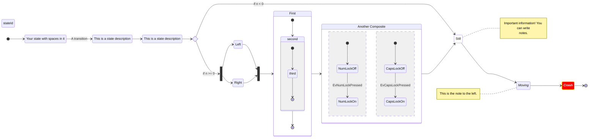
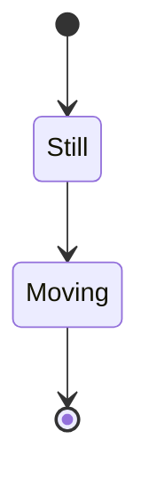

# State diagram

## Keywords

`stateDiagram-v2` (alias `stateDiagram`, the older renderer keyword). Status: stable.

## When to use

A finite set of states and the transitions between them, including composite and concurrent
states. For step-by-step processes with decisions, use `flowchart`.

## Syntax

States, three ways:

```text
stateId
state "This is a state description" as s2
s3 : This is a state description
```

Transitions, start and end:

```text
[*] --> s1
s1 --> s2 : A transition
s2 --> [*]
```

Composite states, concurrency, and direction:

```text
state Active {
  direction LR
  [*] --> A
  --
  [*] --> B
}
```

Pseudo-states and notes:

```text
state if_state <<choice>>
state fork_state <<fork>>
note right of s1 : text
```

Styling:

```text
classDef bad fill:#f00,color:white
class s1, s2 bad
s3:::bad --> s4
```

## Features

| Feature id | Construct | Snippet |
|---|---|---|
| `stateDiagram.keyword-v2` | opening keyword | `stateDiagram-v2` |
| `stateDiagram.keyword-legacy` | older renderer keyword | `stateDiagram` |
| `stateDiagram.state-id` | state by id | `stateId` |
| `stateDiagram.state-description-as` | description with `as` | `state "This is a state" as s2` |
| `stateDiagram.state-description-colon` | description after colon | `s2 : This is a state` |
| `stateDiagram.transition` | transition | `s1 --> s2` |
| `stateDiagram.transition-label` | transition text | `s1 --> s2: A transition` |
| `stateDiagram.start` | start state | `[*] --> s1` |
| `stateDiagram.end` | end state | `s1 --> [*]` |
| `stateDiagram.composite` | composite state | `state First { [*] --> second }` |
| `stateDiagram.composite-named` | composite with description | `NamedComposite: Another Composite` |
| `stateDiagram.composite-nested` | composite in composite | `state First { state Second { ... } }` |
| `stateDiagram.composite-transition` | transition between composites | `First --> Second` |
| `stateDiagram.choice` | choice pseudo-state | `state if_state <<choice>>` |
| `stateDiagram.fork` | fork pseudo-state | `state fork_state <<fork>>` |
| `stateDiagram.join` | join pseudo-state | `state join_state <<join>>` |
| `stateDiagram.note-right-block` | multi-line note right | `note right of S ... end note` |
| `stateDiagram.note-left-inline` | one-line note left | `note left of S : text` |
| `stateDiagram.concurrency` | concurrent regions | `--` |
| `stateDiagram.direction` | diagram direction | `direction LR` |
| `stateDiagram.direction-composite` | direction inside a composite | `state B { direction LR ... }` |
| `stateDiagram.comment` | own-line comment | `%% comment` |
| `stateDiagram.comment-trailing` | end-of-statement comment | `Moving --> Still %% comment` |
| `stateDiagram.classdef` | class definition | `classDef movement font-style:italic` |
| `stateDiagram.class-apply` | apply to one state | `class Crash badBadEvent` |
| `stateDiagram.class-apply-list` | apply to several states | `class Moving, Crash movement` |
| `stateDiagram.class-shorthand` | `:::` in a transition | `Crash:::badBadEvent --> [*]` |
| `stateDiagram.accessibility` | accessible title and description | `accTitle: ...` / `accDescr: ...` |
| `stateDiagram.spaces-in-names` | id plus description for spaced names | `yswsii: Your state with spaces in it` |

## Configuration and theming

Frontmatter `config.state` keys. The syntax page documents none; these are the 12.0.0 schema
defaults.

| Key | Default |
|---|---|
| `theme` / `look` | `redux-color` / `neo` (v12 per-diagram defaults) |
| `layout` | `elk` |
| `wrappingWidth` / `minNodeWidth` | `120` / `120` |
| `titleTopMargin` | `25` |
| `padding` / `dividerMargin` / `noteMargin` | `8` / `10` / `10` |
| `forkWidth` / `forkHeight` | `70` / `7` |
| `radius` | `5` |
| `useMaxWidth` | `true` |

- `theme: default`, `look: classic`, and `layout: dagre` restore the pre-v12 appearance.
  `defaultRenderer` was removed in v12.
- The page documents no state-specific `themeVariables`.
- `accTitle:` and `accDescr:` are documented on the page and render with CLI 12.0.0.

## Traps

A hyphen in a bare state id fails: `--` lexes as the concurrency separator. Use `_` or a description.

```text
stateDiagram-v2
  my-state --> B
```

A quoted name cannot stand in a transition. Declare `state "Some state" as s1`, then use `s1`.

```text
stateDiagram-v2
  "Some state" --> B
```

A note on a state that is not declared yet parses, then crashes the renderer
(`No such shape: undefined`). Declare or transition to the state before its note.

```text
stateDiagram-v2
  note left of Moving : early note
  A --> Moving
```

`click` is not part of state diagram syntax and fails.

```text
stateDiagram-v2
  A --> B
  click A "https://example.com"
```

- `classDef` cannot style start/end states or states inside composites (page limitation). The
  `:::` shorthand on `[*]` and `class` on a composite do not error, but the style is not drawn there.
- The page says transitions between internal states of different composites are not supported.
  CLI 12.0.0 renders `a1 --> b1` across composites without error; avoid relying on it.
- Unlike flowchart, lowercase `end` as a state id renders.
- Prefer `stateDiagram-v2`; the legacy `stateDiagram` keyword still parses the same statements.

## Complete example



Covers: every feature id except `stateDiagram.keyword-legacy` (one opening keyword per diagram).



Covers: `stateDiagram.keyword-legacy`.

## Builder

`candidate`: `scripts/render.py` has an IR builder for this type (target keyword(s) `stateDiagram-v2`). It has not been through the reliability bar yet; see [coverage.md](../coverage.md).
