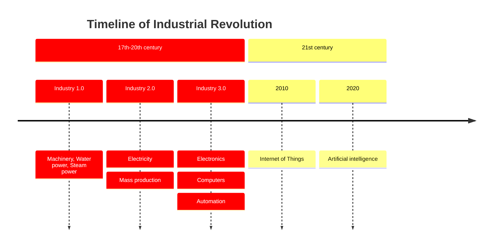
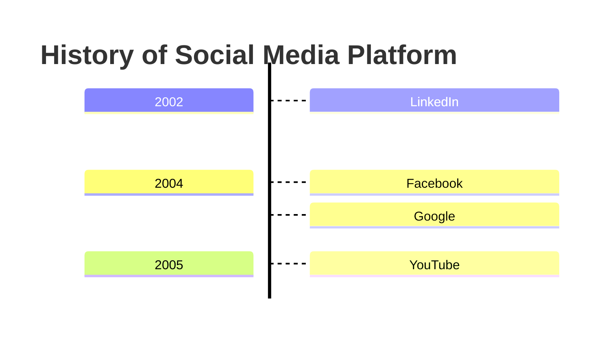

# Timeline

## Keywords
`timeline`, optionally followed by a direction (`timeline TD`). Status: stable (the page calls the diagram
experimental; only the icon integration is the unstable part).

## When to use
A chronology: ordered time periods, each with one or more events, optionally grouped into sections.
Nearest alternative: `gantt` when items have durations or dependencies.

## Syntax
Header:

```text
timeline [LR|TD]
title <text>
```

A period with events (inline or on continuation lines):

```text
<period> : <event> [: <event> ...]
         : <event>
```

Sections group the periods that follow:

```text
section <name>
```

## Features
| Feature id | Construct | Snippet |
|---|---|---|
| `timeline.title` | diagram title | `title History` |
| `timeline.direction-lr` | left-to-right (default) | `timeline LR` |
| `timeline.direction-td` | top-down | `timeline TD` |
| `timeline.period-event` | period with one event | `2002 : LinkedIn` |
| `timeline.multiple-events-inline` | several events on one line | `2004 : Facebook : Google` |
| `timeline.multiple-events-continuation` | events on continuation lines | `     : Google` |
| `timeline.text-period` | non-numeric period text | `Industry 1.0 : Machinery` |
| `timeline.section` | section (age) grouping periods | `section 21st century` |
| `timeline.line-break` | forced line break | `Steam <br>power` |
| `timeline.comment` | comment line | `%% a comment` |
| `timeline.acc-title` | accessible title | `accTitle: Social media` |
| `timeline.acc-descr` | accessible description | `accDescr: Launch years` |
| `timeline.acc-descr-block` | multi-line accessible description | `accDescr { ... }` |

## Configuration and theming
Frontmatter `config.timeline` keys (Mermaid 12.0.0 default config):

| Key | Default | Meaning |
|---|---|---|
| `disableMulticolor` | false | one color scheme for all periods when there are no sections |
| `useMaxWidth` | true | scale to container width |
| `diagramMarginX` / `diagramMarginY` | 50 / 10 | outer margins |
| `leftMargin` | 150 | left margin |
| `width` / `height` | 150 / 50 | box size |
| `boxMargin` / `boxTextMargin` | 10 / 5 | box spacing |
| `taskFontSize` / `taskFontFamily` | 14 / `"Open Sans", sans-serif` | event font |
| `sectionFills` / `sectionColours` | 7 dark fills / `["#fff"]` | section colors |

Other keys in the default config (`noteMargin`, `messageMargin`, `messageAlign`, `bottomMarginAdj`,
`rightAngles`, `taskMargin`, `activationWidth`, `textPlacement`, `actorColours`) are shared with `journey`.

themeVariables: `cScale0`..`cScale11` (section or period background) and `cScaleLabel0`..`cScaleLabel11`
(foreground). More than 12 sections repeat the scale. Themes listed on the page: `redux-color` (default),
`redux-dark-color`, `redux`, `redux-dark`, `default`, `neutral`, `dark`, `forest`, `neo`, `neo-dark`, `base`.
`accTitle`, `accDescr` and `accDescr { }` parse without error in CLI 12.0.0, but the 12.0.0 SVG contains no
`<title>` or `<desc>` for them (checked); treat accessibility as unsupported in output.

## Traps
The event separator is a colon followed by a space. Observed with CLI 12.0.0:

| Event text | Rendered events |
|---|---|
| `Ratio a: b` | `Ratio a`, `b` (split) |
| `Ratio a :b` | `Ratio a :b` |
| `Time 10:30 meeting` | `Time 10:30 meeting` |
| `Year: 2002 : A` (whole line) | period `Year`, events `2002`, `A` |

A colon inside the period itself is a parse error:

```text
timeline
    10:30 : Standup
```

Use the entity `#58;` (`10#58;30 : Standup` renders as `10:30`).

`section` without a name crashes with `TypeError: Cannot read properties of undefined (reading 'events')`:

```text
timeline
    section
    2002 : A
```

Markdown such as `**bold**` is shown literally; only `<br>` is interpreted.
Only `LR` and `TD` are documented directions. `TB` and `RL` also render, but their layout is not documented; avoid them.

## Complete example



Covers: every feature id except `timeline.direction-td` (one direction per diagram) and `timeline.acc-descr-block` (a diagram carries one description).



Covers: `timeline.direction-td`, `timeline.acc-descr-block`, plus `timeline.title`, `timeline.period-event`, `timeline.multiple-events-inline`.

## Builder
`builder`: family `timeline`, keyword `timeline`.

| IR key | Type | Meaning |
|---|---|---|
| `direction` | enum | `LR`, `TD` |
| `title`, `comment` | string | `title` line, `%%` comment |
| `accessibility` | `{title, description}` | `accTitle`, `accDescr` (parsed, not in the 12.0.0 SVG) |
| `config.timeline`, `config.themeVariables` | object | typed keys from Configuration; `cScale0`..`11`, `cScaleLabel0`..`11` colors |
| `events` | event[] | periods without sections |
| `sections[].name`, `sections[].events` | string, event[] | sections |
| event `period` | string | period text |
| event `text` | string[] | events of the period; a newline becomes `<br>` |
| event `layout` | enum | `inline` (default, `a : b`) or `lines` (continuation lines) |

Example: [maximal.json](../../tests/fixtures/timeline/maximal.json) (plus `maximal.td.json`).

Rejected: `events` together with `sections` (Mermaid 12.0.0 drops periods before the first section), a period
that starts with `title `, `section ` or `timeline`. `: # ; % " < > &` are written as entity codes and render as typed.
