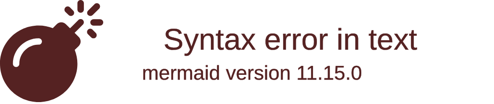

# TreeView

## Keywords
`treeView-beta` (case-sensitive; the detector is `/^\s*treeView-beta/`). Status: beta.

## When to use
A directory-like tree (files and folders, or any hierarchy) with connector lines, optional icons and inline notes.
Nearest alternative: `mindmap` for a radial hierarchy, or `ishikawa` for cause-and-effect.

## Syntax
Indentation input (structure from indentation only):

```text
treeView-beta
    <dir>/
        <file>
        "<name with spaces>"
```

Box-drawing input (auto-detected when any line has `├ └ │ ─` or `┣ ┗ ┃ ━`):

```text
treeView-beta
├── <dir>/
│   └── <file>
└── <file>
```

Annotations after a label, in any order:

```text
<label> :::<class> icon(<pack:name>) ## <description>
```

## Features
| Feature id | Construct | Snippet |
|---|---|---|
| `treeView.indent-nesting` | nesting by indentation | `src/` then `index.js` indented below |
| `treeView.bare-label` | unquoted label | `package.json` |
| `treeView.quoted-label` | quoted label, may contain spaces | `"my project"` |
| `treeView.directory` | trailing `/` marks a directory (bold, folder icon); inside quotes too | `src/`, `"my dir/"` |
| `treeView.file` | label without `/` is a file | `index.js` |
| `treeView.unicode-label` | unicode and emoji kept as written | `🚀 rocket-app/` |
| `treeView.box-drawing-standard` | box-drawing input, light glyphs | `├── src/`, `│   └── a.ts` |
| `treeView.box-drawing-heavy` | box-drawing input, heavy glyphs | `┣━━ src/`, `┃   ┗━━ a.ts` |
| `treeView.class-highlight` | built-in `highlight` class | `App.tsx :::highlight` |
| `treeView.class-custom` | any CSS class on the label | `a.txt :::myClass` |
| `treeView.description` | `##` inline description (italic) | `index.js ## entry point` |
| `treeView.icon-pack` | explicit icon from a registered pack | `App.tsx icon(logos:react)` |
| `treeView.icon-default-pack` | unprefixed icon resolved via `defaultIconPack` | `main.rs icon(rust)` |
| `treeView.icon-builtin` | built-in `file` / `folder` icon | `lib icon(folder)` |
| `treeView.icon-hide-empty` | hide one node's icon | `index.js icon()` |
| `treeView.icon-hide-none` | hide one node's icon | `index.js icon(none)` |
| `treeView.combined-annotations` | class, icon and description together | `App.tsx :::highlight icon(logos:react) ## main` |
| `treeView.comment` | `%%` comment line | `%% generated files` |

## Configuration and theming
Frontmatter `config.treeView` keys (page and 12.0.0 default config agree):

| Key | Default | Meaning |
|---|---|---|
| `rowIndent` | 10 | indentation per level |
| `paddingX` | 5 | horizontal row padding |
| `paddingY` | 5 | vertical row padding |
| `lineThickness` | 1 | connector line thickness |
| `showIcons` | false | show built-in file/folder icons (explicit `icon()` always renders) |
| `defaultIconPack` | `''` | pack used for unprefixed `icon(name)` and map values |
| `filenameIcons` | `{}` | filename to icon map, e.g. `Dockerfile: docker` |
| `extensionIcons` | `{}` | extension to icon map, e.g. `.ts: typescript`; `none` hides |
| `useMaxWidth` | true | scale to container width |

`themeVariables.treeView` keys documented: `labelFontSize` ('16px'), `labelColor` ('black'), `lineColor` ('black'),
`iconColor` ('#546e7a'), `descriptionColor` ('#6a9955'), `highlightBg` (rgba(255,193,7,0.15)), `highlightStroke` (#ffc107).
In CLI 12.0.0 only `labelFontSize`, `labelColor` and `lineColor` take effect; the other four stay at their defaults
(checked in the SVG CSS with frontmatter and with `%%{init}%%`).

`accTitle:`, `accDescr:` and `accDescr { ... }` are supported (not on the page): the 12.0.0 SVG gets `<title>` and `<desc>`.
Mermaid ships no icon packs; in `mmdc` an unregistered `pack:name` renders a question-mark icon.

## Traps
`title <text>` is accepted by the parser but NOT drawn in 12.0.0. Use `accTitle` or a surrounding heading.

A `:::class` must be separated by a space. `b.txt:::highlight` renders the label `b.txt:::highlight` with no class.

`##` starts the description at its first occurrence: `g ## h ## i` is label `g`, description `h ## i`.

Box-drawing and plain indentation cannot be mixed. One box-drawing line switches the whole diagram to box-drawing
mode, and then an indented line without glyphs is an error:

```text
treeView-beta
├── src/
    index.ts
```

fails with "Unexpected indentation without box-drawing characters". Unindented lines in box-drawing mode are top-level.

Uneven indentation does not error; a node is a child of the nearest previous line with smaller indentation, so
a stray space can silently re-parent a node. Tabs are expanded to four spaces. Keep one indent width throughout.

The keyword is case-sensitive: `treeview-beta` is not detected.

## Complete example



Covers: every feature id except `treeView.box-drawing-standard`, `treeView.box-drawing-heavy`.


Covers: `treeView.box-drawing-standard`, `treeView.directory`, `treeView.file`, `treeView.class-highlight`, `treeView.icon-pack`, `treeView.description`, `treeView.combined-annotations`.


Covers: `treeView.box-drawing-heavy`, `treeView.directory`, `treeView.file`.

## Builder
`candidate`: `scripts/render.py` has an IR builder for this type (target keyword(s) `treeView-beta`). It has not been through the reliability bar yet; see [coverage.md](../coverage.md).
