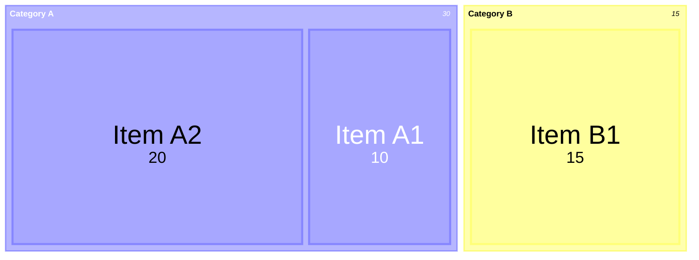
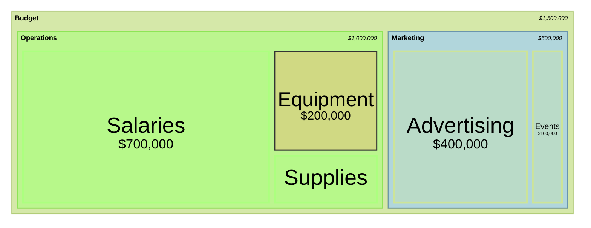
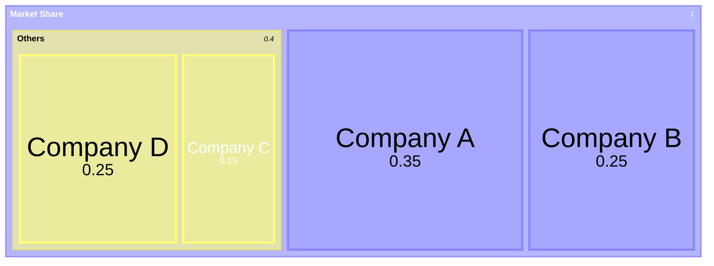

# Treemap diagram

## Keywords
`treemap-beta` (alias `treemap`). Status: beta.

## When to use
Show a hierarchy where each leaf has a size, as nested rectangles with area proportional to value.
Nearest alternative: `pie` for flat proportions, `sankey` for flows between levels.

## Syntax

Sections are quoted names; leaves add `: value`; indentation (spaces or tabs) sets the hierarchy.

```text
treemap-beta
"<section>"[:::<class>]
    "<leaf>": <value>[:::<class>]
    "<sub-section>"
        "<leaf>": <value>
classDef <class> <css>;
```



## Features
| Feature id | Construct | Snippet |
|---|---|---|
| `treemap.keyword` | opening keyword | `treemap-beta` |
| `treemap.keyword-alias` | alias keyword (renders in 12.0.0) | `treemap` |
| `treemap.section` | section / parent node | `"Section 1"` |
| `treemap.leaf` | leaf node with a value | `"Leaf 1.1": 12` |
| `treemap.nested-section` | section inside a section, by indentation | `    "Section 1.2"` |
| `treemap.indent-tabs` | tabs as indentation | `\t"Leaf 2.1": 20` |
| `treemap.section-class` | class shorthand on a section | `"Section 1.2":::class1` |
| `treemap.leaf-class` | class shorthand on a leaf, after the value | `"Leaf 2.1": 20:::class1` |
| `treemap.class-def` | class definition | `classDef class1 fill:red,color:blue,stroke:#FFD600;` |

## Configuration and theming

Frontmatter `config.treemap` keys (defaults from the syntax page):

| Key | Default | Meaning |
|---|---|---|
| `useMaxWidth` | `true` | Width 100%, scales with available space |
| `padding` | `10` | Internal padding between nodes |
| `diagramPadding` | `8` | Padding around the whole diagram |
| `showValues` | `true` | Show values |
| `nodeWidth` | `100` | Node width |
| `nodeHeight` | `40` | Node height |
| `borderWidth` | `1` | Border width |
| `valueFontSize` | `12` | Value font size |
| `labelFontSize` | `14` | Label font size |
| `valueFormat` | `','` | D3 format for values (below) |

`valueFormat` patterns the page lists: `,` thousands separator, `$` dollar sign, `.1f` one decimal,
`.1%` percentage, `$0,0` dollar with thousands separator, `$.2f` dollar with two decimals,
`$,.2f` dollar, separator and two decimals (see Traps).

Theme variables: the syntax page documents none; it shows switching `config.theme` (for example `forest`).
In the 12.0.0 source the section colours come from `cScale0`..`cScale11` and `cScalePeer0`..`cScalePeer11`.

Accessibility: `accTitle: ...` and `accDescr: ...` render with CLI 12.0.0. An undocumented
`title <text>` line also renders.

## Traps

- Names must be quoted (double or single). An unquoted name gives an error SVG:

```text
treemap-beta
A
    "A1": 10
```

- Only `classDef` plus `:::` styles nodes; `style <id> ...` fails.
- On a leaf, `:::class` goes after the value: `"Leaf": 20:::class1`.
- Lines indented under a leaf (a node with a value) do not become its children; they are added to
  the leaf's parent. Give a node no value if it has children.
- Negative values fail. Zero and decimals render.
- `valueFormat: '$,.2f'` drops the `f` in 12.0.0 (the code builds `format(",.2")`), so 1234.5 shows
  as `$1.2e+3`. Use `$0,0` or `$.2f` instead.

## Complete example



Covers: every feature id except `treemap.keyword-alias` (alternative opening keyword) and
`treemap.indent-tabs` (mixing tabs and spaces in one tree is ambiguous), plus every `config.treemap` key.



Covers: `treemap.keyword-alias`, `treemap.indent-tabs`, `treemap.section`, `treemap.leaf`, `treemap.nested-section`.

## Builder
`builder`: family `chart`, keywords `treemap-beta`, `treemap` (emitted as given).

| Key | Type | Meaning |
|---|---|---|
| `nodes` | array, 1+ | Node: `{label, value}` (leaf, number >= 0) or `{label, children}` (section, 1+ children); optional `class` |
| `classes` | object | Class id -> `{fill, color, stroke, strokeWidth}`, emitted as `classDef` |
| `indent` | `spaces` (default) \| `tabs` | Indentation of the tree |
| `accessibility` | object | `{title, description}` |
| `config` | object | Frontmatter: `theme`, `treemap.*` (`valueFormat` is one of the listed patterns), `themeVariables.{cScale0..11, cScalePeer0..11}` |

Example: [maximal.json](../../tests/fixtures/treemap/maximal.json). Rejected: a node with both or
neither of `value` and `children`, an undeclared `class`, colours other than `#rgb`/`#rrggbb` or a
lowercase name, `strokeWidth` other than `<n>px`. Free text is written with Mermaid entity codes (`#quot;`, `#59;`, `#lt;`, ...), which render back to the original characters; leading or trailing spaces, control characters and line breaks (except in `accessibility.description`) are rejected.
