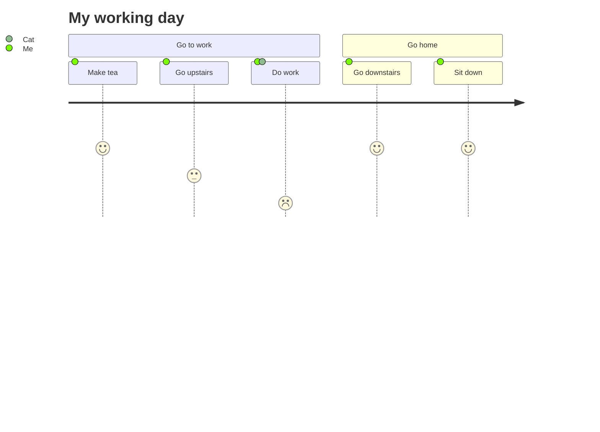
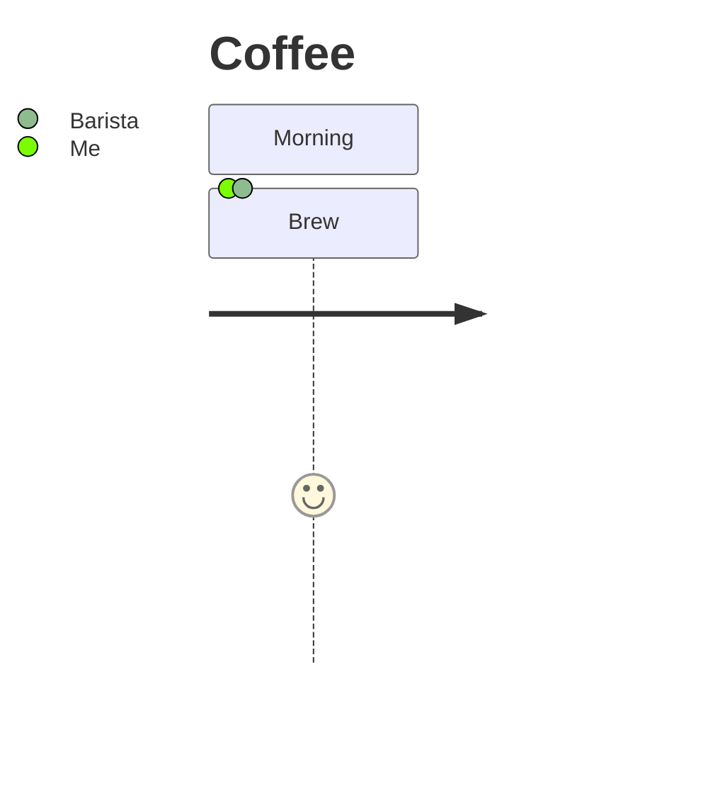

# User journey

## Keywords
`journey`. Status: stable.

## When to use
The steps a user takes to finish a task, grouped into sections, with a 1-5 satisfaction score and the actors involved in each step.
Nearest alternative: `timeline` for a plain chronology without scores or actors.

## Syntax
Header:

```text
journey
title <text>
```

Sections and tasks:

```text
section <name>
<task name>: <score 1-5>: <actor>[, <actor> ...]
```

## Features
| Feature id | Construct | Snippet |
|---|---|---|
| `userJourney.title` | diagram title | `title My working day` |
| `userJourney.section` | section of tasks | `section Go to work` |
| `userJourney.task` | task with score and one actor | `Make tea: 5: Me` |
| `userJourney.task-multiple-actors` | comma-separated actors | `Do work: 1: Me, Cat` |
| `userJourney.score-1` | lowest score (sad face) | `Do work: 1: Me` |
| `userJourney.score-3` | neutral score | `Go upstairs: 3: Me` |
| `userJourney.score-5` | highest score (happy face) | `Sit down: 5: Me` |
| `userJourney.comment` | comment line | `%% a comment` |
| `userJourney.acc-title` | accessible title | `accTitle: Working day` |
| `userJourney.acc-descr` | accessible description | `accDescr: Steps from tea to home` |
| `userJourney.acc-descr-block` | multi-line accessible description | `accDescr { ... }` |

The page documents only title, sections, and the task line; comments and accessibility are the
common Mermaid statements, verified to render here.

## Configuration and theming
The syntax page documents no configuration. Frontmatter `config.journey` keys from the Mermaid 12.0.0 default config:

| Key | Default | Meaning |
|---|---|---|
| `useMaxWidth` | true | scale to container width |
| `diagramMarginX` / `diagramMarginY` | 50 / 10 | outer margins |
| `leftMargin` | 150 | room for the actor legend |
| `maxLabelWidth` | 360 | max legend label width |
| `width` / `height` | 150 / 50 | task box size |
| `boxMargin` / `boxTextMargin` | 10 / 5 | box spacing |
| `taskFontSize` / `taskFontFamily` | 14 / `"Open Sans", sans-serif` | task font |
| `taskMargin` | 50 | task spacing |
| `actorColours` | 6 colors (`#8FBC8F` ...) | actor dot colors |
| `sectionFills` / `sectionColours` | 7 dark fills / `["#fff"]` | section colors |
| `titleColor` / `titleFontFamily` / `titleFontSize` | `""` / trebuchet / `4ex` | title style |

Other keys (`noteMargin`, `messageMargin`, `messageAlign`, `bottomMarginAdj`, `rightAngles`,
`activationWidth`, `textPlacement`) exist in the default config with no documented effect here.
The journey renderer reads themeVariables `fillType0`..`fillType7` (section fills), `actor0`..`actor5`
and `faceColor`; the page documents none of them.
`accTitle`, `accDescr` and `accDescr { }` render with CLI 12.0.0.

## Traps
The first colon ends the task name. `Review 10:30: 5: Me` renders task `Review 10`, score `30`, actor `5`
with no error. Use `#58;`: `Review 10#58;30: 5: Me` renders correctly.

A colon in a section name, and `#` or `;` in a task name, are parse errors:

```text
journey
    section Go: home
        A: 5: Me
```

```text
journey
    section S
        C# build: 5: Me
        a; b: 5: Me
```

Use entities: `C#35; build`, `a#59; b`.

Silent: a score outside 1-5 (`0`, `9`), a decimal score, a non-numeric score (`x`), a task without actors,
and a task outside any section all render without error. Keep scores integers 1-5 and always list an actor.

## Complete example



Covers: every feature id except `userJourney.acc-descr-block` (a diagram carries one description).



Covers: `userJourney.acc-descr-block`, plus `userJourney.title`, `userJourney.section`, `userJourney.task-multiple-actors`.

## Builder
`candidate`: `scripts/render.py` has an IR builder for this type (target keyword(s) `journey`). It has not been through the reliability bar yet; see [coverage.md](../coverage.md).
