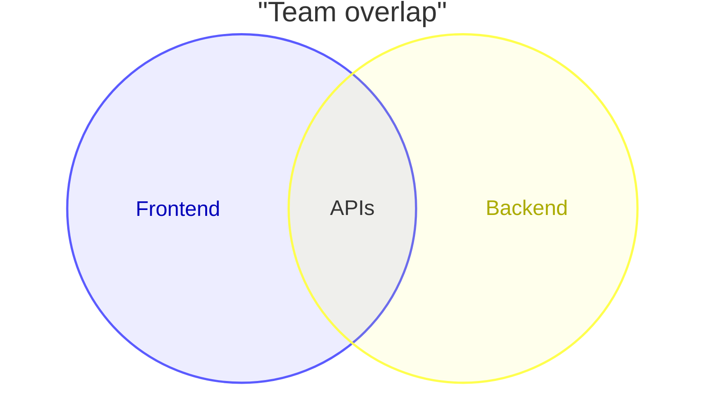
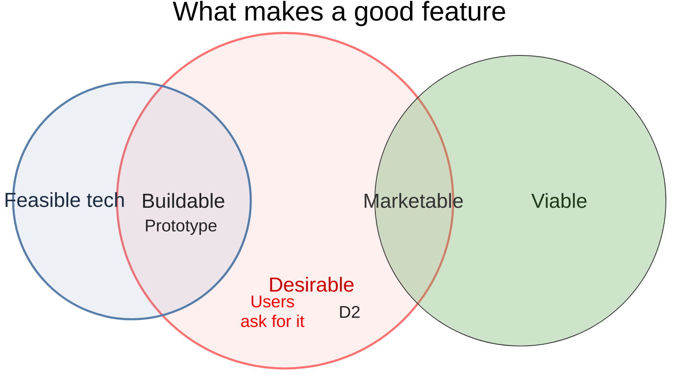

# Venn diagram

## Keywords
`venn-beta`. Status: beta.

## When to use
Show how a few sets overlap, with labelled intersections and optional items inside each region.
Nearest alternative: `quadrantChart` for two independent criteria, `mindmap` for plain grouping.

## Syntax

```text
venn-beta
    title <text>
    set <id>["<label>"][:<size>]
        text <id>["<label>"]
    union <id>,<id>[,<id>...]["<label>"][:<size>]
        text <id>["<label>"]
    style <id>[,<id>...] <prop>:<value>[,<prop>:<value>...]
```

Ids are bare words (`A`, `Set_1`) or quoted strings (`"Foo Bar"`). Every id in a `union` needs an
earlier `set`. Indented `text` lines attach to the most recent `set` or `union`.



## Features
| Feature id | Construct | Snippet |
|---|---|---|
| `venn.keyword` | opening keyword | `venn-beta` |
| `venn.title` | diagram title | `title What makes a good feature` |
| `venn.set` | set with a bare-word id | `set Desirable` |
| `venn.set-quoted-id` | set with a quoted id | `set "Foo Bar"` |
| `venn.set-label` | display label on a set | `set A["Alpha"]` |
| `venn.union` | overlap of two sets | `union A,B["AB"]` |
| `venn.union-higher-arity` | overlap of three or more sets | `union Desirable,Feasible,Viable["Innovation"]` |
| `venn.set-size` | size suffix on a set | `set A["Alpha"]:20` |
| `venn.union-size` | size suffix on a union | `union A,B["AB"]:3` |
| `venn.text` | text node inside the latest set or union | `    text A1` |
| `venn.text-label` | text node with a display label | `    text A1["React"]` |
| `venn.style-fill` | style: fill colour | `style A fill:#ff6b6b` |
| `venn.style-color` | style: text colour | `style A1 color:red` |
| `venn.style-stroke` | style: stroke colour | `style B stroke:#333` |
| `venn.style-stroke-width` | style: stroke width | `style B stroke-width:3px` |
| `venn.style-fill-opacity` | style: fill opacity | `style B fill-opacity:0.3` |
| `venn.style-union-target` | style a union by its set ids | `style A,B color:#333` |

## Configuration and theming

Venn defaults to the `redux-color` theme and the `neo` look (v12.0.0). Set `theme: default` and
`look: classic` in frontmatter (top level, or under `config.venn`) for the previous appearance.

Frontmatter `config.venn` keys. The page documents only `theme` and `look`; the other keys and all
defaults come from the 12.0.0 config schema.

| Key | Default | Meaning |
|---|---|---|
| `theme` | `redux-color` | Per-diagram theme (page) |
| `look` | `neo` | Per-diagram look (page) |
| `width` | `800` (schema) | Diagram width |
| `height` | `450` (schema) | Diagram height |
| `padding` | `8` (schema) | Padding around the diagram |
| `useMaxWidth` | `true` (schema) | Scale SVG to container width |
| `useDebugLayout` | `false` (schema) | Draw layout debug output |

Theme variables: the syntax page documents none. The 12.0.0 theme source defines `venn1`..`venn8`
(set colours), `vennSetTextColor` and `vennTitleTextColor`; `venn1` was verified to take effect.

Accessibility: `accTitle` and `accDescr` are NOT supported; both are parse errors with CLI 12.0.0.

## Traps

- The keyword is `venn-beta`; bare `venn` is `UnknownDiagramError`.
- A `union` naming an undeclared set throws `unknown set identifier`.
- A `text` line before any `set` is a parse error. Unindented `text` after a set still attaches to it.
- No `classDef`, `class` or `:::` shorthand; only `style` works:

```text
venn-beta
    set A:::hot
    set B
```

- `accTitle:` / `accDescr:` lines fail anywhere in the diagram.

## Complete example



Covers: every feature id, plus every `config.venn` key and the theme variables listed above.

## Builder
`candidate`: `scripts/render.py` has an IR builder for this type (target keyword(s) `venn-beta`). It has not been through the reliability bar yet; see [coverage.md](../coverage.md).
