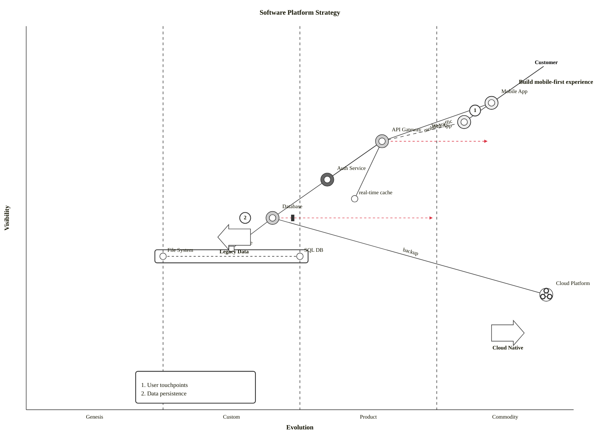

# Wardley map

## Keywords

`wardley-beta`. Status: beta (v11.14.0+).

## When to use

Strategy maps: a value chain of components placed by visibility and evolution, with
dependencies, evolution arrows, and sourcing decisions. Nearest alternative: `quadrantChart`
(points on two axes, no dependencies).

## Syntax

```text
wardley-beta
title Text
size [width, height]
evolution Stage1 -> Stage2 -> Stage3 -> Stage4
anchor Name [visibility, evolution]
component Name [visibility, evolution] label [dx, dy] (build|buy|outsource|market) (inertia)
pipeline Parent {
  component "Child" [evolution]
}
A -> B
A -> B; annotation text
evolve Name targetEvolution
note "text" [visibility, evolution]
annotations [x, y]
annotation N,[x, y] "text"
accelerator "text" [x, y]
deaccelerator "text" [x, y]
```

Coordinates are OWM order: `[visibility, evolution]` (Y first, then X).

```mermaid
wardley-beta
title Tea
anchor Business [0.95, 0.63]
component Cup of Tea [0.79, 0.61]
Business -> Cup of Tea
```

## Features

| Feature id | Construct | Snippet |
|---|---|---|
| `wardley.keyword` | diagram keyword | `wardley-beta` |
| `wardley.title` | map title | `title Tea Shop Value Chain` |
| `wardley.size` | canvas size in pixels (default `[1100, 600]`) | `size [1100, 800]` |
| `wardley.component` | component at `[visibility, evolution]` | `component Kettle [0.43, 0.35]` |
| `wardley.component-quoted` | quoted component name | `component "Custom Service" [0.55, 0.35]` |
| `wardley.component-hyphen` | unquoted hyphenated name | `component real-time processing [0.55, 0.40]` |
| `wardley.component-label-offset` | label offset `[dx, dy]` | `component DB [0.40, 0.85] label [-50, 10]` |
| `wardley.anchor` | anchor (user or customer, bold label) | `anchor Customer [0.90, 0.95]` |
| `wardley.inertia` | inertia decorator | `component Legacy [0.45, 0.40] (inertia)` |
| `wardley.source-build` | build (triangle) | `component App [0.45, 0.85] (build)` |
| `wardley.source-buy` | buy (diamond) | `component Tool [0.85, 0.65] (buy)` |
| `wardley.source-outsource` | outsource (square) | `component Svc [0.60, 0.40] (outsource)` |
| `wardley.source-market` | market (circle) | `component Cloud [0.95, 0.25] (market)` |
| `wardley.link` | dependency | `A -> B` |
| `wardley.link-alt` | dependency, alternative style | `A --> B` |
| `wardley.link-annotation` | dependency with annotation | `A -> B; label` |
| `wardley.link-dashed` | dashed flow | `A -.-> B` |
| `wardley.flow` | flow with arrow marker | `A +> B` |
| `wardley.flow-reverse` | reverse flow | `A +< B` |
| `wardley.flow-bidirectional` | bi-directional flow | `A +<> B` |
| `wardley.flow-labeled` | labelled flow | `A +'backup'> B` |
| `wardley.evolve` | evolution arrow to a target evolution | `evolve Kettle 0.62` |
| `wardley.trend` | trend indicator, `(x, y)` order | `Component -.- (x, y)` |
| `wardley.pipeline` | pipeline of components sharing visibility | `pipeline Database {` … `}` |
| `wardley.pipeline-component` | pipeline member with evolution only | `component "SQL DB" [0.50]` |
| `wardley.evolution-stages` | custom evolution stage labels | `evolution Unmodelled -> Divergent -> Convergent -> Modelled` |
| `wardley.evolution-dual-labels` | dual stage labels | `evolution Genesis / Concept -> Custom / Emerging -> …` |
| `wardley.evolution-widths` | custom stage boundaries with `@` | `evolution Genesis@0.2 -> Custom@0.4 -> Product@0.75 -> Commodity@1.0` |
| `wardley.note` | note at coordinates (quoted text) | `note "High risk area" [0.40, 0.35]` |
| `wardley.annotations` | annotation box position | `annotations [0.10, 0.90]` |
| `wardley.annotation` | numbered annotation | `annotation 1,[0.60, 0.65] "Critical component"` |
| `wardley.accelerator` | accelerator force | `accelerator "AI Adoption" [0.55, 0.25]` |
| `wardley.deaccelerator` | deaccelerator force | `deaccelerator "Legacy Constraints" [0.15, 0.75]` |
| `wardley.comment` | `%%` comment, whole line or trailing | `component A [0.3, 0.2] %% low` |

## Configuration and theming

The syntax page documents no `config.wardley` keys and no type-specific themeVariables;
it says Wardley maps follow Mermaid's theme system. `look: handDrawn` is not supported
(custom D3 renderer). Canvas size is set in the diagram with `size`.

`accTitle:` and `accDescr:` are not documented, but both render with CLI 12.0.0.

## Traps

Wardley parse errors do not fail the CLI: it exits 0 and writes an error SVG, so
`check.sh` reports `FAIL line unknown`. Bisect by deleting lines.

The documented trend indicator does not render with CLI 12.0.0 in any form tried
(`(x, y)`, `(x,y)`, `[x, y]`):

```text
wardley-beta
component A [0.5, 0.5]
A -.- (0.7, 0.6)
```

Numbers need a leading digit and a decimal point. Integers and bare `.5` fail; out-of-range
values like `1.2` are accepted.

```text
wardley-beta
component A [1, 0]
component B [.5, .5]
evolve A 1
```

Use `[1.0, 0.0]` and `evolve A 1.0`.

Unquoted names reject `.`, `'`, `/`, `:`, a leading digit, and a leading lowercase
keyword (`note`, `evolve`, …). `&`, `-`, `_`, and a capitalized `Note` are fine. Quote the
name otherwise, and quote it the same way in links and `evolve`:

```text
wardley-beta
component A.B [0.5, 0.5]
component Bob's app [0.5, 0.5]
component A/B [0.5, 0.5]
component A: B [0.5, 0.5]
component 3rd party [0.5, 0.5]
component note taker [0.5, 0.5]
```

`component "Bob's: app/v2" [0.4, 0.4]` renders.

Ordering after the coordinates is fixed: `label [dx, dy]` first, then the sourcing
decorator, then `(inertia)`. Anchors take no decorators.

```text
wardley-beta
component A [0.5, 0.5] (build) label [-60, 10]
component B [0.5, 0.5] (inertia) (buy)
anchor C [0.5, 0.5] (build)
```

- `note` text must be quoted; `note Plain text [0.5, 0.5]` fails. Accelerator text may be
  unquoted.
- A link or `evolve` naming an undeclared component does not fail the render.
- Trend coordinates are documented as `(x, y)`, opposite to `[visibility, evolution]`.
- `title`, `size` may come after components.

## Complete example



Covers: every feature id except `wardley.trend` (rejected by CLI 12.0.0, see Traps),
`wardley.evolution-stages`, `wardley.evolution-dual-labels` (one `evolution` line per map;
below).

```mermaid
wardley-beta
title Custom Stages
evolution Unmodelled -> Divergent -> Convergent -> Modelled
component Raw Data [0.15, 0.20]
component Reports [0.75, 0.70]
Reports -> Raw Data
```

Covers: `wardley.evolution-stages`.

```mermaid
wardley-beta
title Dual Label Stages
evolution Genesis / Concept -> Custom / Emerging -> Product / Converging -> Commodity / Accepted
component Novel Idea [0.05, 0.20]
component Utility [0.95, 0.90]
Utility -> Novel Idea
```

Covers: `wardley.evolution-dual-labels`.

## Builder

`candidate`: `scripts/render.py` has an IR builder for this type (target keyword(s) `wardley-beta`). It has not been through the reliability bar yet; see [coverage.md](../coverage.md).
