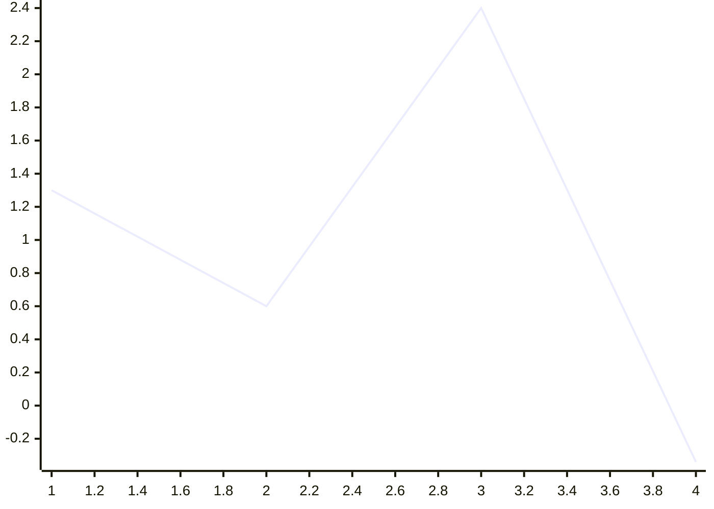
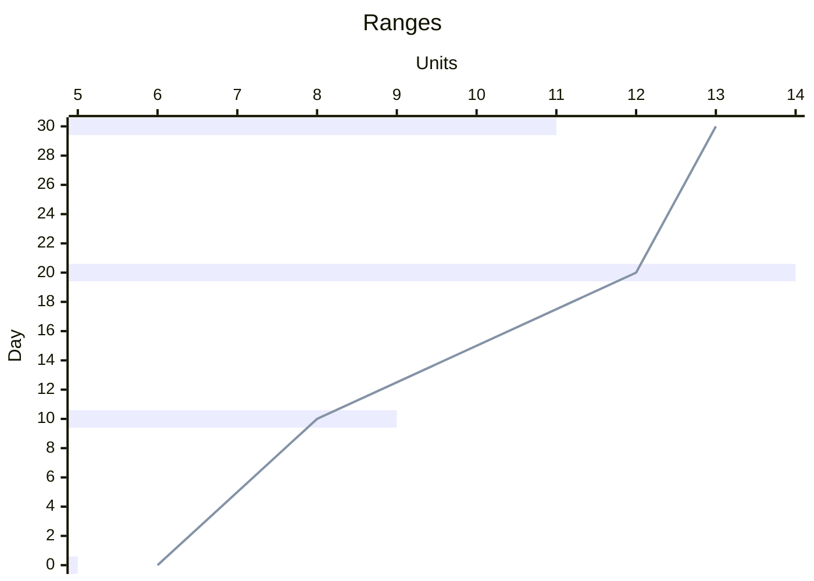

# XY chart

## Keywords
`xychart` (alias `xychart-beta`). Status: stable.

## When to use
Bar and line charts over categorical or numeric x values, including combined bar plus line.
Nearest alternative: `pie` for parts of a whole, `quadrantChart` for 2x2 positioning.

## Syntax

Opening line, optional orientation (default vertical):

```text
xychart [horizontal | vertical]
```

Title and axes (quote any text that contains spaces):

```text
title "<text>"
x-axis ["<title>"] [<cat1>, "<cat 2>", ...]
x-axis ["<title>"] <min> --> <max>
y-axis ["<title>"] [<min> --> <max>]
```

Series (a quoted name adds it to the legend; `line` values may carry a quoted point label):

```text
bar ["<name>"] [<n1>, <n2>, ...]
line ["<name>"] [<n1> ["<label>"], <n2>, ...]
```



## Features
| Feature id | Construct | Snippet |
|---|---|---|
| `xyChart.keyword` | opening keyword | `xychart` |
| `xyChart.keyword-beta` | older alias keyword | `xychart-beta` |
| `xyChart.orientation-vertical` | vertical orientation (default) | `xychart vertical` |
| `xyChart.orientation-horizontal` | horizontal orientation | `xychart horizontal` |
| `xyChart.title` | chart title | `title "Sales Revenue"` |
| `xyChart.x-axis-categories` | categorical x-axis | `x-axis [jan, feb, "mar 1"]` |
| `xyChart.x-axis-title` | x-axis title before the values | `x-axis "Month" [jan, feb]` |
| `xyChart.x-axis-range` | numeric x-axis range | `x-axis Day 0 --> 30` |
| `xyChart.y-axis-range` | y-axis title and numeric range | `y-axis "Revenue (in $)" 4000 --> 11000` |
| `xyChart.y-axis-title-only` | y-axis title, range auto from data | `y-axis Revenue` |
| `xyChart.bar` | unnamed bar series | `bar [5000, 6000, 7500]` |
| `xyChart.bar-named` | named bar series, shown in legend | `bar "2025" [5000, 6000, 7500]` |
| `xyChart.line` | unnamed line series | `line [5000, 6000, 7500]` |
| `xyChart.line-named` | named line series, shown in legend | `line "p95" [112.2, 75.3, 103.0]` |
| `xyChart.line-point-label` | per-point text label on a line value | `line [25 "Launch", 45, 90 "Target Hit"]` |
| `xyChart.number-forms` | signed and leading-dot numbers in series | `line [+1.3, .6, -.34]` |
| `xyChart.comment` | comment line | `%% Black line` |

## Configuration and theming

Frontmatter `config.xyChart` keys (defaults from the syntax page):

| Key | Default | Meaning |
|---|---|---|
| `width` | `700` | Chart width |
| `height` | `500` | Chart height |
| `titlePadding` | `10` | Top and bottom padding of the title |
| `titleFontSize` | `20` | Title font size |
| `showTitle` | `true` | Show the title |
| `showLegend` | `true` | Show the legend for named plots |
| `legendFontSize` | `14` | Legend font size |
| `legendPadding` | `10` | Padding around the legend |
| `xAxis` | AxisConfig | x-axis settings (table below) |
| `yAxis` | AxisConfig | y-axis settings (table below) |
| `chartOrientation` | `'vertical'` | `vertical` or `horizontal` |
| `plotReservedSpacePercent` | `50` | Minimum space the plots take |
| `showDataLabel` | `false` | Show each bar's value |
| `showDataLabelOutsideBar` | `false` | Put data labels outside the bar |

AxisConfig keys (`config.xyChart.xAxis.*`, `config.xyChart.yAxis.*`):

| Key | Default | Meaning |
|---|---|---|
| `showLabel` | `true` | Show labels or tick values |
| `labelFontSize` | `14` | Label font size |
| `labelPadding` | `5` | Top and bottom padding of the label |
| `showTitle` | `true` | Show the axis title |
| `titleFontSize` | `16` | Axis title font size |
| `titlePadding` | `5` | Top and bottom padding of the axis title |
| `showTick` | `true` | Show ticks |
| `tickLength` | `5` | Tick length |
| `tickWidth` | `2` | Tick width |
| `showAxisLine` | `true` | Show the axis line |
| `axisLineWidth` | `2` | Axis line thickness |
| `labelRotation` | `0` | Label rotation in degrees (bottom x-axis only) |

Theme variables (`config.themeVariables.xyChart.*`):

| Variable | Meaning |
|---|---|
| `backgroundColor` | Background of the whole chart |
| `titleColor` | Title text colour |
| `dataLabelColor` | Data label colour (when shown) |
| `legendTextColor` | Legend text colour |
| `xAxisLabelColor` | x-axis label colour |
| `xAxisTitleColor` | x-axis title colour |
| `xAxisTickColor` | x-axis tick colour |
| `xAxisLineColor` | x-axis line colour |
| `yAxisLabelColor` | y-axis label colour |
| `yAxisTitleColor` | y-axis title colour |
| `yAxisTickColor` | y-axis tick colour |
| `yAxisLineColor` | y-axis line colour |
| `plotColorPalette` | Comma-separated colours, used by plots in order |

Accessibility: `accTitle: ...`, `accDescr: ...` and `accDescr { ... }` render with CLI 12.0.0.

## Traps

- The config and theme namespace is camel case `xyChart`. With CLI 12.0.0, `config.xychart` and
  `themeVariables.xychart` render but are silently ignored.
- Unquoted multi-word text loses its spaces: `title Two words` renders `Twowords`, and
  `x-axis [a b, c]` gives a category `ab`. Quote it: `title "Two words"`.
- Series length is not checked: a series longer or shorter than the categories renders without error,
  with values dropped or missing. Keep counts equal.
- Point labels on `bar` parse but are ignored; they only render on `line`.
- The y-axis is numeric only; a categorical y-axis fails to render:

```text
xychart
    y-axis [a, b]
    bar [1, 2]
```

## Complete example

```mermaid
---
config:
  xyChart:
    width: 900
    height: 600
    titlePadding: 10
    titleFontSize: 20
    showTitle: true
    showLegend: true
    legendFontSize: 14
    legendPadding: 10
    chartOrientation: vertical
    plotReservedSpacePercent: 50
    showDataLabel: true
    showDataLabelOutsideBar: true
    xAxis:
      showLabel: true
      labelFontSize: 14
      labelPadding: 5
      showTitle: true
      titleFontSize: 16
      titlePadding: 5
      showTick: true
      tickLength: 5
      tickWidth: 2
      showAxisLine: true
      axisLineWidth: 2
      labelRotation: 30
    yAxis:
      showLabel: true
      labelFontSize: 14
      showTick: true
  themeVariables:
    xyChart:
      backgroundColor: "#ffffff"
      titleColor: "#b71c1c"
      dataLabelColor: "#212121"
      legendTextColor: "#212121"
      xAxisLabelColor: "#424242"
      xAxisTitleColor: "#424242"
      xAxisTickColor: "#616161"
      xAxisLineColor: "#616161"
      yAxisLabelColor: "#424242"
      yAxisTitleColor: "#424242"
      yAxisTickColor: "#616161"
      yAxisLineColor: "#616161"
      plotColorPalette: "#1565c0, #ef6c00, #2e7d32, #6a1b9a"
---
xychart vertical
    title "Quarterly Performance"
    accTitle: Quarterly revenue
    accDescr: Revenue bars and a target line by quarter
    x-axis "Quarter" [Q1, Q2, "Q3 late", Q4]
    y-axis "Revenue ($M)" -10 --> 100
    %% two bar series, two line series
    bar "Actual" [25, 45, 72, 90]
    bar [20, 30, 25, 35]
    line "Target" [25 "Launch", 45, 72, 90 "Target Hit"]
    line [+1.5, .6, 24.4, -5.34]
```

Covers: every feature id except `xyChart.keyword-beta`, `xyChart.orientation-horizontal`, `xyChart.x-axis-range`, `xyChart.y-axis-title-only` (each is an alternative to one shown here), plus every `config.xyChart` key and theme variable.



Covers: `xyChart.keyword-beta`, `xyChart.orientation-horizontal`, `xyChart.x-axis-range`, `xyChart.y-axis-title-only`, `xyChart.bar-named`, `xyChart.line-named`.

## Builder
`builder`: family `chart`, keywords `xychart`, `xychart-beta` (emitted as given).

| Key | Type | Meaning |
|---|---|---|
| `series` | array, 1+ | `{type: bar\|line, name?, values}`; a value is a number or, on `line`, `{value, label}` |
| `orientation` | `vertical` \| `horizontal` | Written after the keyword when present |
| `title` | string | Chart title |
| `xAxis` | object | `{title?, categories?}` or `{title?, min, max}` |
| `yAxis` | object | `{title?, min?, max?}`; `min` and `max` go together, `min < max` |
| `comment` | string | `%% comment` line |
| `accessibility` | object | `{title, description}` |
| `config` | object | Frontmatter: `theme`, `xyChart.*` (with `xAxis`/`yAxis` AxisConfig), `themeVariables.xyChart.*` |

Example: [maximal.json](../../tests/fixtures/xyChart/maximal.json). Rejected: a series whose length
differs from the categories, duplicate categories, a point label on a `bar` series (it would not
render), and `categories` together with `min`/`max`. Free text is written with Mermaid entity codes (`#quot;`, `#59;`, `#lt;`, ...), which render back to the original characters; leading or trailing spaces, control characters and line breaks (except in `accessibility.description`) are rejected.
