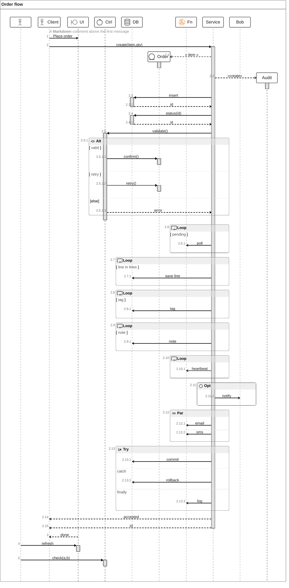

# ZenUML

## Keywords
`zenuml`. External diagram (`@mermaid-js/mermaid-zenuml` 1.0.1 on `@zenuml/core` 3.50.1); Mermaid CLI 12.0.0 bundles it
and registers it with `registerExternalDiagrams`, so `mmdc` renders it with no extra setup. A web page must import and
register it itself. Status: stable (the page marks the integration experimental).

## When to use
A sequence diagram written as code-like method calls, with nesting by `{}` and control flow (`if`, `while`, `try`, `par`).
Nearest alternative: `sequenceDiagram`, Mermaid's native sequence type with its own arrow syntax.

## Syntax
Participants and annotators:

```text
zenuml
    title <text>
    <Name>
    @Actor <Name>
    <Id> as <Label>
```

Messages:

```text
A->B: async text
A.method(args) { nested statements }
new B(args)
x = A.method()
```

Fragments:

```text
if(cond) { ... } else if(cond) { ... } else { ... }
while(cond) { ... }
opt { ... }
par { ... }
try { ... } catch { ... } finally { ... }
```

## Features
| Feature id | Construct | Snippet |
|---|---|---|
| `zenuml.title` | diagram title | `title Demo` |
| `zenuml.participant-implicit` | participant created by first use | `Alice->John: Hi` |
| `zenuml.participant-declare` | declared participant fixes order | `Bob` |
| `zenuml.annotator-actor` | actor symbol | `@Actor Alice` |
| `zenuml.annotator-boundary` | boundary symbol | `@Boundary UI` |
| `zenuml.annotator-control` | control symbol | `@Control Ctrl` |
| `zenuml.annotator-database` | database symbol | `@Database Bob` |
| `zenuml.annotator-entity` | entity symbol | `@Entity Order` |
| `zenuml.annotator-cloud-icon` | cloud icon annotator (AWS, Azure, GCP sets) | `@Lambda Fn` |
| `zenuml.alias` | identifier with a display label | `A as Alice` |
| `zenuml.sync-message` | sync (blocking) call | `A.SyncMessage` |
| `zenuml.sync-message-params` | sync call with parameters | `A.SyncMessage(with, parameters)` |
| `zenuml.sync-message-nested` | nested calls in `{}` | `A.method() {` / `B.nested()` / `}` |
| `zenuml.sync-message-from` | sync call from an explicit caller | `Client->A.method()` |
| `zenuml.async-message` | async (fire-and-forget) message | `Alice->Bob: How are you?` |
| `zenuml.creation-message` | creation | `new A1` |
| `zenuml.creation-message-params` | creation with parameters | `new A2(with, parameters)` |
| `zenuml.reply-assign` | reply by assignment | `a = A.SyncMessage()` |
| `zenuml.reply-assign-typed` | typed assignment | `SomeType a = A.SyncMessage()` |
| `zenuml.reply-return` | `return` inside a sync block | `return result` |
| `zenuml.reply-annotator-return` | `@return` on an async message | `@return` then `A->Client: x` |
| `zenuml.reply-annotator-reply` | `@reply` on an async message | `@reply` then `B->A: done` |
| `zenuml.comment` | `//` comment, drawn above the next message or fragment | `// a comment` |
| `zenuml.comment-markdown` | Markdown inside a comment | `// **Markdown** is supported` |
| `zenuml.mermaid-comment` | `%%` comment, not drawn (not on the page) | `%% note` |
| `zenuml.loop-while` | loop with `while` | `while(true) {` |
| `zenuml.loop-for` | loop with `for` | `for(i in list) {` |
| `zenuml.loop-foreach-camel` | loop with `forEach` | `forEach(item) {` |
| `zenuml.loop-foreach-lower` | loop with `foreach` | `foreach(item) {` |
| `zenuml.loop-loop` | loop with `loop` | `loop {` |
| `zenuml.alt-if` | alt fragment | `if(is_sick) {` |
| `zenuml.alt-else-if` | further alt branch | `} else if(tired) {` |
| `zenuml.alt-else` | else branch | `} else {` |
| `zenuml.opt` | opt fragment | `opt {` |
| `zenuml.par` | parallel fragment | `par {` |
| `zenuml.try` | try block | `try {` |
| `zenuml.catch` | catch block | `} catch {` |
| `zenuml.finally` | finally block | `} finally {` |

## Configuration and theming
The page documents no config keys, and Mermaid 12.0.0's config schema has no `zenuml` namespace.
The page documents no themeVariables.
`accTitle` and `accDescr` are NOT supported: `accTitle: Seq` renders participants named `accTitle` and `Seq` plus a
message, and the SVG gets no `<title>` or `<desc>`.

## Traps
The ZenUML parser is lenient: `check.sh` passes almost any text after `zenuml`. A garbage line like
`A->B: x {{{{ ))) if(` renders as a message. Inspect the rendered SVG, not only the exit code.

An async message label runs to the end of the line, so a closing `}` on the same line becomes part of the label:

```text
zenuml
    if(a) { A->B: yes } else { A->B: no }
```

renders one alt branch labelled `yes } else { A->B: no }`. Put each `}` on its own line after an async message.
Sync calls are fine inline (`A.m() { B.n() }`).

`@Queue` (a common guess) renders no icon; only the documented annotators and the cloud icon names do.
Unknown annotators are silently ignored.

`%%` and `//` comments differ: `//` before a message is drawn above it (with Markdown); `%%` is never drawn.
A `//` comment before a participant declaration is ignored.

Constructs not on the page also render with 12.0.0 (`critical(x) { }`, `section(x) { }`, `group G { }`,
`@Starter(User)`, `<<Service>> S`). They are ZenUML core features; this catalog does not list them as features.

## Complete example



Covers: every feature id.

## Builder
`candidate`: `scripts/render.py` has an IR builder for this type (target keyword(s) `zenuml`). It has not been through the reliability bar yet; see [coverage.md](../coverage.md).
